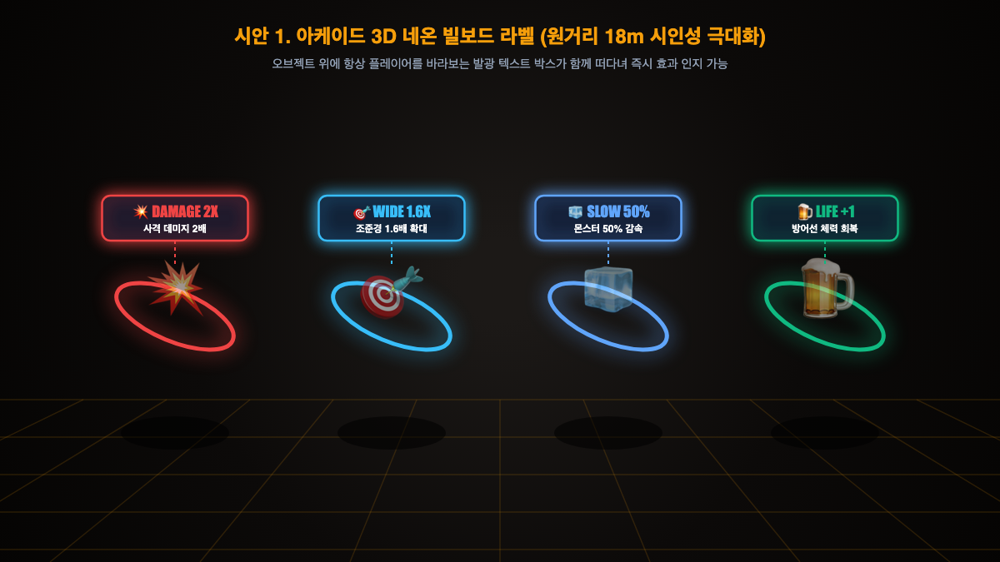
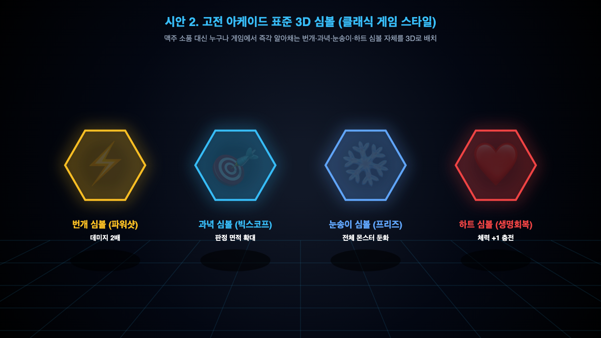
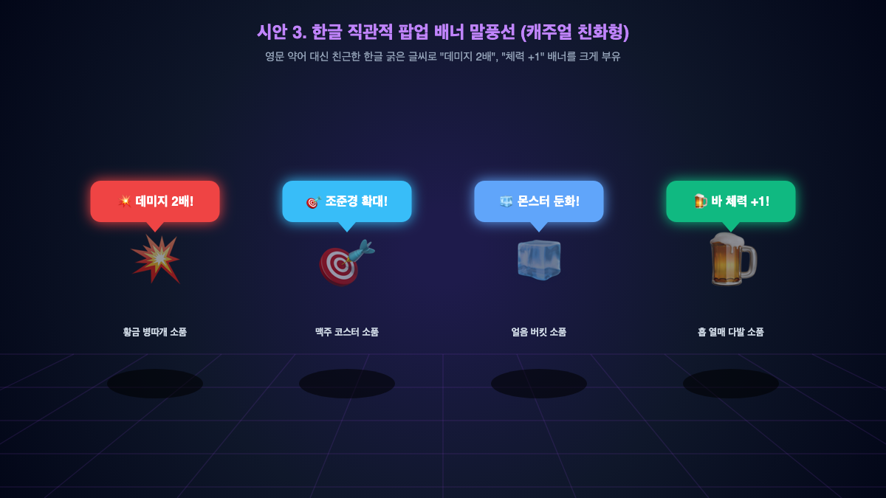

# 🎨 직관적인 아이템 디자인 3가지 시안 비교

현재 펍 소품형 아이템 4종의 시인성과 효과 인지도를 극대화하기 위해 제작된 3가지 시안입니다.

---

### 1. 시안 1. 아케이드 3D 네온 빌보드 라벨 (추천 ⭐)

- **외형**: 기존 펍 소품(황금 병따개, 맥주 코스터, 얼음 버킷, 홉 열매) 위에 **카메라를 정면으로 바라보는 네온 박스 라벨** 부유.
- **표시 내용**:
  - `[💥 DAMAGE 2X]` (사격 데미지 2배)
  - `[🎯 WIDE 1.6X]` (조준경 1.6배 확대)
  - `[🧊 SLOW 50%]` (몬스터 50% 감속)
  - `[🍺 LIFE +1]` (방어선 체력 회복)
- **장점**: 18m 먼 거리에서도 텍스트와 색상으로 0.1초 만에 효과를 인지할 수 있고, 오비맥주 펍의 고유한 컨셉 분위기도 유지됩니다.

---

### 2. 시안 2. 고전 아케이드 표준 3D 심볼 (단순화 ⚡)

- **외형**: 펍 소품을 완전히 제거하고, 게임 플레이어라면 전 세계 누구나 아는 **거대 발광 심볼**로 대체.
  - ⚡ **번개 심볼** (파워샷 / 데미지 2배)
  - 🎯 **과녁 스코프** (빅 스코프 / 판정 면적 확대)
  - ❄️ **눈송이 결정** (아이스 프리즈 / 몬스터 둔화)
  - ❤️ **하트 큐브** (바 수리 / 생명 +1 회복)
- **장점**: 글자를 읽을 필요조차 없이 형태만 보고 반사적으로 반응할 수 있습니다.

---

### 3. 시안 3. 한글 직관적 팝업 배너 말풍선 (캐주얼 친화형 💬)

- **외형**: 기존 펍 소품 위에 굵고 친근한 **한글 팝업 말풍선** 부유.
  - `[💥 데미지 2배!]`
  - `[🎯 조준경 확대!]`
  - `[🧊 몬스터 둔화!]`
  - `[🍺 바 체력 +1!]`
- **장점**: 영문 약어가 부담스러운 유저에게 가장 직관적이고 친절합니다.
