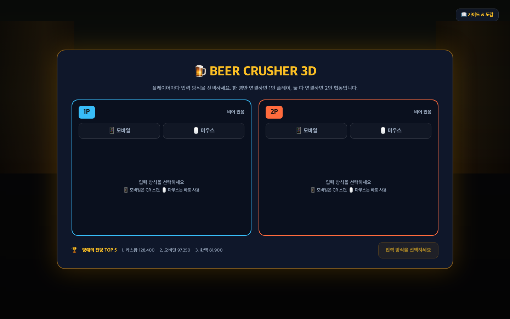
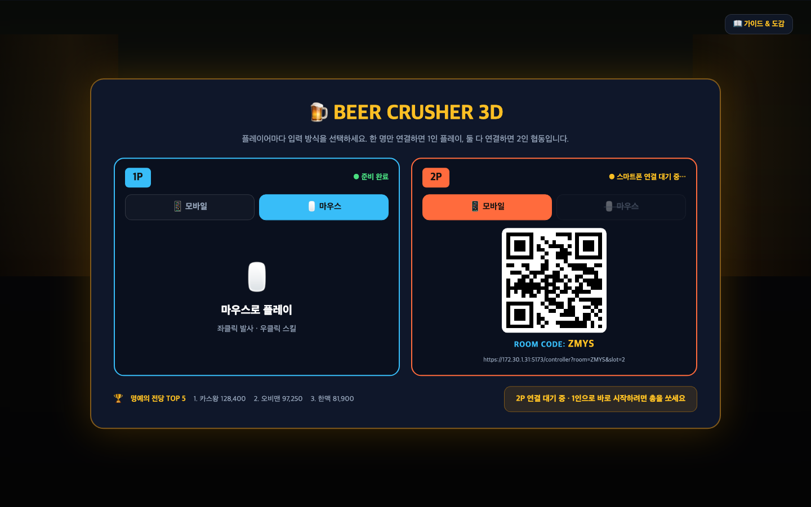
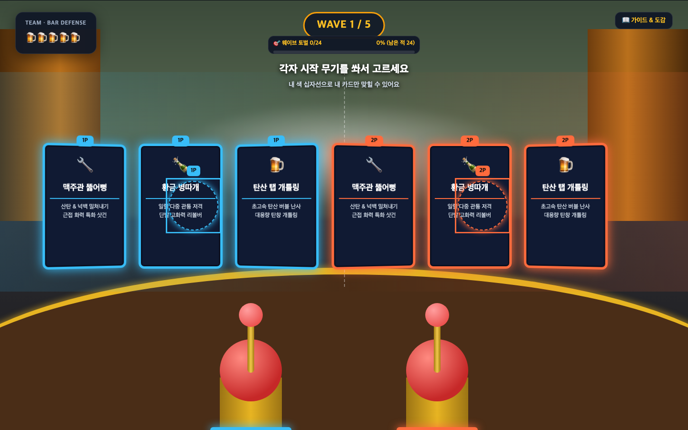
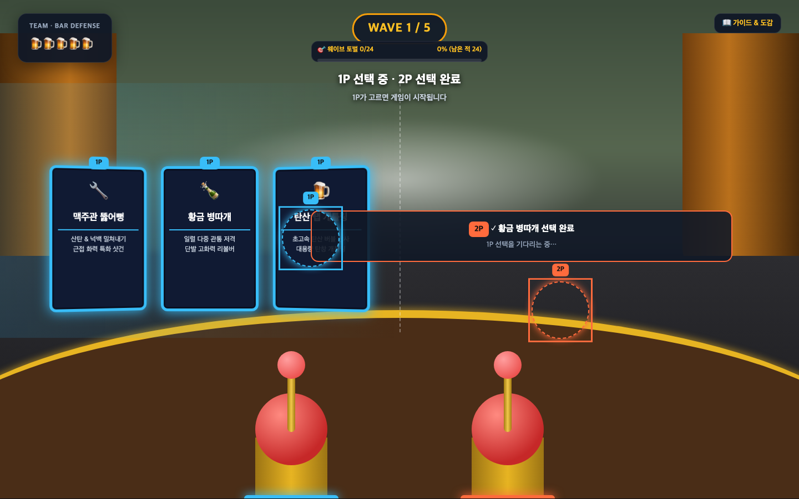
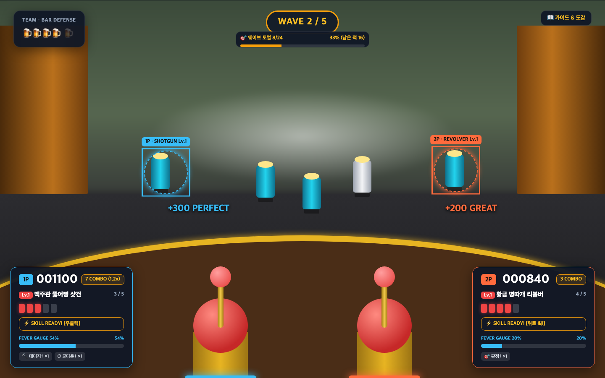
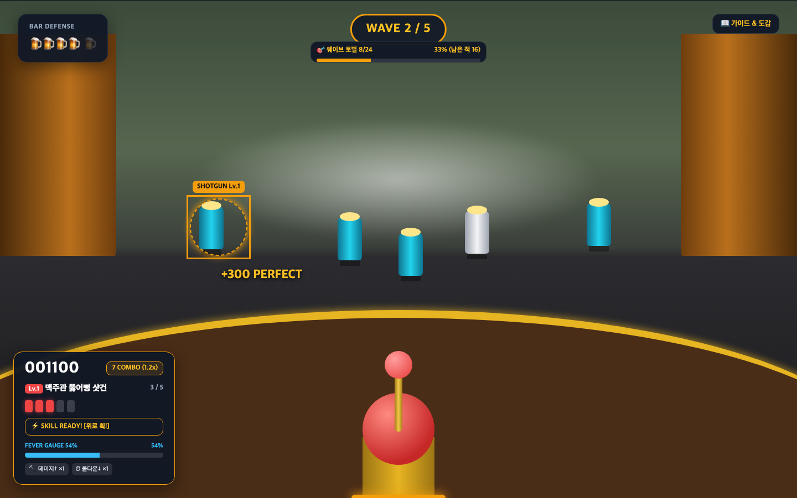
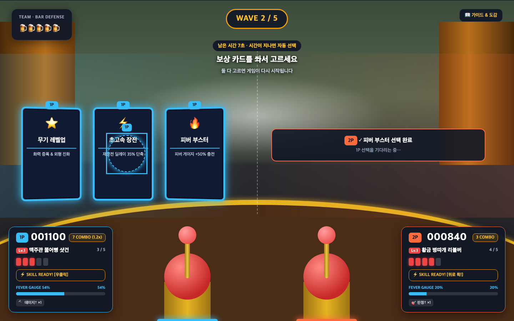

# 2인팟 화면 시안

- 작성: 2026-11-07, 결정 문서 [2026-11-07-two-player-coop](../decisions/2026-11-07-two-player-coop.md)의 UI 시안
- 원본: 작성자 계정 전용 claude.ai 아티팩트였던 것을 저장소로 옮겼다. 시안 HTML 사본은 [two-player-coop-mockups/mockup.html](./two-player-coop-mockups/mockup.html)(브라우저로 열면 원래 시안 페이지), 아래 이미지는 그 HTML을 1440×900으로 캡처한 것이다.
- 3D 장면(배경·캔·총)은 위치 확인용 단순화다. 패널 크기·위치·색·글꼴은 실제 UI 값을 따랐다.
- **시안을 그린 뒤 바뀐 결정이 있다.** 구현은 각 화면 아래의 "시안 이후 바뀐 점"과 결정 문서를 따른다.

## 공통 값

| 항목 | 값 | 근거 |
| :--- | :--- | :--- |
| 1P 색 | `#38bdf8` | D09 |
| 2P 색 | `#ff6b3d` (붉은 주황. 결정의 "주황"을 앰버 UI와 구분되게 그린 값) | D09 |
| 1인 색 | `#f59e0b` (지금의 앰버) | D09 |
| 개인 패널 | 폭 292px, 패딩 16px 20px, 배경 `rgba(17,24,39,.96)`, 테두리 1px 플레이어 색, radius 16px, 하단 24px·좌/우 24px | D09 |
| 3D 총 | 2인은 화면 아래 좌우 한 자루씩(받침에 플레이어 색 링), 1인은 가운데 한 자루 | D21 |

## 1. 로비 — 처음 상태 (D06)

1P/2P 슬롯 카드 2개. 입력 방식을 고르기 전에는 두 슬롯 모두 "비어 있음".

## 2. 로비 — 1P 마우스 준비 완료, 2P 모바일 연결 대기 (D06, D07)

- 마우스는 고르는 즉시 준비 완료. 다른 슬롯이 마우스면 마우스 칸은 취소선·비활성(마우스는 1명만, D01).
- 모바일은 슬롯 전용 QR(`/controller?room=…&slot=2`).
- 한쪽만 준비된 상태로 시작하면 1인 플레이.

**시안 이후 바뀐 점**
- 마우스 슬롯은 고른 뒤 **닉네임 입력 → 등록**해야 준비 완료다(D15). 저장된 닉네임은 자동으로 채운다.
- 하단 명예의 전당은 **"개인 랭킹 / 팀 랭킹" 탭**이다(D22). 탭은 마우스 클릭·Tab 키로 바꾸고, 참여 인원이 2명이면 팀 탭이 기본(D38).
- 시작: 마우스는 "게임 시작" 버튼 클릭, 폰은 지금처럼 화면 가운데를 쏘면 시작(D26, D33). 모두 준비돼야 시작되고, 막히면 "2P 준비 중" 안내(D07).

## 3. 시작 무기 선택 — 둘 다 고르는 중 (D13)

화면 좌우 절반, 1P 카드 3장 왼쪽·2P 카드 3장 오른쪽. 각자 자기 카드만 맞힐 수 있다.

**시안 이후 바뀐 점**
- 카드 테두리: 시안은 주인 색 한 겹이지만, 최종은 **안쪽은 카드 종류 색(예: 공격력 강화는 빨강), 바깥에 주인 색 테두리 한 겹**이다(D23). 카드 위 1P/2P 배지는 그대로.

## 4. 시작 무기 선택 — 2P가 먼저 고른 뒤 (D13)

2P가 고르면 2P 카드만 사라지고 "✓ 황금 병따개 선택 완료 / 1P 선택을 기다리는 중…" 상자가 남는다. 1P가 고르면 시작.

**시안 이후 바뀐 점**: 3번과 같은 카드 테두리(D23). 선택에 시간 제한은 없다(D34).

## 5. 2인 전투 화면 (D09)

- 팀 공용(목숨 "TEAM · BAR DEFENSE", 웨이브, 진행도, 보스 체력)은 지금 위치.
- 개인(점수·콤보·무기·탄창·스킬·피버·패시브 카드)은 1P 왼쪽 아래, 2P 오른쪽 아래 패널.
- 십자선 이름표 `1P · SHOTGUN Lv.1`, 판정 팝업도 플레이어 색.
- 스킬 안내는 입력 방식별 하나(마우스 "우클릭", 폰 "위로 휙!").

**시안 이후 바뀐 점**
- 30초 재접속 유예 뒤 이탈한 플레이어는 패널이 흐려지고 "나감" 표시가 붙으며 십자선·총이 숨는다(D20). 시안에는 없다.
- 웨이브 표기 "WAVE 2 / 5"는 시안의 예시 문구다. 실제 게임은 7웨이브다.

## 5-1. 1인 전투 화면 (D09, D14)

1인도 같은 개인 패널을 쓴다. "1P" 배지와 십자선 "1P ·" 접두어만 숨기고 색은 앰버. 왼쪽 위에는 목숨만("BAR DEFENSE"), 오른쪽 아래 피버 패널은 개인 패널 안으로. 튜토리얼도 이 패널을 쓴다(D14).

## 6. 보상 카드 선택 (D04)

킬 게이지(팀 공용)가 차면 두 사람에게 동시에 카드가 뜬다. 각자 고르고, 둘 다 고르면 재개.

**시안 이후 바뀐 점**
- 상단 **"남은 시간 7초 · 시간이 지나면 자동 선택" 칩은 없다.** 1인·2인 모두 선택 시간 제한이 없다(D34). 이탈 처리된 플레이어 몫만 즉시 자동 선택(D20).
- 카드 테두리는 3번과 같다(D23).

## 시안에 없는 화면

| 화면 | 결정 | 계획 |
| :--- | :--- | :--- |
| 재접속 대기("2P 재접속 대기 중 · 27초", "혼자 계속하기") | D08, D20, D40 | P04-T06 |
| 결과 화면(1P·2P 나란히, 팀 합계, 이 팀 최고 기록, 랭킹 탭) | D11, D18, D22 | P05-T04, P05-T07 |
| 폰 화면 1P/2P 배지, "이미 다른 폰이 2P로 연결돼 있습니다" | D06 | P04-T02 |
