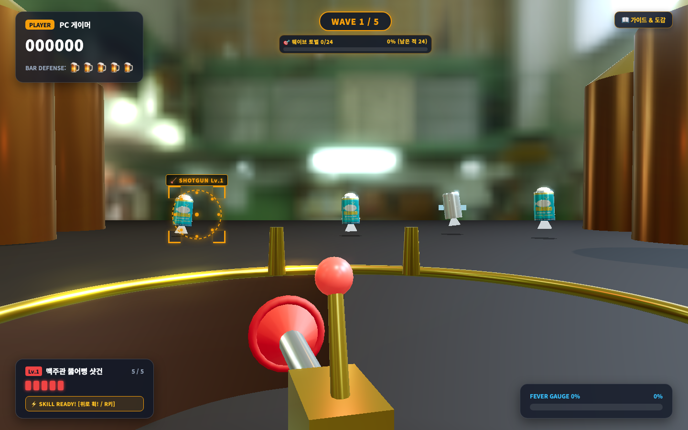
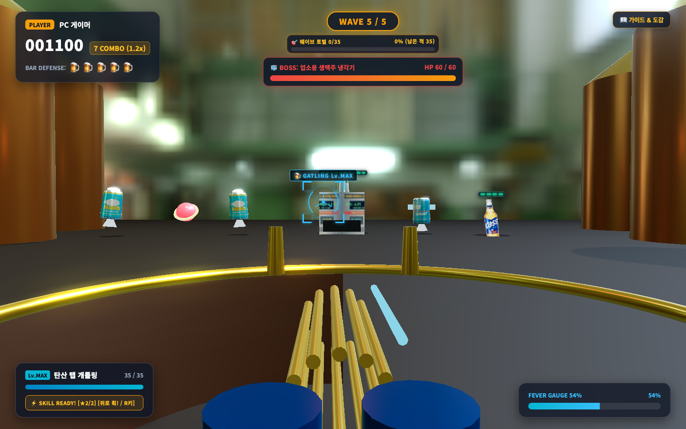
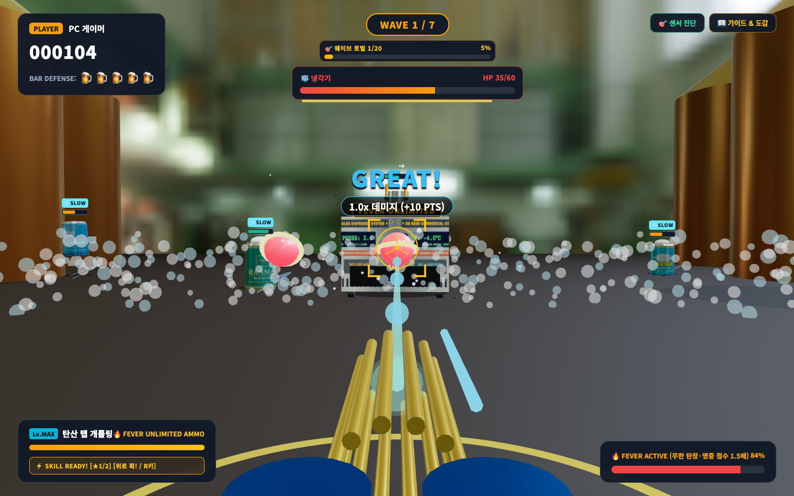
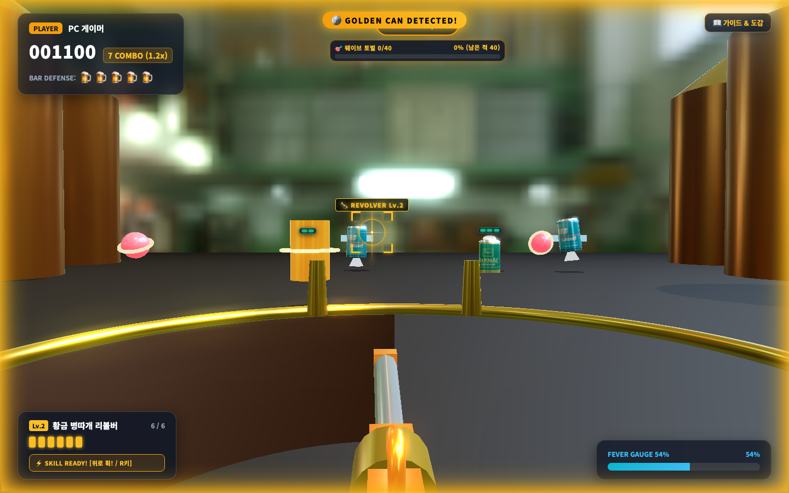
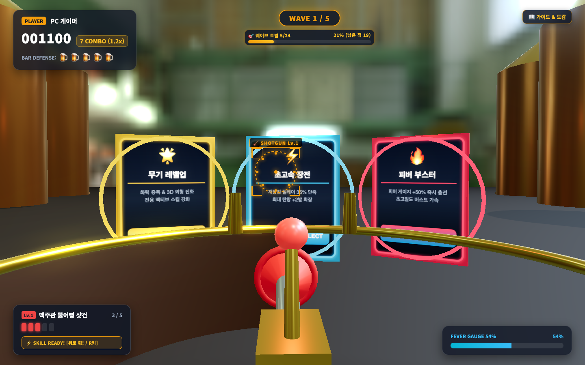

# 🍺 비어 크러셔 3D (Beer Crusher 3D Arcade v2.2)

> 스마트폰을 권총처럼 모니터에 조준하여 쏟아지는 오비맥주 몬스터들을 파괴하는 **체감형 3D 아케이드 슈팅 게임**입니다.

PC 모니터는 실사 펍 HDRI 환경과 PBR 맥주 모델·네온 라인·아이템 타이머를 렌더링하고, 스마트폰의 자이로/가속도 센서와 터치 인터페이스를 무선 권총 컨트롤러로 활용합니다.



---

## 📚 공식 문서 맵 (Single Source of Truth)

각 문서는 단일 책임 원칙에 따라 전문적인 영역을 깊이 있게 다루며 중복 없이 상호 참조합니다:

| 문서 | 핵심 주제 | 대상 독자 |
| :--- | :--- | :--- |
| [**🏛️ 비어 크러셔 상세설계서**](./docs/비어%20크러셔%20상세설계서.md) | 시스템 아키텍처, 60Hz WS 통신 프로토콜, 자이로 센서 추적 수식, 판정 엔진 루프 | 개발자·엔지니어 |
| [**📋 요구사항 분석서**](./docs/비어%20크러셔%20요구사항%20분석서.md) | 프로젝트 기획 배경, 유저 스토리, 기능(FR)/비기능(NFR) 요구사항 매트릭스 | 기획자·QA |
| [**🔫 무기 및 스킬 가이드**](./docs/무기_및_스킬_가이드.md) | 3종 무기 아키타입, 정밀도 데미지 배율, 연사·장전 규칙, '휙!' 스냅 스킬, 보상 카드 9종 | 플레이어·기획자 |
| [**👾 몬스터 도감 설명서**](./docs/몬스터_도감_설명서.md) | 실물 PBR 맥주 몬스터 5종 + 보스, 몬스터별 특색, 7웨이브·보스전 3회, 적 처치 아이템 드롭 | 플레이어·아티스트 |
| [**🎯 튜토리얼 & 훈련장 가이드**](./docs/튜토리얼_훈련장_가이드.md) | 정면 영점 교정, 4단계 인터랙티브 튜토리얼, 샌드박스 테스트 랩 및 모듈 제어판 | 신규 플레이어 |
| [**📸 구동화면 쇼케이스**](./docs/구동화면_쇼케이스.md) | PC 대기실, 모바일 컨트롤러 3단계, 인게임 전투, 랭킹 모달 라이브 스크린샷 갤러리 | 전체 |

---

## 👥 2인팟 로비 & 연결 유지

- **1P / 2P 슬롯 선택**: 대기실에서 1P(하늘색 #38bdf8), 2P(주황색 #ff6b3d) 슬롯을 각각 📱 모바일(슬롯별 전용 QR 스캔) 또는 🖱 마우스(닉네임 입력)로 연결할 수 있습니다. 마우스는 한 명만 선택 가능하며, 참여한 모든 슬롯이 준비되면 게임을 시작할 수 있습니다. 한쪽 슬롯만 참여하면 기존 1인 모드로 진행됩니다.
- **QR은 한 번만**: PC는 방 코드를 브라우저(localStorage)에 기억해 새로고침해도 같은 QR을 씁니다. 폰도 마지막 방을 기억하고, 화면이 꺼졌다 켜지거나 네트워크가 잠깐 끊기면 자동으로 다시 연결합니다. 다른 폰으로 바꾸려면 대기실의 `새 QR 발급`을 누르세요.
- **일시정지**: 게임 중 `Esc` 키 또는 상단 `⏸ 일시정지` 버튼 → `이어하기`(3초 카운트다운) / `다시시작`(무기 선택부터, 이번 판 점수는 저장되지 않음) / `로비로 나가기`(확인 후 대기실로 이동, 이번 판 점수는 저장되지 않음).
- **폰이 끊겼을 때의 보호**:
  - **2인 협동 모드**: 폰 연결이 끊기면 30초 동안 '나감(AWAY)' 상태로 총이 숨겨지고 남은 플레이어가 혼자 계속 싸웁니다. 30초 내에 폰이 재접속하면 기존 점수와 무기를 그대로 유지한 채 즉시 전장에 복귀합니다.
  - **1인 모드**: 게임이 자동으로 일시정지되고, 폰이 다시 연결된 뒤 `이어하기`를 눌러야 재개됩니다.
- 참고: 폰을 오래 백그라운드에 두면 OS가 연결을 끊을 수 있으며, 화면을 다시 켜면 자동으로 복구됩니다. 모션 센서 권한은 페이지를 완전히 다시 열면 한 번 더 허용해야 할 수 있습니다.

---

## 🎮 Arcade v2.2 핵심 하이라이트

- **🎯 명중 정밀도 데미지 배율**:
  - `PERFECT (오차 25% 이내)`: **2.0배 데미지** 폭딜 (+15 PTS & 피버 +2% 충전).
  - `GREAT (오차 55% 이내)`: **1.0배 정타 데미지** (+10 PTS) — 샷건·리볼버는 1레벨에서 기본 캔(1HP)을 원샷으로 제압합니다.
  - `GOOD (오차 100% 이내)`: **0.5배 스침 데미지** (+5 PTS) — 스쳐 살아남은 캔은 머리 위에 잔여 체력바가 즉시 표시됩니다.
  - **웨이브 시간 보너스**: 웨이브마다 정해진 기준 시간 안에 끝내면 웨이브당 최대 700점(보스 웨이브는 2,800점)을 받고, 기준 시간의 1.6배에서 0점이 될 때까지 선형으로 줄어듭니다. 카드 선택·일시정지 시간은 제외되며, 웨이브를 깰 때마다 클리어 시간과 보너스가 표시됩니다. 보스를 살려 두고 부하만 잡으며 시간을 끌면 시간 보너스가 줄어듭니다.
  - **저레벨 클리어 보너스**: 클리어할 때 무기 레벨이 낮을수록 기본 점수에 배율이 붙습니다(Lv.1 ×1.2, Lv.2 ×1.1, Lv.3 ×1.05, MAX ×1.0). 패배한 판에는 없습니다.
  - **정밀도 보너스**: 클리어하면 한 판의 판정 비율(PERFECT 100% · GREAT 50% · GOOD 20% 가중, MISS 포함)의 제곱에 12,000점을 곱한 보너스가 한 번 더해집니다. 많이 쏘는 것보다 정확히 맞히는 것이 랭킹에 유리합니다.
  - `MISS`: 점수·콤보 페널티는 없지만 빗나간 탄약과 긴 장전(기본의 1.2배)이 손해입니다. 판정 범위(x0.75, 화면비 보정)가 좁아 난사로는 깨기 어렵습니다.
- **🎯 조준경 링 게이지**: 십자선 둘레의 원호로 위는 남은 탄창(20% 미만이면 노란색, 장전 중에는 하늘색으로 차오르며 피버 중에도 장전은 계속됩니다), 왼쪽 아래는 스킬 충전(점은 스택), 오른쪽 아래는 피버입니다. 피버 게이지는 충전될 때 주황색으로 차오르고, 피버가 켜지면 붉은색으로 남은 시간만큼 줄어듭니다. 가득 차면 반짝입니다. 2인 판에서는 각자 자기 십자선에 자기 상태만 보입니다.
- **🔫 빠른 연사 · 긴 장전 · 누르고 쏘기 페널티**:
  - 발사 간격이 기본의 0.7배로 빨라지고 장전은 1.2배로 깁니다.
  - 모바일 터치 패드를 누른 채 연사하면 첫 발은 대기 시간 없이 즉시 단발 강타가 발사된 뒤 '투두두두' 자동 연발로 전환됩니다.
  - 버튼을 누른 채 쏘는 연사는 피해가 줄어듭니다(샷건·리볼버 60%, 개틀링 85%). 한 발씩 정확히 누르세요.
  - 보상 카드를 선택한 직후 0.3초간은 스킬이 오발동되지 않도록 안전 잠금이 적용됩니다.
- **👥 2인팟 협동 플레이 (Two-Player Co-op)**:
  - **팀 공유 & 개인 성장**: 목숨(BAR DEFENSE 5개 공유), 웨이브 진행, 보스는 함께 맞서 싸우며, 무기 레벨·보상 카드·득점·콤보는 각자 개별적으로 성장합니다.
  - **2인 맞춤 밸런스**: 2인 참여 시 몬스터 체력과 스폰량이 협동 난이도에 맞추어 강화됩니다.
  - **3D 총 2자루 배치**: 1P 총은 왼쪽(#38bdf8 발광 링), 2P 총은 오른쪽(#ff6b3d 발광 링)에 배치되어 각 플레이어의 조준·사격·반동·광선이 독립적으로 연출됩니다.
  - **동시 카드 선택 (시간 제한 없음)**: 웨이브 클리어 시 두 사람 모두 카드를 맞힐 때까지 전장이 정지되며, 신중하게 상의하여 고를 수 있습니다.
  - **팀 랭킹 명예의 전당**: 2인팟 기록은 솔로 명예의 전당에 섞이지 않고 '팀 랭킹' 탭에 두 사람의 팀 합계 점수로 등록됩니다. 팀 줄에는 1P·2P 각자의 점수·무기·입력 방식(🖱 마우스/📱 모바일)이 함께 보이고, 개인 랭킹 줄과 결과 화면에도 입력 방식이 표시됩니다.
- **🃏 보상 카드 9종 & 전장 일시정지 (Combat Freeze)**:
  - 웨이브를 클리어할 때(3·5웨이브는 보스를 처치한 뒤)와 4·6웨이브 진행도 절반(한 번)에 전장이 얼어붙으며 9종 중 무작위 3장의 3D 홀로그램 카드가 나옵니다. 이미 최대치인 카드는 나오지 않습니다.
  - `⬆️ 무기 레벨업`(웨이브별 상한), `⚡ 초고속 장전`, `🍺 바리케이드 수리`(체력 +2), `🔥 피버 부스터`(+50%), `🍀 행운의 보급품`, `💥 공격력 강화`(+10%), `⏱️ 스킬 가속`(-10%), `🔥 피버 연장`(+0.5초), `🎯 조준 보정`(+5%).
  - 카드 선택 중에는 피버·버프·쿨다운 시간이 모두 멈추고, **새로 누른 입력으로만** 카드를 고를 수 있습니다(누르고 있던 입력과 피버 자동 발사는 무시).
- **👾 몬스터 5종, 대응법이 다릅니다**:
  - `필굿`: 땅을 굴러오다 가까워지면 가속 · `카스 라이트`: 유일한 비행 몬스터, 크게 흔들림 · `오비`: 방패를 들었다 내리는 방패병(스킬만 방패를 뚫음) · `한맥`: 잡으면 터져 주변 몬스터에게 피해를 주는 폭탄 캔 · `병맥주`: 깨지면 작은 병 2마리로 분열.
- **🧊 7웨이브, 보스전 3회 (3·5·7웨이브)**:
  - 일반 몬스터를 절반쯤 소환하면 경고와 함께 보스가 등장하고, 보스가 살아 있는 동안에도 일반 몬스터가 계속 나옵니다. 냉각기 1대(체력 100) → 2대(각 120) → 2대(각 150) + 대왕 냉각기(250). 보스전 중에는 웨이브 진행 바 대신 보스 체력 바와 카드 처치 카운터만 보입니다.
  - 보스는 좌우로 움직이며 체력이 99% / 66% / 33% 아래로 내려갈 때마다 부하를 소환하고(4·5·6마리씩 필드 10~18m에 위에서 떨어집니다. 시간이 아니라 체력 기준이라 빨리 잡아도 소환을 봅니다), 몸통을 맞혀도 피버가 차지 않습니다. 부하를 잡아 피버와 아이템을 모으세요.
  - 중간 보스는 처치하면 카드를 고르고 다음 웨이브로, 마지막 보스전은 모두 처치해야 승리합니다.
- **🍺 적 처치 시 필드 아이템 드롭**:
  - 몬스터를 격파할 때 일정 확률(기본 4%, 보스 소환 부하 10%, 행운의 보급품 카드 배율 적용)로 아이템이 출현합니다.
- **🟡 바닥 네온 방어선**:
  - 벽 없이 플레이어 앞 바닥에 황금 네온 라인이 깔리고, 위험할 때 빨갛게 깜빡입니다. 갈색 똥 모양 투사체(보스가 발사, 빛나는 아이템과 다름)를 요격하면 몬스터처럼 터지며 요격음이 납니다. 게임이 끝나면 결과 옆에 판별 TOP 5(같은 사람도 여러 줄, 닉네임·점수·스테이지·무기)가 바로 나옵니다. 체력이 줄면 화면 가장자리가 빨갛게 번쩍이고 피격음이 나며, 보스가 나올 때는 빛줄이 훑는 `WARNING` 띠와 경고음이 2초 동안 나옵니다. 마지막 보스를 잡으면 큰 폭발과 남은 몬스터의 연쇄 폭발, BOSS DOWN! 배너가 나온 뒤 카드가 뜹니다.
- **📊 100% 비례 슬림 게이지 체력바**:
  - 매끄러운 연속 게이지 바로 체력이 표시되며, 1HP 캔도 스쳐 맞았을 때 즉시 머리 위에 체력바가 나타납니다.
- **스마트폰 '휙!(Snap)' 제스처 액티브 스킬 & 350ms 에임 프리즈**:
  - 손목을 위로 빠르게 튕겨 8방향 뚫어뻥 폭풍(기절), 오프너 참격(부채꼴 칼날), 거품 해일(밀어내기) 시전. 쿨다운은 레벨에 따라 21/19/16/14초입니다.
- **🔥 4초 피버 (무제한 탄창 & 명중 점수 1.5배)**:
  - PERFECT(+2%) 및 몬스터 처치(+4%)로 100% 충전 후 더블탭으로 발동. 4초간 재장전 없이 무제한 탄창으로 자동 연사하고 점수가 1.5배가 됩니다(연사 속도·피해는 평소와 같고 명중은 모두 GREAT 판정이며, 오비 방패도 뚫지 못합니다). 금색 캔은 피버 +30%와 스킬 1회 충전을 줍니다.
- **⚙️ 난이도 수치는 한 곳에**: `src/shared/gameTuning.ts`의 `GAME_TUNING`만 고치면 판정·피버·무기·카드·웨이브·보스 수치가 바뀝니다.

### 📸 Arcade v2.2 라이브 인게임 갤러리

| 냉각기 보스전 (좌우 이동 & 부하 소환) | 피버 버스트 & 거품 해일 스킬 시전 |
| :---: | :---: |
|  |  |
| **황금 캔 출현 (골드 네온 플래시)** | **3D 보상 카드 사격 선택** |
|  |  |

---

## 🛠️ 시스템 요구 사항

- **Node.js**: v18.0.0 이상
- **PC**: 모던 브라우저 (Chrome, Safari, Edge 등)
- **모바일**: 자이로/가속도 센서가 탑재된 스마트폰 (iOS Safari 13+ 또는 Android Chrome) — 자이로가 없는 보급형 폰은 지원하지 않습니다.

---

## 🚀 빠른 시작 (설치 및 실행)

### 1. 패키지 설치
```bash
npm install
```

### 2. 서버 실행 (2개의 터미널 창 필요)

#### 터미널 1: 웹소켓 세션 & 랭킹 서버 실행
```bash
npm run server
```
* 포트 `8787`에서 구동되며 세션 룸 매칭, 센서 패킷 릴레이, 플레이어 영구 랭킹을 처리합니다.
* 서버 코드(`server/`, `src/shared/`)를 수정하면 자동으로 다시 시작됩니다. 재시작하면 연결이 잠깐 끊기며, PC와 폰은 자동으로 다시 붙습니다.

#### 터미널 2: Vite 개발 서버 및 모바일 터널 실행 (권장)
```bash
npm run dev
```
* 포트 `5173`에서 Vite HTTPS 개발 서버와 함께 **Cloudflare Tunnel**이 자동으로 구동됩니다.
* 터미널 로그의 `[tunnel] ➜ https://xxxx.trycloudflare.com` 주소를 확인합니다.
* **PC 브라우저에서 해당 터널 주소(`https://xxxx.trycloudflare.com`)로 접속**합니다.
  * 💡 PC에서 터널 주소로 접속해야 대기실의 QR 코드와 링크가 외부 접속 가능한 공인 HTTPS 주소로 자동 생성됩니다.
  * 💡 카페/외부 Wi-Fi의 기기간 통신 차단(AP 격리), Windows 방화벽, LTE/5G 환경에서도 모바일 폰과 즉시 연결됩니다.
  * 💡 로컬 전용(오프라인)으로 작업할 때는 `npm run dev:vite`를 사용하세요.

---

## 📱 스마트폰 권총 컨트롤러 연결 방법

1. PC 화면에 표시된 **세션 QR 코드**를 스마트폰 카메라로 스캔합니다.
2. 폰 브라우저에서 **센서 권한 허용** 버튼을 누릅니다. 누른 순간의 폰 방향이 자동으로 정면 영점이 되고, PC 화면에 조준경이 나타납니다. 센서(자이로)가 없는 폰은 "이 기기는 지원하지 않아요" 안내가 뜨며 연결되지 않으니, 다른 폰으로 접속하세요.
3. 신규 플레이어인 경우 닉네임(2~10자)을 입력합니다. (기존 플레이어는 폰 고유번호로 자동 로그인)
4. 조준이 어긋나면 휴대폰 윗부분을 모니터 정중앙에 겨눈 채 패드의 **정면 영점** 버튼을 터치해 다시 맞춥니다.
5. 3초 카운트다운 후 아케이드 건슈팅을 즐기세요! (PC 마우스/키보드 단독 플레이도 지원)

---

## 🧪 테스트 실행 및 무결성 검증

```bash
# TypeScript 타입 무결성 검사 (0 errors)
npx tsc --noEmit

# 11개 스위트, 82개 단위/통합 테스트 전체 실행 (100% PASS)
npx vitest run tests/
```

## 📊 플레이 기록

판은 서버의 SQLite DB `data/game.db`에 저장됩니다(`games`: 판 결과, `game_players`: 플레이어별 상세, `game_waves`: 웨이브별 시간·보너스·피격 수, `game_player_card_picks`: 카드 선택). 판이 시작될 때 기록이 만들어지고 끝날 때 채워지며, 중간에 나간 판은 `abandoned`로 남습니다. 랭킹과 개인 기록은 현재 규칙 버전의 끝난 판으로 계산하므로 규칙 버전이 바뀌어도 기록은 지워지지 않습니다. DB에 기기 ID와 닉네임이 들어 있으니 외부에 공유할 때 주의하세요. 예전 `players.json`/`play-records.jsonl`은 더 이상 쓰지 않습니다(옮기지 않음).
