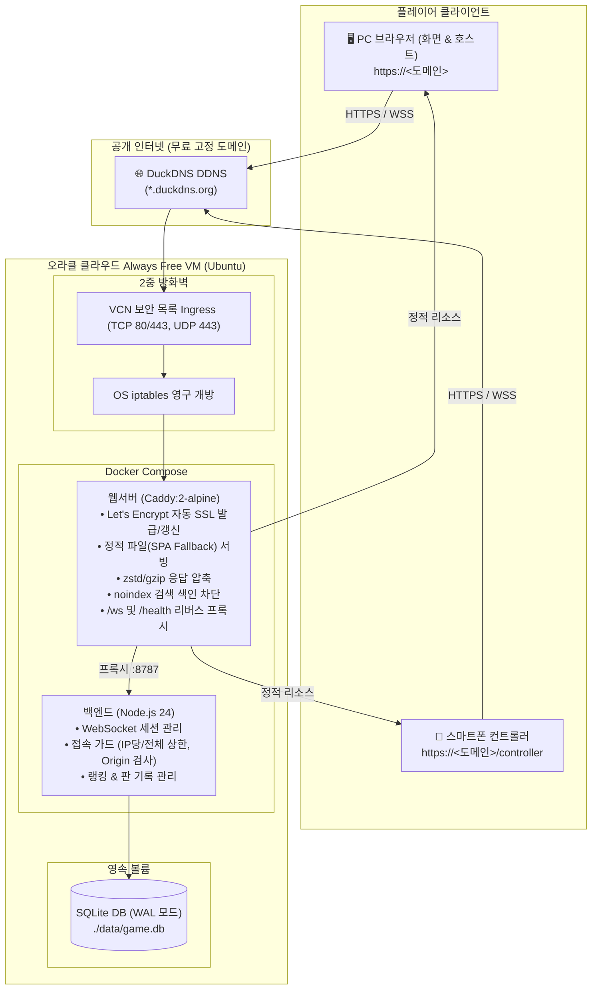

# ☁️ 오라클 클라우드 Always Free 무료 배포 가이드

> [!WARNING]
> **레거시 문서입니다.** 현재 운영은 Azure(`deploy/azure/`, `docs/Azure_VM_배포_가이드.md`)입니다. 오라클 Always Free로 되돌아갈 때 참고하세요.
> 모든 `docker compose` 명령은 저장소 루트에서 `-f deploy/oracle/docker-compose.yml`로 실행합니다.

> **비용 0원으로 영구 운영하는 스마트폰 체감형 3D 아케이드 슈팅 게임**  
> 오라클 클라우드(OCI)의 평생 무료(Always Free) VM과 무료 DDNS(DuckDNS), Caddy 자동 Let's Encrypt HTTPS 웹서버를 결합하여 모바일 자이로 센서 기반 3D 게임을 배포하고 운영하는 완결 가이드입니다.

---

## 🏛️ 시스템 아키텍처



---

## 📋 준비물 체크리스트
- [x] 오라클 클라우드(OCI) 무료 계정 ([oracle.com/cloud/free](https://www.oracle.com/cloud/free/))
- [x] DuckDNS 무료 계정 ([duckdns.org](https://www.duckdns.org/))
- [x] SSH 터미널 접속 도구 (macOS/Linux Terminal, Windows PowerShell 또는 PuTTY)

---

## 🚀 단계별 배포 절차

### 1단계: 오라클 클라우드 Always Free 인스턴스 생성

1. **OCI 콘솔 로그인**: [cloud.oracle.com](https://cloud.oracle.com)에 로그인합니다.
2. **인스턴스 생성 메뉴 진입**: 좌측 햄버거 메뉴(`☰`) ➔ **컴퓨트(Compute)** ➔ **인스턴스(Instances)** ➔ **인스턴스 생성(Create Instance)**을 클릭합니다.
3. **사양 및 이미지 선택**:
   - **이름**: `ob-crash-server` (원하는 이름 입력)
   - **배치(Placement)**: 기본 가용성 도메인 선택
   - **이미지**: **Canonical Ubuntu 22.04** 또는 **24.04 Minimal/Standard** 선택
   - **구성(Shape)**:
     - 🥇 **1순위 (추천 - 고성능)**: **Ampere ARM (`VM.Standard.A1.Flex`)**
       - OCPU: **2 ~ 4개**, 메모리: **12 ~ 24GB** (Always Free 한도 내 무료)
     - 🥈 **2순위 (ARM 일시 품절 시 대안)**: **AMD Micro (`VM.Standard.E2.1.Micro`)**
       - 1 OCPU, 1GB RAM (아래 4GB Swap 생성 필수)
4. **네트워킹**:
   - 가상 클라우드 네트워크(VCN) 자동 생성 선택
   - **공용 IPv4 주소 할당**: 반드시 **"공용 IPv4 주소 할당(Assign a public IPv4 address)"** 체크
5. **SSH 키 저장**:
   - **"전용 키 저장(Save private key)"**을 클릭하여 `.pem` 파일을 PC에 안전하게 다운로드합니다.
6. **생성 클릭**: 1~2분 후 인스턴스가 `실행 중(Running)` 상태가 되면 **공용 IP 주소(Public IP)**를 복사합니다.

#### 💡 (AMD 1GB 메모리 선택 시 필수) 4GB 스왑 메모리 설정
> ARM 인스턴스가 품절되어 AMD 1GB Micro 인스턴스를 생성한 경우, Three.js 프론트 빌드 시 메모리 부족(OOM) 방지를 위해 SSH 접속 직후 아래 스크립트를 실행하세요:
```bash
sudo fallocate -l 4G /swapfile
sudo chmod 600 /swapfile
sudo mkswap /swapfile
sudo swapon /swapfile
echo '/swapfile none swap sw 0 0' | sudo tee -a /etc/fstab
```

---

### 2단계: 2중 방화벽(VCN 보안 목록 + OS iptables) 해제

웹 브라우저의 HTTPS 접속과 WebSocket 연결을 위해 **오라클 클라우드 네트워크**와 **우분투 OS 내부 방화벽**을 모두 개방해야 합니다.

#### 1) 오라클 콘솔 VCN 보안 목록 설정
1. OCI 콘솔에서 생성된 인스턴스 상세 페이지 ➔ 하단 **기본 VNIC(Primary VNIC)**의 **서브넷(Subnet)** 링크 클릭.
2. 서브넷 상세 페이지에서 **보안 목록(Security Lists)** 중 `Default Security List for...` 클릭.
3. **수신 규칙 추가(Add Ingress Rules)** 클릭 후 아래 규칙 추가:
   - **소스 CIDR**: `0.0.0.0/0`
   - **IP 프로토콜**: `TCP`
   - **대상 포트 범위**: `80, 443`
   - **설명**: `HTTP and HTTPS`
4. (선택: HTTP/3 QUIC 가속) 추가 수신 규칙:
   - **소스 CIDR**: `0.0.0.0/0`
   - **IP 프로토콜**: `UDP`
   - **대상 포트 범위**: `443`
   - **설명**: `HTTP3 QUIC`

#### 2) 우분투 OS iptables 방화벽 영구 개방
SSH로 인스턴스에 접속합니다:
```bash
chmod 400 <다운로드받은_키파일.pem>
ssh -i <다운로드받은_키파일.pem> ubuntu@<인스턴스_공인IP>
```

접속 후 우분투 기본 방화벽 규칙을 개방하고 저장합니다:
```bash
sudo iptables -I INPUT 6 -m state --state NEW -p tcp --dport 80 -j ACCEPT
sudo iptables -I INPUT 6 -m state --state NEW -p tcp --dport 443 -j ACCEPT
sudo iptables -I INPUT 6 -m state --state NEW -p udp --dport 443 -j ACCEPT
sudo netfilter-persistent save
```

---

### 3단계: DuckDNS 무료 도메인 발급 및 IP 자동 갱신 크론 설정 (필수)

스마트폰의 모션/자이로 센서 API(`DeviceOrientationEvent`)는 브라우저 보안 규정상 **HTTPS 연결이 필수**입니다. DuckDNS로 평생 무료 고정 도메인을 발급받고, 인스턴스 정지/재시작에 대비해 자동 갱신 크론탭을 등록합니다.

1. **[duckdns.org](https://www.duckdns.org/)**에 로그인합니다.
2. **Domains** 입력란에 원하는 서브도메인 이름(예: `my-ob-crash`)을 입력하고 **add domain**을 누릅니다.
3. 생성된 도메인의 **current ip**에 오라클 VM의 공인 IP를 입력하고 **update ip**를 누릅니다.
4. 상단의 **token** 값을 복사해 둡니다.

#### IP 자동 갱신 크론탭 등록 (인스턴스 재시작 시 공인 IP 변경 대비)
SSH 터미널에서 아래 명령을 실행합니다:
```bash
mkdir -p ~/duckdns
cat << 'EOF' > ~/duckdns/duck.sh
echo url="https://www.duckdns.org/update?domains=<본인도메인>&token=<본인토큰>&ip=" | curl -k -o ~/duckdns/duck.log -K -
EOF
chmod 700 ~/duckdns/duck.sh
```
> `<본인도메인>`에는 `.duckdns.org`를 뺀 이름(예: `my-ob-crash`), `<본인토큰>`에는 복사한 토큰을 입력합니다.

크론탭 등록:
```bash
(crontab -l 2>/dev/null; echo "*/5 * * * * ~/duckdns/duck.sh >/dev/null 2>&1") | crontab -
```
이제 5분마다 VM의 최신 공인 IP가 DuckDNS에 자동 동기화됩니다.

---

### 4단계: Docker 및 Docker Compose 원클릭 설치

SSH 터미널에서 공식 Docker 스크립트로 설치를 진행합니다:
```bash
curl -fsSL https://get.docker.com -o get-docker.sh
sudo sh get-docker.sh
sudo usermod -aG docker $USER
# 인스턴스 재부팅 시 도커 데몬 자동 시작 활성화
sudo systemctl enable docker
newgrp docker
```

---

### 5단계: 소스코드 클론 및 환경 설정

```bash
git clone https://github.com/ChaJiYoung/ob-crash-game.git
cd ob-crash-game
cp deploy/oracle/.env.example deploy/oracle/.env
nano deploy/oracle/.env
```
`deploy/oracle/.env` 파일에서 `DOMAIN` 값을 3단계에서 생성한 DuckDNS 도메인으로 변경합니다:
```env
DOMAIN=my-ob-crash.duckdns.org
```
*(저장: `Ctrl+O` ➔ `Enter`, 나가기: `Ctrl+X`)*

> [!NOTE]
> 서버는 처음 실행될 때 빈 SQLite DB(`data/game.db`)를 자동으로 생성하므로 별도의 DB 세팅이 필요 없습니다.

---

### 6단계: 빌드 및 컨테이너 실행

Docker Compose로 Caddy 웹서버와 백엔드 서비스를 백그라운드 빌드 및 기동합니다:
```bash
docker compose -f deploy/oracle/docker-compose.yml up -d --build
```

실행 상태 확인:
```bash
docker compose -f deploy/oracle/docker-compose.yml ps
```
- `backend`: `healthy`
- `web`: `running` (Up)

---

### 7단계: 배포 검증 및 게임 플레이

#### 1) 원클릭 스모크 테스트 실행
VM 내부(또는 로컬 PC)에서 프로젝트 내장 검증 스크립트를 실행합니다:
```bash
node scripts/deploy-smoke.mjs https://<본인도메인>.duckdns.org
```
헬스체크, SPA 라우팅, noindex 헤더, robots.txt, 웹소켓 방 생성, Origin 보안 거절 등 6개 항목이 모두 `OK`로 통과하는지 확인합니다.

#### 2) 인게임 플레이 검증
1. **PC 브라우저 (호스트)**:
   - Chrome, Edge, Safari 등으로 `https://<본인도메인>.duckdns.org`에 접속합니다.
   - Caddy가 Let's Encrypt 정식 SSL 인증서를 발급하여 자물쇠 표시(보안 연결)가 뜨고 3D 대기실이 로드됩니다.
   - 화면에 표시된 1P 슬롯 QR 코드를 확인합니다.
2. **모바일 폰 (권총 컨트롤러)**:
   - 스마트폰 카메라로 PC 화면의 QR 코드를 스캔하여 접속합니다.
   - 화면 안내에 따라 **모션 및 방향 센서 권한을 허용**합니다.
   - 영점 조절 후 스마트폰을 권총처럼 잡고 조준 및 격발을 테스트합니다.

---

## 🛠️ 운영 및 유지보수 매뉴얼

### 1. Always Free 유휴 회수(Idle Reclamation) 대응 및 재시작 체크리스트
오라클 Always Free 계정은 장기간 CPU 사용률이 매우 낮으면 인스턴스가 일시 정지(Stop)될 수 있습니다. (디스크와 설정은 삭제되지 않고 보존됩니다.)

**인스턴스가 멈췄을 때 재시작 체크리스트**:
1. OCI 콘솔에 로그인하여 인스턴스 상태가 `Stopped`인 경우 **시작(Start)** 버튼을 클릭합니다.
2. 부팅 완료 후 SSH로 접속합니다. Docker 서비스와 컨테이너(`restart: unless-stopped`)는 자동으로 복구됩니다:
   ```bash
   docker compose -f deploy/oracle/docker-compose.yml ps
   ```
3. 공인 IP가 변경되었더라도 등록해 둔 DuckDNS 크론(`duck.sh`)이 5분 이내에 자동으로 새 IP를 갱신합니다.
4. 브라우저로 `https://<본인도메인>/health`에 접속하여 `{"status":"ok"}`가 나오는지 확인합니다.
*(참고: ARM A1 인스턴스는 리전 리소스 상황에 따라 재시작 시 일시적으로 용량 부족 메시지가 나올 수 있으며, 잠시 후 다시 시도하면 정상 시작됩니다.)*

### 2. SQLite WAL 안전 온라인 백업
본 프로젝트의 SQLite DB는 고성능 WAL(`journal_mode=WAL`) 모드로 동작합니다. 단순히 파일을 복사하면 메모리/WAL에 남아있는 최신 기록이 빠질 수 있으므로, 아래 공식 온라인 백업 명령을 사용하세요:
```bash
docker compose -f deploy/oracle/docker-compose.yml exec backend node -e "const Database = require('better-sqlite3'); const db = new Database('data/game.db'); db.backup('data/backup-' + Date.now() + '.db').then(() => { console.log('Backup completed'); db.close(); }).catch(e => { console.error(e); process.exit(1); });"
```
백업 파일은 호스트의 `./data/backup-<타임스탬프>.db`에 안전하게 저장됩니다.

### 3. 실시간 로그 확인
```bash
# 전체 컨테이너 로그
docker compose -f deploy/oracle/docker-compose.yml logs -f

# 백엔드 로그만 확인
docker compose -f deploy/oracle/docker-compose.yml logs -f backend

# 웹서버(Caddy) 로그만 확인
docker compose -f deploy/oracle/docker-compose.yml logs -f web
```
*(로그 파일은 `deploy/oracle/docker-compose.yml` 설정에 따라 파일당 10MB, 최대 3개로 자동 순환되므로 디스크가 가득 차지 않습니다.)*

### 4. 최신 버전 업데이트 배포
```bash
git pull
docker compose -f deploy/oracle/docker-compose.yml up -d --build
```

---

## 🔒 보안 및 검색엔진 노출 차단 안내

1. **검색엔진 색인 차단 (SEO Noindex)**:
   - Caddy 웹서버가 모든 HTTP 응답에 `X-Robots-Tag: noindex, nofollow` 헤더를 기본 제공합니다.
   - `/robots.txt` 요청에 대해 `Disallow: /`를 응답하여 구글, 네이버 등 검색엔진 로봇의 크롤링과 검색 결과 노출을 차단합니다.
   - **한계 안내**: Let's Encrypt 인증서 발급 내역은 전 세계에 공개되는 인증서 투명성(CT) 로그에 자동 등록되므로 도메인 주소 자체는 알려질 수 있습니다. 다만 검색 결과에는 노출되지 않으며, 무차별 접속은 서버 접속 상한 가드(IP당 60개, 전체 300개)로 안전하게 보호됩니다.
2. **WebSocket 접속 가드**:
   - `ALLOWED_ORIGIN` 환경변수를 통해 인가되지 않은 외부 사이트에서의 WebSocket 도용을 원천 차단합니다.
   - 메시지 페이로드는 최대 64KB로 제한되어 DoS 공격을 방지합니다.

---

## ❓ 자주 묻는 질문 (FAQ) & 트러블슈팅

### Q1. 도메인 접속 시 "응답 시간이 너무 깁니다" (무한 로딩)
- **원인**: 2중 방화벽 중 하나가 닫혀 있습니다.
- **해결**:
  1. OCI 콘솔 VCN 보안 목록에서 TCP 80, 443 포트가 `0.0.0.0/0`에 대해 열려 있는지 확인하세요.
  2. 우분투 내부에서 `sudo iptables -L -n -v`를 실행하여 80/443 허용 규칙이 저장되어 있는지 확인하고, 본 가이드의 2단계를 다시 적용하세요.

### Q2. Caddy 로그에 Let's Encrypt 인증서 발급 오류가 발생합니다.
- **원인**: DuckDNS 도메인의 IP와 인스턴스의 실제 공인 IP가 일치하지 않거나 80 포트가 막혀 있습니다.
- **해결**: DuckDNS 웹사이트에서 도메인의 IP를 확인하고, 80 포트 방화벽이 열려 있는지 점검하세요.

### Q3. 화면에 "접속자가 많아요. 자리가 나면 자동으로 연결됩니다" 배너가 뜹니다.
- **원인**: 동일한 공인 IP에서의 동시 접속이 60개를 넘었거나 서버 전체 접속이 300개를 초과했습니다.
- **해결**: 대규모 행사나 대회 환경인 경우 `deploy/oracle/.env` 파일에서 `WS_MAX_CONN_PER_IP=150`, `WS_MAX_CONN_TOTAL=600` 등으로 한도를 늘린 후 `docker compose -f deploy/oracle/docker-compose.yml up -d`를 실행하세요.

---

## 🎁 부록: GitHub Actions 무중단 CI/CD 자동 배포

GitHub 리포지토리에 코드를 push했을 때 오라클 VM에 자동으로 최신 버전이 배포되도록 설정할 수 있습니다.

### 1) 리포지토리 Secrets 설정
GitHub 저장소 ➔ **Settings** ➔ **Secrets and variables** ➔ **Actions**에 등록:
- `OCI_HOST`: VM 공인 IP (또는 DuckDNS 도메인)
- `OCI_USERNAME`: `ubuntu`
- `OCI_KEY`: SSH 비밀키(`.pem` 내용 전체)

### 2) `.github/workflows/deploy.yml` 파일 생성
```yaml
name: Deploy to Oracle Cloud Always Free VM

on:
  push:
    branches: [main]

jobs:
  deploy:
    runs-on: ubuntu-latest
    steps:
      - name: Deploy via SSH
        uses: appleboy/ssh-action@v1.0.3
        with:
          host: ${{ secrets.OCI_HOST }}
          username: ${{ secrets.OCI_USERNAME }}
          key: ${{ secrets.OCI_KEY }}
          script: |
            cd ~/ob-crash-game
            git pull origin main
            docker compose -f deploy/oracle/docker-compose.yml up -d --build
            node scripts/deploy-smoke.mjs
```
