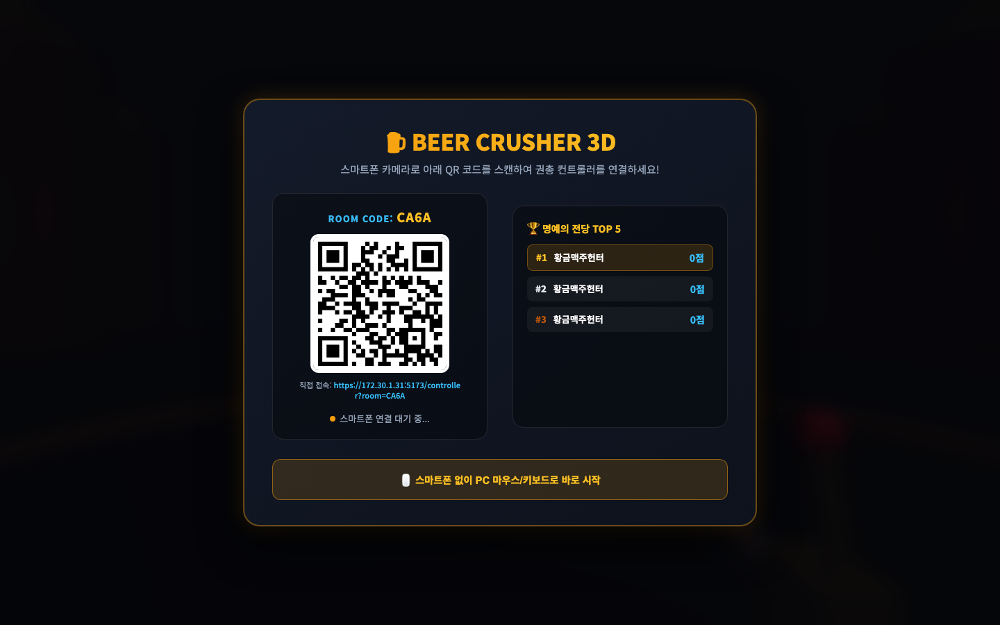
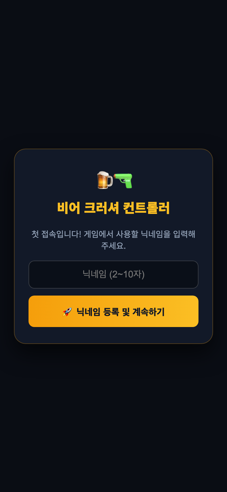
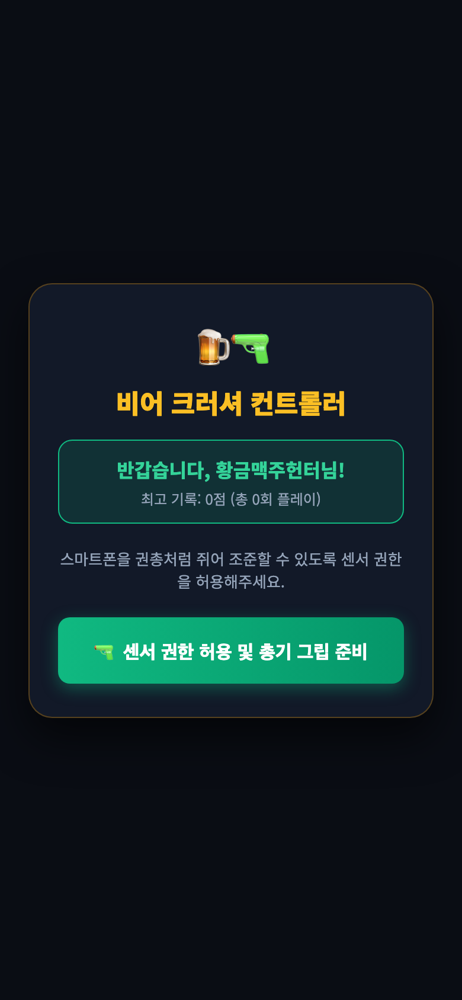
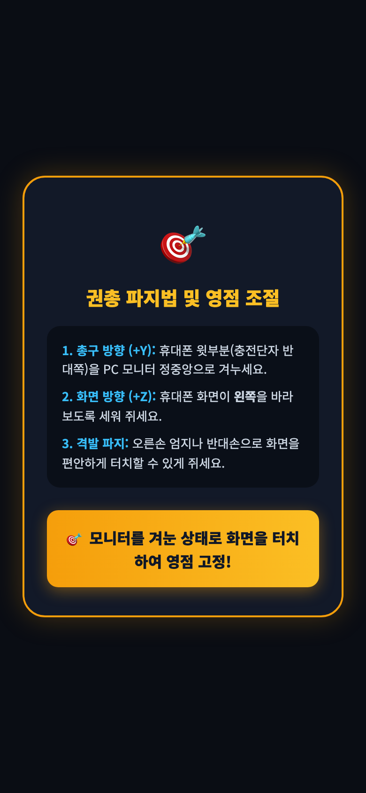
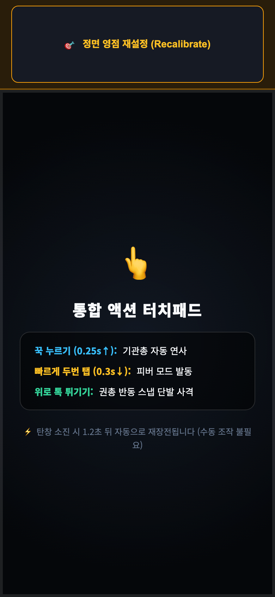
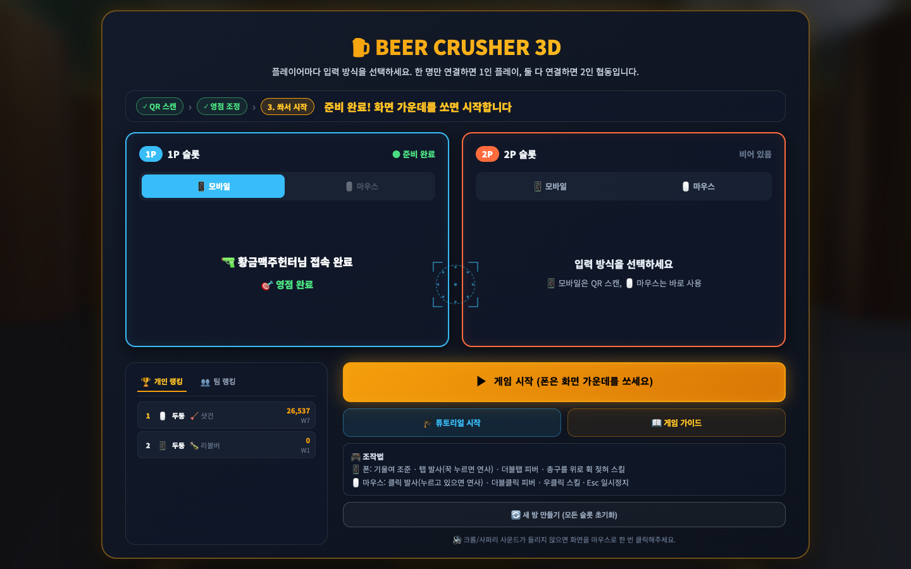
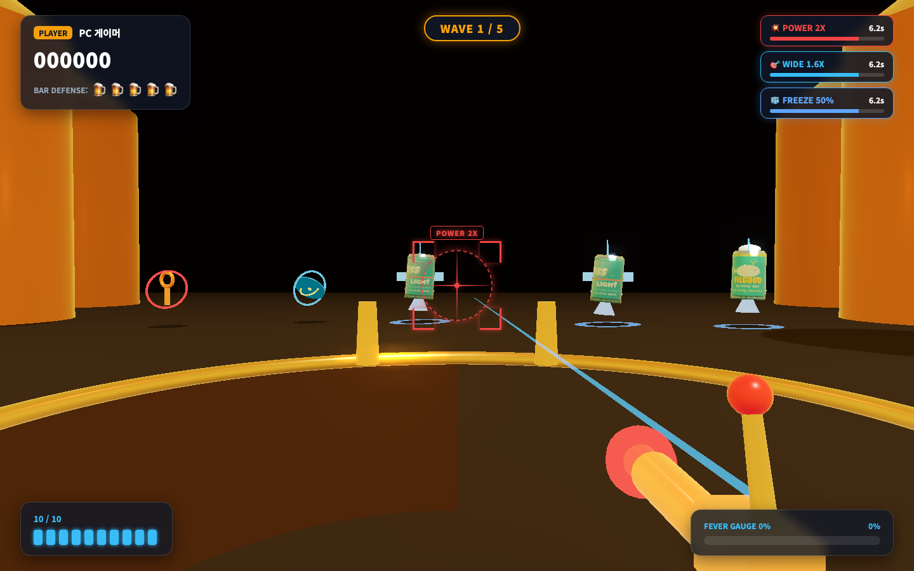
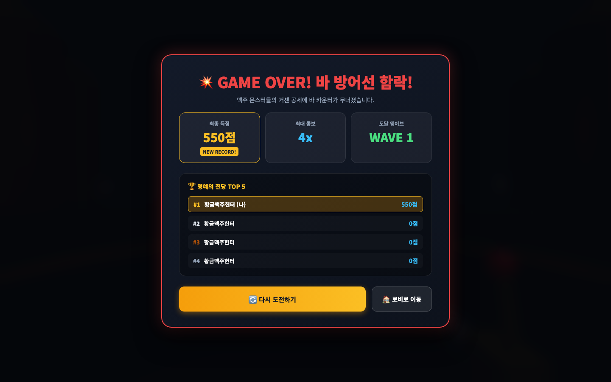

# 🍺 비어 크러셔 3D 실제 구동 화면 쇼케이스

본 문서는 PC 모니터 3D 렌더링 화면과 모바일 권총 컨트롤러가 상호 연동되어 동작하는 실제 화면 캡처 및 UI/UX 구조를 설명합니다.

---

## 1. 🖥️ PC 초기 로비 & QR 페어링 화면

PC에서 게임을 실행하면 고유 4자리 룸 코드와 함께 스마트폰으로 스캔 가능한 QR 코드가 생성됩니다. PC가 `localhost`에 있더라도 실제 Wi-Fi IP(`172.30.1.31`)를 자동으로 감지하여 모바일 접속 주소를 구성합니다.

* **ROOM CODE**: 4자리 세션 방 코드 자동 발급 (예: `CA6A`)
* **QR 코드**: 스마트폰 카메라 스캔 시 컨트롤러 웹 앱으로 즉시 연결
* **직접 접속 URL**: Wi-Fi LAN IP 주소 표기 (`https://172.30.1.31:5173/controller?room=...`)
* **명예의 전당 TOP 5**: 최고 기록 랭킹 보드
* **PC 단독 플레이**: 스마트폰 없이도 PC 마우스/키보드로 즉시 시작 가능

---

## 2. 📱 스마트폰 모바일 컨트롤러 온보딩 (3단계)

스마트폰으로 QR 코드를 스캔하여 접속했을 때 진행되는 3단계 인터페이스입니다.

### [1단계] 디바이스 UUID 자동 로그인 & 닉네임 등록
기기 고유 UUID를 발급하여 별도의 회원가입 없이 자동 로그인 처리되며, 첫 방문 시 게임 내에서 사용할 닉네임을 등록합니다.

### [2단계] 센서 권한 허용 Gate
iOS Safari 및 안드로이드의 자이로/가속도 센서 권한을 단 1회의 탭으로 획득합니다.

### [3단계] 권총 파지법 및 영점 고정 (Zero Calibration)
플레이어가 모니터를 정면으로 바라본 상태에서 기준 조준점을 캘리브레이션합니다.
* **총구 방향(+Y)**: 휴대폰 윗부분(충전 단자 반대쪽)을 PC 모니터 정중앙으로 조준
* **화면 방향(+Z)**: 휴대폰 화면이 **왼쪽**을 바라보도록 세워 파지
* **격발 파지**: 오른손 엄지나 반대손으로 화면을 편안하게 터치할 수 있게 쥠
* 화면 터치 한 번으로 기준 각도를 0점으로 고정합니다.

### [4단계] 통합 액션 터치패드 컨트롤러 (GunGripPad)
* **상단 15% 영역**: `🎯 정면 영점 재설정 (Recalibrate)` 버튼 (게임 도중 언제든 재영점 가능)
* **하단 85% 터치패드 영역**:
  - **꾹 누르기 (0.25초↑)**: 기관총 초고속 자동 연사
  - **빠르게 두 번 탭 (0.3초↓)**: 피버(FEVER) 모드 즉시 발동
  - **위로 톡 튀기기**: 권총 반동 스냅 단발 격발
  - **자동 재장전**: 탄창(10발) 소진 시 1.2초 뒤 자동 장전

---

## 3. 🤝 모바일 페어링 완료 시 PC 로비 상태

스마트폰 컨트롤러가 연결되고 영점 보정이 완료되면, PC 로비에 즉시 플레이어 정보와 접속 완료 뱃지가 표시되며 초록색 게임 시작 버튼으로 전환됩니다.

---

## 4. 🎯 PC 3D 인게임 전투 화면

3D WebGL (Three.js) 기반의 아케이드 슈팅 화면입니다.

* **바 카운터 & 3D 네온 건 배럴**: 하단에 3D 맥주 탭 바 카운터와 조준 방향을 따라 움직이는 3D 레이저 총구 모델 배치 (파워 샷 버프 시 황금 골든 캐논으로 진화)
* **부채꼴 스폰 맥주 몬스터**: 날개 달린 맥주캔, 올 뉴 카스 500ml 투명 병맥주가 플레이어 시점 방향 부채꼴 공간에서 쇄도
* **네온 크로스헤어**: 스마트폰 자이로 조준점에 실시간 60Hz 동기화 (빅 스코프 버프 시 140px 대형화 & 홀로그램 가이드 빔 전개)
* **실시간 3D 상태 효과**: 전장 몬스터 서리 결빙 틴트 & 얼음 링, 머리 위 록온 마커, 타격 좌표 아케이드 플로팅 텍스트
* **상단 HUD**: 플레이어명, 6자리 아케이드 점수, 바 방어선 라이프(맥주잔 5개 🍺×5), 현재 웨이브
* **하단 HUD**: 좌측 네온 잔탄 게이지(10발), 우측 피버 게이지 및 피버 발동 표시

---

## 5. 🏆 게임 오버 및 랭킹 모달 (결과 화면)

바 방어선이 함락되거나 전 웨이브를 클리어했을 때 나타나는 결과 모달입니다.

* **결과 스탯 요약**: 최종 득점(점수), 최대 콤보(Combo), 도달 웨이브 표기
* **신기록 달성 뱃지**: 본인 최고 기록 갱신 시 `NEW RECORD!` 골드 뱃지 점등
* **실시간 명예의 전당 TOP 5**: 내 순위와 서버 상위 랭커 목록 자동 갱신
* **원클릭 재도전 & 로비 복귀**: `[🔄 다시 도전하기]` 또는 `[🏠 로비로 이동]`
