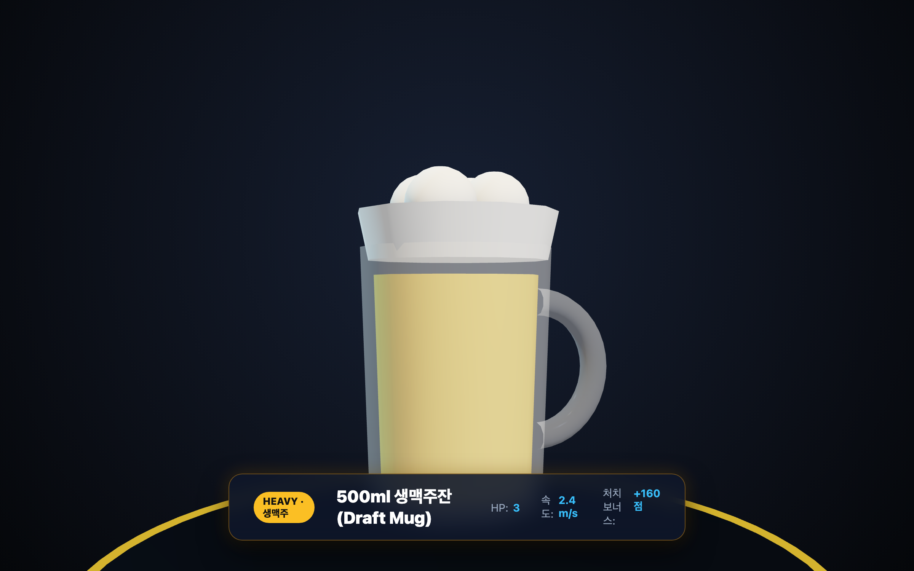

# 🍺 비어 크러셔 3D 몬스터 도감 및 공략 설명서

> 바 카운터를 향해 전방 부채꼴 공간에서 쏟아지는 **6종의 맥주 몬스터들의 특징, 스펙, 그리고 공략법**을 안내합니다.

---

## 🌟 몬스터 전체 라인업 (Lineup)

비어 크러셔 3D에는 가벼운 스피드형 캔부터 3D 유리 생맥주잔, 그리고 초대형 업소용 냉각기 보스까지 총 6종의 개성 넘치는 타겟이 등장합니다.


### 📊 몬스터 스펙 비교 요약표

| 몬스터 | 분류 | 체력 (HP) | 속도 | 피격 반경 | 처치 점수 | 주요 특징 |
| :--- | :---: | :---: | :---: | :---: | :---: | :--- |
| **필굿 (FiLGOOD)** | SPEED · 일반 | **1** | 4.5 m/s | 0.55m | +30점 | 일반 캔 중 최고 속도, 톡 쏘는 탄산 거품 |
| **카스 라이트 (Cass Light)** | FLYING · 일반 | **1** | 3.8 m/s | 0.58m | +40점 | 홀로그램 날개 비행, 경쾌한 공중 기동 |
| **오비 라거 (OB Lager)** | TANK · 중형 | **2** | 3.1 m/s | 0.65m | +70점 | 단단한 정통 라거 캔, 2연타 격파 필요 |
| **한맥 (HANMAC)** | ELITE · 고급 | **2** | 3.3 m/s | 0.65m | +90점 | 부드러운 헤드 거품, 높은 처치 보너스 점수 |
| **500ml 생맥주잔 (Draft Mug)** | HEAVY · 생맥주 | **3** | 2.4 m/s | 0.80m | +160점 | 투명 크리스탈 10각 잔 + 넘치는 생맥주 거품 |
| **생맥주 냉각기 (Boss)** | BOSS · 최종보스 | **30** | 1.15 m/s | 1.55m | +1,500점 | 거대 스테인리스 캐비닛 + 듀얼 골드 탭 |

---

## 📖 몬스터별 상세 프로필 및 공략 매뉴얼

---

### 1. 🐳 필굿 (FiLGOOD) — 초고속 돌진 캔


* **코드명**: `pilgood`
* **체력(HP)**: `1` (1발 명중 시 즉시 파괴)
* **전진 속도**: `4.5 m/s` (⚡ 전 타겟 중 최고 이동 속도)
* **처치 보너스**: `+30점`
* **외형 디자인**:
  * 산뜻한 스카이 블루/옐로우 컬러의 발포주 캔 바디
  * 캔 상단에 봉긋하게 솟아오른 톡 쏘는 탄산 거품 모자
* **공략 가이드**:
  * 가장 빠른 속도로 바 카운터를 향해 쇄도하므로 방심하면 순식간에 방어선을 뚫립니다.
  * 체력이 1이므로 원거리에서 발견 즉시 권총 스냅 단발 사격으로 조기 격추하는 것이 안전합니다.

---

### 2. 🦇 카스 라이트 (Cass Light) — 비행 날개 캔


* **코드명**: `caslight`
* **체력(HP)**: `1` (1발 명중 시 즉시 파괴)
* **전진 속도**: `3.8 m/s` (날렵한 공중 활공)
* **처치 보너스**: `+40점`
* **외형 디자인**:
  * 제로 슈거의 청량한 하늘색 캔 바디
  * 양옆으로 펼쳐진 반투명 시안 블루 홀로그램 비행 날개
* **공략 가이드**:
  * 날개를 펄럭이며 공중을 가로질러 날아옵니다.
  * 좌우로 펼쳐진 날개 덕분에 피격 판정 범위(0.58m)가 넓어 조준하기 수월합니다.
  * 이동 중 콤보를 이어가기 가장 좋은 타겟입니다.

---

### 3. 🐻 오비 라거 (OB Lager) — 묵직한 정통 라거 캔


* **코드명**: `obi`
* **체력(HP)**: `2` (2발 적중 필요)
* **전진 속도**: `3.1 m/s`
* **처치 보너스**: `+70점`
* **외형 디자인**:
  * 클래식한 골드 앰버 컬러 캔 바디와 레드 밴드
  * 상단 알루미늄 뚜껑에 정교하게 제작된 실물 풀탭(Pull Tab)
* **공략 가이드**:
  * 1발을 맞추면 붉은색 피격 플래시(Hit Flash)와 함께 짧은 경직이 발생합니다.
  * 1발만 쏘고 지나치면 파괴되지 않고 바 카운터로 밀고 들어오므로, **반드시 "탕-탕!" 더블탭 2연타 사격**으로 마무리하세요.

---

### 4. 🌿 한맥 (HANMAC) — 부드러운 거품의 엘리트 캔


* **코드명**: `hanmac`
* **체력(HP)**: `2` (2발 적중 필요)
* **전진 속도**: `3.3 m/s`
* **처치 보너스**: `+90점` (일반 캔 중 최고 득점)
* **외형 디자인**:
  * 깊고 풍부한 쌀 맥주를 상징하는 딥 에메랄드 그린 & 골드 라벨
  * 캔 상단에 얹어진 부드럽고 촘촘한 크림 헤드 거품
* **공략 가이드**:
  * 오비 라거보다 약간 빠른 속도로 다가오며 2발을 적중시켜야 합니다.
  * 처치 점수가 +90점으로 높으므로, 콤보 배율(최대 1.5배~2.0배)이 쌓여있을 때 처치하면 순식간에 대량 득점을 올릴 수 있습니다.

---

### 5. 🍺 500ml 크리스탈 생맥주잔 (Draft Mug) — 중형 맥주 탱크



* **코드명**: `mug`
* **체력(HP)**: `3` (3발 타격 필요)
* **전진 속도**: `2.4 m/s` (묵직하고 안정적인 전진)
* **처치 보너스**: `+160점`
* **외형 디자인**:
  * 빛을 굴절시키는 투명 크리스탈 10각 패싯(Facet) 유리 바디
  * 내부를 가득 채운 황금빛 호박색(Amber) 생맥주 액체
  * 두툼한 크리스탈 유리 손잡이
  * 잔 위로 봉긋하게 솟구치며 넘쳐흐르는 생맥주 거품 방울들
* **공략 가이드**:
  * 체력이 3이나 되기 때문에 일반 단발 사격 시 탄창(10발)의 30%를 소모합니다.
  * 잔여 탄약이 부족한 상태에서 조우하면 장전 딜레이 동안 방어선이 뚫릴 수 있습니다.
  * 탄창을 가득 채운 상태에서 공격하거나, **모바일 터치패드를 꾹 눌러 초고속 기관총 연사**로 순식간에 깨뜨리는 것을 추천합니다.

---

### 6. 🧊 업소용 생맥주 냉각기 (Draft Cooler Boss) — 웨이브 3 최종 보스


* **코드명**: `boss`
* **체력(HP)**: `30` (강력한 거대 보스 체력)
* **전진 속도**: `1.15 m/s` (느리지만 절대 멈추지 않는 전진)
* **처치 보너스**: `+1,500점` (초대형 보너스!)
* **피격 반경**: `1.55m` (모니터 화면을 가득 채우는 거대한 크기)
* **외형 디자인**:
  * 실제 호프집에서 사용하는 대형 블랙 스테인리스 스틸 냉각기 캐비닛
  * 전면 하단의 냉각 루버 통풍 그릴
  * 상단 중앙의 크롬 드래프트 타워
  * 황금빛 듀얼 생맥주 추출구(Spout) 및 오렌지색 생맥주 탭 핸들 2개
  * 하단 4개의 이동용 캐스터 바퀴
* **보스 전투 패턴 및 공략 가이드**:
  1. **전용 보스 체력바**: 보스 출현 시 화면 상단에 붉은색-골드 그라데이션의 전용 대형 보스 체력바가 나타납니다.
  2. **바 방어선 즉사 위험**: 일반 몬스터는 바 카운터 침범 시 라이프를 1개 깎지만, **보스는 침범하는 순간 라이프 3개가 한 번에 모두 날아가 즉시 게임 오버**됩니다!
  3. **피버(FEVER) 모드 극딜 필수**:
     * 보스 등장 전 웨이브 1~2에서 `PERFECT` 판정을 연속으로 따내어 피버 게이지를 100% 모아두세요.
     * 보스가 시야에 들어오는 순간 **스마트폰 화면을 빠르게 두 번 탭(더블탭)하여 피버 모드를 발동**합니다.
     * 피버 모드 동안은 탄약이 무제한이 되므로, 화면을 꾹 누른 채 기관총 난사로 30발을 쏟아부어 격파해야 합니다!

---

## 🎯 판정 시스템 및 피버 연계 공략법

```
[ 조준 오차 ]
0.0 ~ 0.25 (정중앙 명중) ──▶ PERFECT  (+100점 · 피버 게이지 +15%)
0.25 ~ 0.50 (근접 명중)   ──▶ GREAT    (+50점  · 피버 게이지 +10%)
0.50 ~ 0.75 (가장자리 명중)─▶ GOOD     (+20점  · 피버 게이지 +5%)
0.75 초과 (빗나감)        ──▶ MISS     (콤보 초기화)
```

1. **콤보 유지**: 연속으로 명중시키면 콤보 배율이 최대 1.5배~2.0배까지 증가합니다.
2. **피버 게이지 100% 충전**: 게이지가 가득 차면 모바일 컨트롤러 패드가 황금빛으로 점등되며 알림이 뜹니다.
3. **피버 발동**:
   - 모바일: 화면을 빠르게 따닥 더블탭
   - PC: `E` 키 터치
   - 10초간 **골든 샷건 & 무제한 초고속 기관총 연사**로 맥주 몬스터들을 일망타진할 수 있습니다.
