# 🍺 비어 크러셔 3D: 오비맥주 몬스터 & 아이템 공식 도감 및 공략집

> **Beer Crusher 3D Arcade v2 Official Codex & Strategy Guide**  
> 본 문서는 오비맥주(OB Brewery) 4종 캔·카스 프레시 500ml 병맥주·업소용 냉각기 보스 몬스터 6종과 오비 펍 소품형 아이템 4종의 상세 스펙, 비주얼 특징, 몬스터별 특색, 그리고 7웨이브·보스전 3회 공략법을 집대성한 공식 도감입니다.

---

## 📸 1. 몬스터 6종 풀 라인업

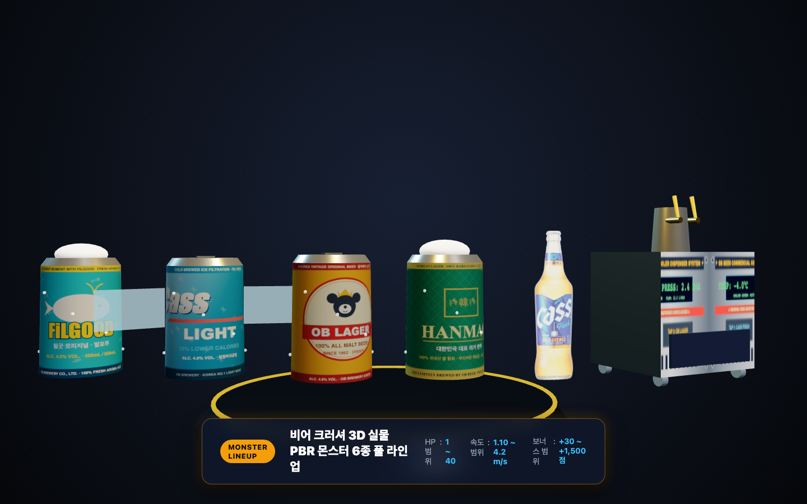

### 📊 몬스터 6종 종합 스펙 비교표

| 몬스터 | 브랜드 / 형태 | 고도 / 기동 | 체력 (HP) | 접근 속도 | 처치 점수 | 히트 반경 | 공략 특징 |
| :--- | :--- | :--- | :---: | :---: | :---: | :---: | :--- |
| **필굿 (FiLGOOD)** | 캔 / 탄산 제트 | **지상 (0.55m)** | 1 | 2.6 m/s (12m 안에서 ×1.4) | +3점 | 0.85m | **지상 돌격**: 가까워지면 가속. 멀리서 미리 잡기 |
| **카스 라이트 (Cass Light)** | 캔 / 아이스 윙 | **공중 (1.45m)** | 1 | 2.4 m/s | +4점 | 0.90m | **유일한 비행 몬스터**: 좌우로 크게 흔들리는 회피 비행 |
| **오비 라거 (OB Lager)** | 캔 / 랄라베어 | **지상 (0.55m)** | 2 | 1.9 m/s | +7점 | 0.95m | **방패병**: 1.5초 들고 1.5초 내림. 내렸을 때만 피해(피버·스킬은 방패를 뚫음) |
| **한맥 (HANMAC)** | 캔 / 쌀 엠블럼 | **지상 (0.55m)** | **3** | 2.0 m/s (11m에서 정지) | +9점 | 0.95m | **포격**: 11m에서 멈춰 4초마다 자기 위치에서 투사체 발사 |
| **카스 프레시 병맥주 (Cass Fresh Bottle)** | 올 뉴 카스 투명 유리병 | **지상 (0.55m)** | **4** | 1.5 m/s | +16점 | 1.35m | **분열 탱커**: 모델 1.2배. 깨지면 작은 병 2마리(체력 1, 2.2 m/s)로 분열 |
| **업소용 냉각기 보스 (Boss)** | 스테인리스 쿨러 | **지상 (1.15m)** | 40~50 (대왕 120) | 0.85 m/s (10m 정지) | **+150점** | 2.10m (판정 ×0.6) | **좌우 이동**, 부하 소환(8초에서 5초로 가속), 넉백 면역, 몸통 타격은 피버 0. 대왕은 쉴드 |

---

### 🥫 몬스터 개별 상세 프로필

#### 1. 필굿 (FiLGOOD) — *지상 돌격대*
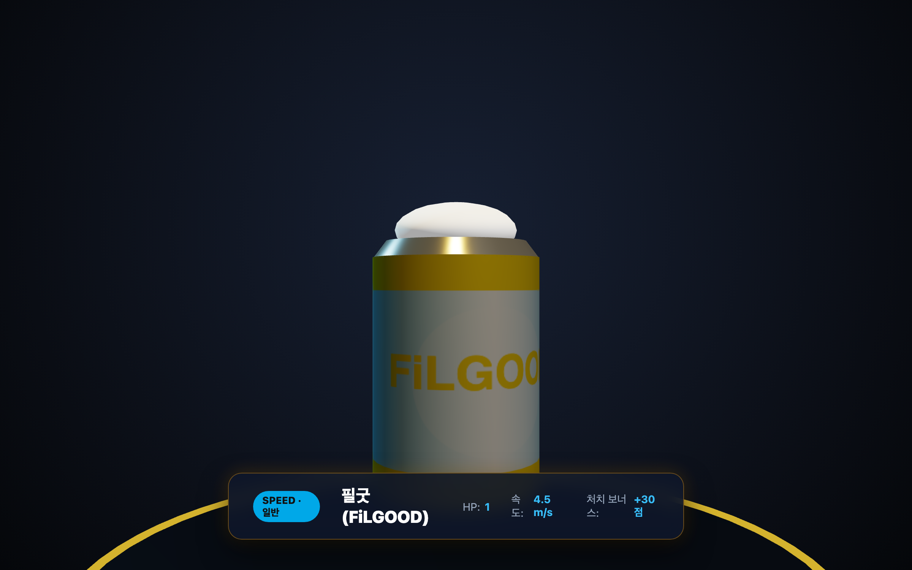
- **타입**: 지상 돌격형 (Ground Charger, 고도 `0.55m`)
- **외형**: 시안 블루(#00a8e8) 알루미늄 캔, 필굿 고래 일러스트 전면 라벨, 뒤쪽을 향한 탄산 제트 분사구, 상단 크림 거품
- **특징**: 땅을 굴러 접근하다가 방어선 **12m 안으로 들어오면 속도가 ×1.4**로 올라 순식간에 쇄도합니다. 체력은 1이므로 멀리서 미리 저격하세요.

#### 2. 카스 라이트 (Cass Light) — *아이스 윙 비행선*
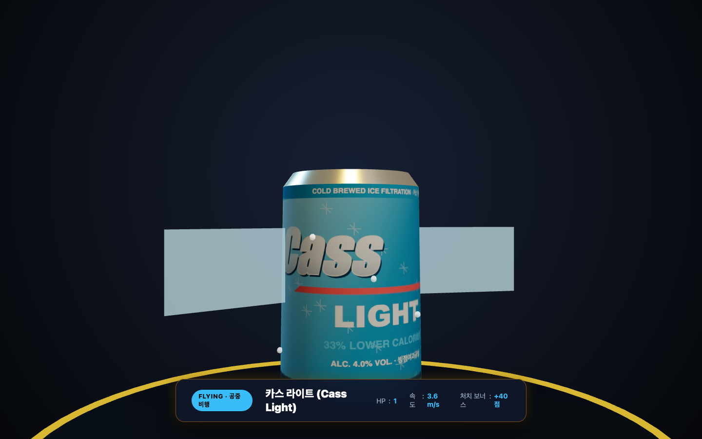
- **타입**: 공중 비행형 (Airborne Flyer, 고도 `1.45m`) — **공중에 뜬 유일한 몬스터**
- **외형**: 아이스 실버/블루 메탈릭 캔, 카스 다이내믹 쉐브론 로고, 양 측면 반투명 시안 날개 펄럭임
- **특징**: 날개를 퍼덕이며 **좌우로 크게 흔들리는** 회피 비행을 합니다. 지상 타겟보다 조준선을 높게 잡고, 흔들림의 가장자리에서 방향을 바꾸는 순간을 노리세요.

#### 3. 오비 라거 (OB Lager) — *뉴트로 랄라베어 방패병*
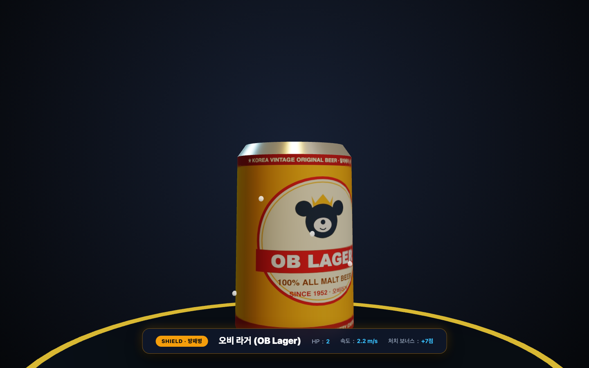
- **타입**: 지상 접지형 (Ground Contact, 고도 `0.55m`, 바닥 바운스)
- **외형**: 앰버 골드 캔, 왕관을 쓴 오비 랄라베어 마스코트 엠블럼, 1952 클래식 레드 리본, 푸른 방패 판
- **특징**: 푸른 방패를 **1.5초 들고 1.5초 내리기**를 반복하며, 개체마다 시작 타이밍이 다릅니다. 방패가 올라가 있으면 탄이 튕겨 나가고(점수·피버 없음, 탄약만 소모, "팅!" 소리) 내려간 순간에만 피해가 들어갑니다. **피버 중 사격과 액티브 스킬은 방패를 뚫습니다.**

#### 4. 한맥 (HANMAC) — *대한민국 대표 라거 포병*
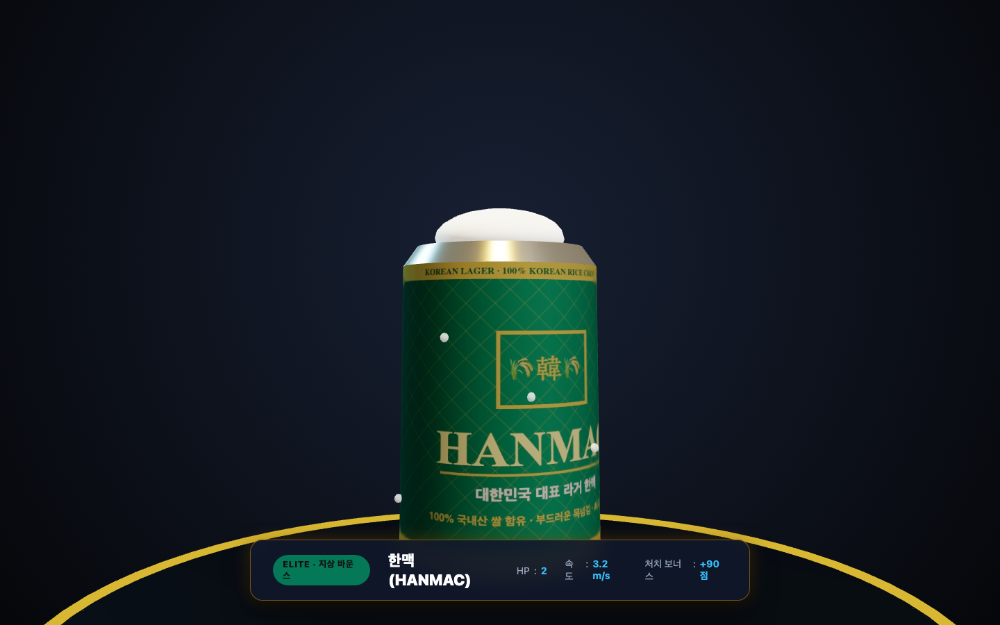
- **타입**: 지상 포격형 (Ground Artillery, 고도 `0.55m`)
- **외형**: 딥 에메랄드 그린 PBR 캔, 100% 국산 쌀 황금 벼 이삭 크레스트 쉴드, 韓 모노그램, 골드 테두리
- **특징**: 3HP의 단단한 엘리트입니다. **11m에서 멈춰 서서 4초마다 자기 위치에서 거품 투사체를 발사**합니다(기절하면 쏘지 않음). 방어선을 넘지 않으므로 투사체를 요격하거나 먼저 처치하세요. (이전의 "맞으면 분노 가속"은 없어졌습니다.)

#### 5. 카스 프레시 500ml 병맥주 (Cass Fresh Bottle) — *분열하는 탱커*
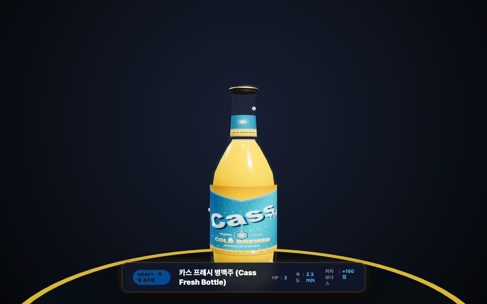
- **타입**: 지상 대형 탱커 (Ground Heavy, 고도 `0.55m`, 모델 1.2배)
- **외형**: 정품 500ml 투명병 실사 PNG 빌보드, 은색 크라운 캡, V-컷 CASS FRESH 블루 라벨
- **특징**: 4HP의 단단한 병맥주입니다. **깨지는 순간 작은 병 2마리(체력 1, 더 빠른 2.2 m/s)로 양옆에 분열**해 달려오며, 작은 병은 다시 나뉘지 않습니다. 작은 병까지 잡아야 웨이브가 끝납니다. 큰 병은 유리 파편과 맥주 방울이 튀며 "뻥!" 소리가 납니다.

#### 6. 업소용 생맥주 냉각기 보스 (Boss Dispenser) — *3·5·7웨이브 보스전*
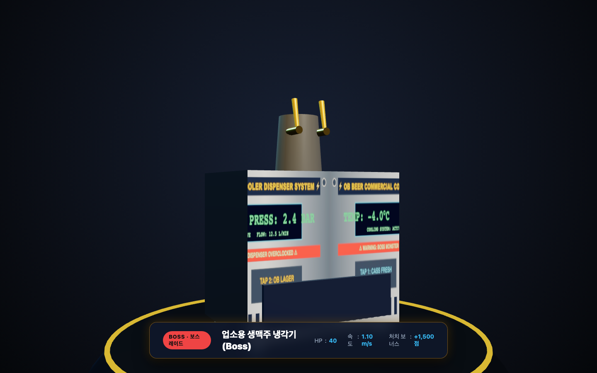

- **타입**: 지상 캐비닛 보스 (Ground Boss, 고도 `1.15m`, 1.65배 거대 스케일)
- **외형**: 브러시드 스테인리스 헤어라인 전면 패널, 그린 디지털 LED(-4.0°C / 2.4 BAR), 크롬 드래프트 타워, 듀얼 골드 탭 추출구 및 오렌지 레버, 하단 4개 캐스터 휠
- **보스전 구성**: 미니웨이브를 처치하면 `⚠️ 보스 등장!` 경고와 함께 등장합니다.
  | 웨이브 | 구성 | 체력 | 소환 부하 |
  | :---: | :--- | :--- | :--- |
  | 3 | 냉각기 1대 | 45 | 오비, 카스 라이트, 한맥 |
  | 5 | 냉각기 2대 | 각 40 | 필굿, 오비, 한맥, 병맥주 |
  | 7 | 냉각기 2대 + **대왕 냉각기**(1.5배) | 각 50 + 대왕 120 | 5종 전부 |
- **패턴**: 방어선 앞 10m에 멈춰 **좌우로 움직입니다**(1대는 좌우 왕복, 2대는 교차). 부하 3마리를 필드 6~14m 곳곳에 위에서 떨어뜨려 소환합니다(필드 부하 7마리 미만일 때). 소환 간격은 8초에서 시작해 보스전이 길어질수록 5초까지 짧아지고, 부하는 착지까지 약 1.2초 동안 맞힐 수 없으며 착지 위치에 링이 표시됩니다(오비는 방패를 내린 채 착지). 냉각기는 번갈아 자기 위치에서 투사체를 쏩니다. **넉백에 면역**이며 판정 범위가 몬스터의 0.6배입니다.
- **피버·아이템**: 보스 몸통을 맞혀도 **피버가 차지 않습니다.** 소환 부하를 잡아야 피버가 차고 아이템 드롭률(20%)도 높습니다.
- **대왕 쉴드**: 대왕은 등장 시 **쉴드(무적)**를 두르며, **부하 6마리 처치 또는 냉각기 1대 처치**로 풀립니다. 체력이 2/3, 1/3 아래로 내려가면 쉴드가 다시 켜집니다. 쉴드에는 피버·스킬도 통하지 않습니다.
- **진행**: 중간 보스(3·5웨이브)를 모두 처치하면 보상 카드를 고르고 다음 웨이브로 넘어갑니다. 7웨이브는 냉각기 2대와 대왕을 모두 처치해야 `VICTORY`입니다.

---

## 🎁 2. 오비 펍 아이템 4종 도감 및 처치 드롭 메커니즘

웨이브 진행 중 필드 바닥에 무작위로 뜨지 않고, **적 몬스터를 격파할 때 일정 확률(기본 4% + 행운의 보급품 카드 배율 2x/3x/4x)로 처치 지점에 드롭**됩니다.  
드롭된 아이템은 머리 위(`y = +0.60m`)에 **3D 아케이드 네온 빌보드 라벨 카드(`[💥 DAMAGE 2X]`, `[🎯 WIDE 1.6X]`, `[🧊 SLOW 50%]`, `[🍺 LIFE +1]`)**를 상시 부유하고 있어, 18m 원거리에서도 0.1초 만에 어떤 아이템인지 즉각 식별할 수 있습니다!  
아이템을 사격해 맞히면, **피격된 바로 그 3D 월드 좌표에서 네온 라벨이 0.8초간 위로 솟구치며 페이드아웃**되고, 화려한 3D 실시간 비주얼 상태 효과가 즉시 발동합니다!  
*(※ 아이템은 방어선에 닿아도 목숨을 깎지 않고 자연 소멸합니다.)*

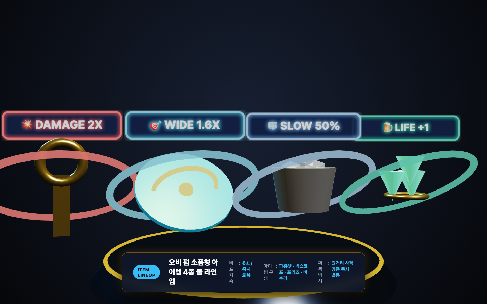

### 📋 아이템 4종 종합 스펙 요약표

| 아이콘 | 아이템 명칭 | 3D 소품 외형 | 상시 3D 네온 라벨 카드 | 실시간 3D 상태 효과 | 지속 시간 | 출현 조건 |
| :---: | :--- | :--- | :---: | :--- | :---: | :---: |
| 💥 | **파워 샷 (Power Shot)** | 황금 병따개 (Opener) | `[💥 DAMAGE 2X]` | **골든 캐논 총기 진화** & 총구 화염 오라 구체 | 8초 | 처치 드롭(웨이브 무관) |
| 🎯 | **빅 스코프 (Wide Scope)** | 맥주 코스터 (Coaster) | `[🎯 WIDE 1.6X]` | **홀로그램 사이트 빔** & 전 몬스터 상단 **록온 마커** | 8초 | 처치 드롭(웨이브 무관) |
| 🧊 | **아이스 프리즈 (Ice Freeze)** | 은색 얼음 버킷 (Ice Bucket) | `[🧊 SLOW 50%]` | 전 몬스터 **서리 결빙 틴트(`0x93c5fd`)** & 발밑 **회전 얼음 링** | 8초 | 처치 드롭(웨이브 무관) |
| 🍺 | **바 수리 (Bar Repair)** | 초록 홉 열매 (Hop Cones) | `[🍺 LIFE +1]` | 방어선 **에메랄드 치유 펄스 파동** 확산 | 즉시 | 처치 드롭(웨이브 무관) |

---

### 🛠 아이템 개별 상세 설명 및 전략 가이드

#### 1. 💥 파워 샷 (황금 병따개)
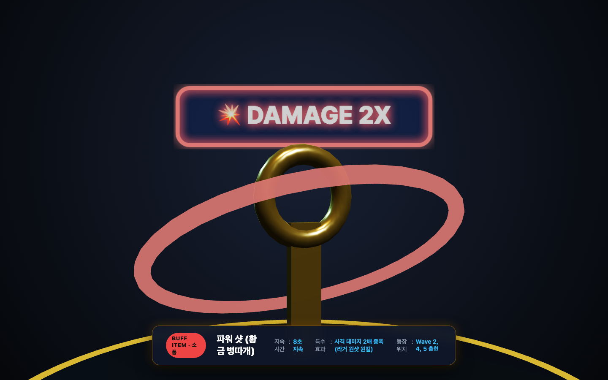
- **외형**: 번쩍이는 골드 황동 병따개 핸들과 링 헤드, 붉은색 회전 오라 링
- **발동 효과**: 8초간 3D 총기(생맥주 탭 건)가 **황금 '골든 드래프트 캐논'으로 진화**하고 총구에 붉은 화염 오라가 점등되며, 발사되는 모든 레이저 빔이 붉은색으로 강화되어 사격 데미지가 **2배(1발당 2 데미지)**로 증가합니다.
- **실전 팁**:
  - 체력 2인 오비라거와 한맥을 **단 1발로 격파(One-Shot One-Kill)**할 수 있습니다.
  - 보스전에서 피버 모드와 조합하면 보스 체력을 순식간에 줄일 수 있는 최우선 아이템입니다.

#### 2. 🎯 빅 스코프 (오비 맥주 코스터)
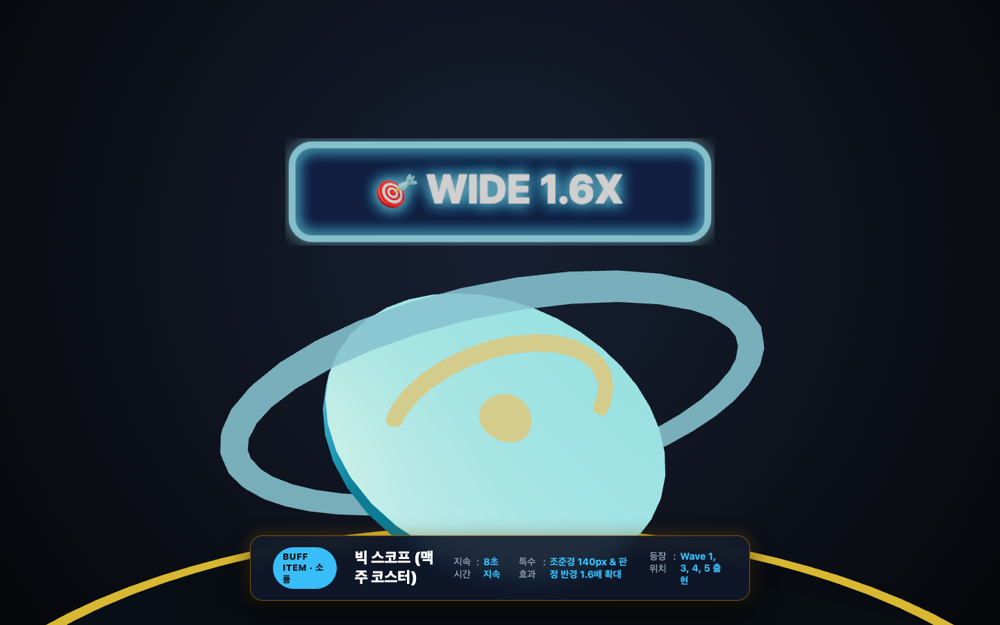
- **외형**: 원형 블루 오비 맥주 코스터에 노란색 동심원 타겟 과녁이 새겨진 디스크 소품, 하늘색 회전 오라 링
- **발동 효과**: 8초간 화면 중앙의 조준경이 **88px에서 140px로 1.6배 대형화**되며, 총구 전방에 **미래형 홀로그램 레이저 가이드 빔**이 전개되고 모든 몬스터 머리 위에 **푸른색 록온(Lock-On) 마커**가 점등되어 유효 타격 판정 면적이 1.6배 넓어집니다.
- **실전 팁**:
  - 조준이 미세하게 빗나가도 `PERFECT` 및 `GREAT` 판정을 쉽게 띄울 수 있어 피버 게이지를 순식간에 100%까지 채우는 최고의 빌드업 아이템입니다.
  - 크게 흔들리는 카스 라이트와 돌격하는 필굿 떼를 손쉽게 쓸어 담을 수 있습니다.

#### 3. 🧊 아이스 프리즈 (얼음 버킷)
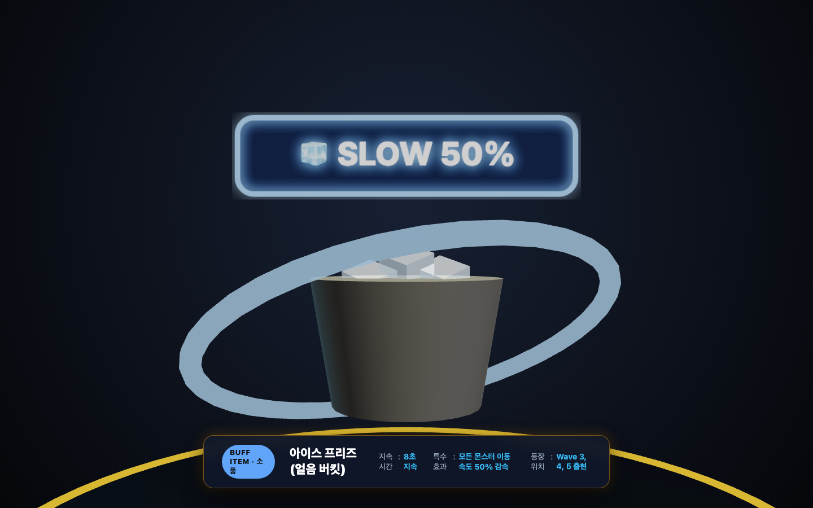
- **외형**: 은색 스테인리스 얼음 버킷 안에 차가운 각얼음 3개가 담긴 소품, 푸른 냉기 오라 링
- **발동 효과**: 8초간 무대 위의 모든 몬스터 전신에 **푸른 서리 결빙 틴트(`0x93c5fd`) 코팅**과 발밑 **회전 얼음 링**이 부여되며, 돌격 속도가 **절반(50% 감속)**으로 느려집니다.
- **실전 팁**:
  - 몬스터들이 1.8m 방어선 코앞까지 밀고 들어와 비상경보(Red Alert)가 울릴 때 시간을 벌어주는 절대적인 방어형 아이템입니다.
  - 슬로우가 걸려 있는 동안 자동 재장전(1.2s)을 안전하게 마치고 차분하게 정밀 조준을 이어갈 수 있습니다.

#### 4. 🍺 바 수리 (홉 열매 다발)
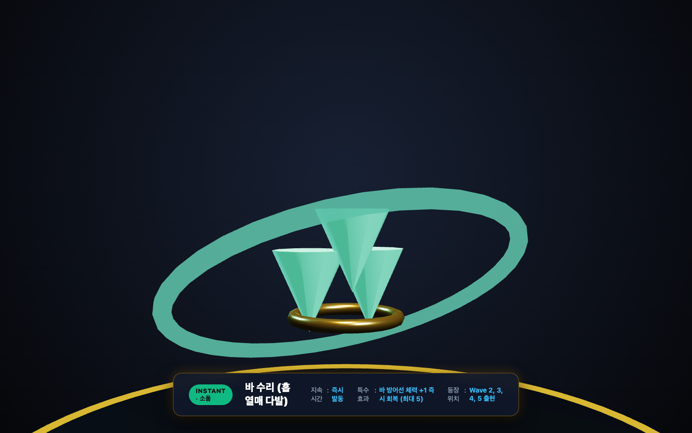
- **외형**: 싱싱한 에메랄드빛 홉 솔방울 3송이와 골드 리본 장식, 초록색 회전 오라 링
- **발동 효과**: 바닥 네온 방어선에 **에메랄드빛 치유 펄스(Green Shield Pulse) 파동**이 촤르륵 확산되며, 손상된 방어선 체력(`🍺`)을 **즉시 +1 회복**합니다. (최대 5개까지 완충 가능)
- **실전 팁**:
  - 체력이 가득 찬 상태(5/5)에서는 추가로 늘어나지 않으므로, 체력이 1~4개로 깎인 위기 상황에서 침착하게 사격하여 체력을 복구하세요.

---

## 🌊 3. 7웨이브 아케이드 구성 및 공략 가이드

7웨이브를 모두 깨고 3·5·7웨이브 보스전을 마쳐야 최종 `VICTORY`를 쟁취할 수 있습니다. 웨이브마다 일반 몬스터 속도가 4%씩 빨라지지만 체력은 오르지 않습니다. 한 판은 약 3분이 목표입니다.

### 📌 웨이브별 상세 정보 & 추천 전략

| 웨이브 | 출현 몬스터 | 총 스폰 | 최대 동시 | 스폰 간격 | 보스 | 핵심 공략 요령 |
| :---: | :--- | :---: | :---: | :---: | :--- | :--- |
| **1** | 필굿, 카스 라이트 | 20 | 5 | 0.7초 | - | 돌격하는 필굿과 흔들리는 카스 라이트로 조준 감각을 익히세요. |
| **2** | 필굿, 오비 | 26 | 6 | 0.65초 | - | 오비의 **방패 타이밍**을 읽으세요. 내려간 순간에 쏘고, 피버·스킬은 방패를 뚫습니다. |
| **3** | 오비, 카스 라이트, 한맥 | 15 | 6 | 0.7초 | **냉각기 1대** | 한맥의 포격을 요격하며 미니웨이브를 정리한 뒤 첫 보스전. |
| **4** | 필굿, 카스 라이트, 병맥주 | 34 | 6 | 0.6초 | - | 병맥주의 **분열**을 처리하세요. 22킬에 중간 카드가 나옵니다. |
| **5** | 오비, 한맥, 병맥주 | 20 | 7 | 0.6초 | **냉각기 2대** | 교차 이동하는 보스 2대. 무기 MAX가 가능한 첫 웨이브입니다. |
| **6** | 5종 전부 | 40 | 7 | 0.55초 | - | 모든 특색이 섞입니다. 26킬에 중간 카드. |
| **7** | 5종 전부(한맥·병맥주 2배 비중) | 25 | 8 | 0.6초 | **냉각기 2대 + 대왕** | 부하를 잡아 쉴드를 풀고 최종 보스전을 돌파하세요. |

## 🏆 4. 몬스터 처치 및 전장 생존 핵심 팁

1. **100% 슬림 연속 체력 게이지 바 확인**: 모든 몬스터 머리 위에 100% 비례 슬림 게이지 바가 표시됩니다. 스쳐 맞은 1HP 캔도 즉시 체력바가 나타나므로 잔여 체력을 확인하고 마무리 사격을 가하세요. 남은 체력과 기절(`⚡STUN`) / 둔화(`❄️SLOW`) 상태를 확인하고 점사하세요.
2. **🌟 황금 캔(Golden Can) 필살 저격**: 웨이브마다 1회 고속 횡단하는 황금 캔(스폰 시 코인 차임 사운드 & 골드 네온 테두리)을 격추하여 **+50점 보너스**, **스킬 1회 충전**, **피버 +30%**를 노리세요.

3. **🫧 거품/병뚜껑 투사체 요격**: 한맥과 보스가 날리는 투사체를 공중에서 요격(몬스터처럼 터지며 요격음)하여 방어선 생명(맥주잔 5개)을 보존하세요.
4. **홀드 자동 연발과 피버 활용**: 누르고 쏘는 자동 연발은 피해가 줄어드니, 정확한 탭 사격으로 PERFECT와 처치를 쌓아 피버를 채우고 4초 무한 연사로 웨이브를 돌파하세요.
4. **무기별 전술 운용**: 몬스터의 밀집도와 비행 형태에 따른 3종 무기 진화 및 스킬 공략은 [docs/무기_및_스킬_가이드.md](./무기_및_스킬_가이드.md)를 참고하세요.
