# 🍺 비어 크러셔: 로그라이크 3종 무기 & 스킬 가이드

본 문서는 **비어 크러셔 (Beer Crusher)**의 **3종 코믹 펍 무기 아키타입**, **Lv.1 ~ Lv.4(MAX) 단계별 프로시저럴 3D 에셋 외형 및 수치 밸런스**, **스마트폰 '휙!(Snap)' 가속도 제스처 기반 전용 액티브 스킬 물리 메커니즘**, 그리고 **웨이브 사격 선택(Shoot-to-Select) 보상 카드 & 전술 가이드**를 상세히 기술합니다.

---

## 1. 3종 코믹 펍 무기 아키타입 개요

플레이어는 게임 시작 시 또는 웨이브 진행 중 사격형 카드를 통해 3가지 독창적인 펍 테마 무기를 선택하고 진화시킬 수 있습니다.

```
       [생맥주 탭 베이스 머신]
              │
    ┌─────────┼─────────┐
    ▼         ▼         ▼
🪠 뚫어뻥    🍾 오프너   🍺 탄산 탭
   샷건      리볼버      개틀링
 (넓은 범위 산탄) (관통저격) (초고속연사)
```

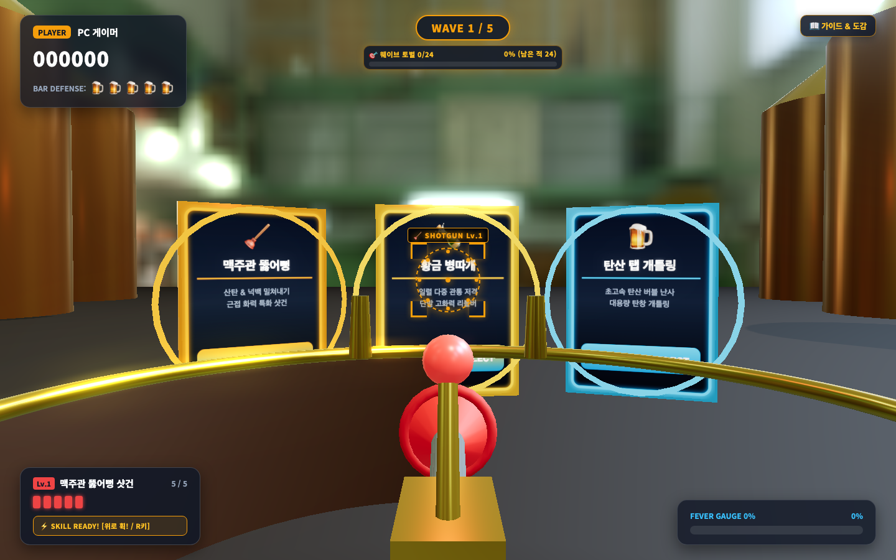
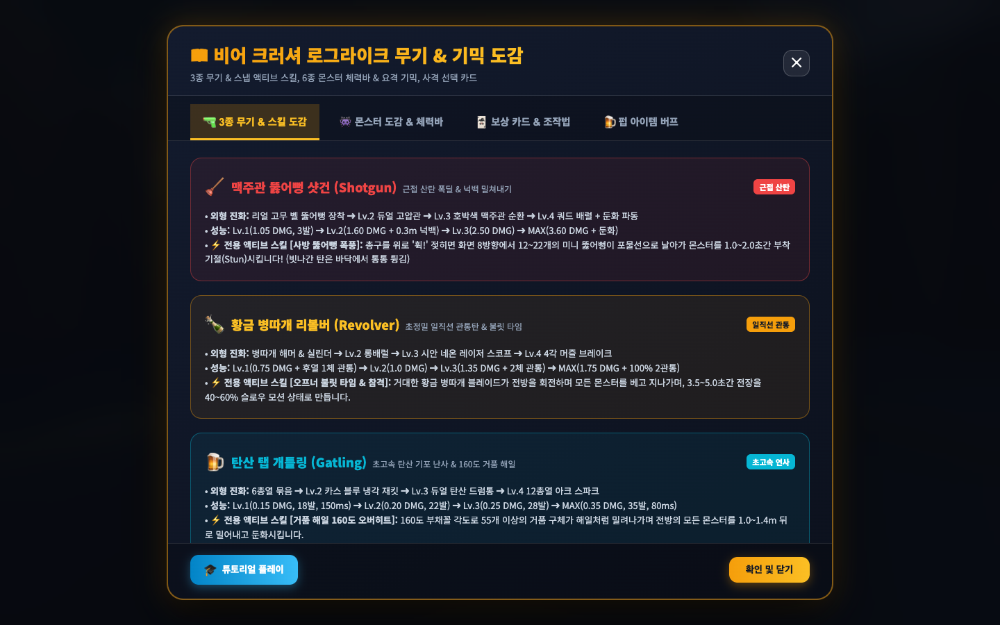

| 무기 종류 | 이름 | 컨셉 & 키워드 | 탄창 | 발사 간격 | 전용 액티브 스킬 |
| :--- | :--- | :--- | :---: | :---: | :--- |
| **`shotgun`** | **맥주관 뚫어뻥 샷건** | 넓은 명중 범위 & 한 발 강한 화력 | 14 ~ 16발 | 224 ~ 182ms | **사방 뚫어뻥 폭풍** (방어선에 가까운 몬스터에 박혀 기절 후 폭발) |
| **`revolver`** | **황금 병따개 리볼버** | 초정밀 일직선 관통 & 부채꼴 칼날 | 10 ~ 12발 | 196 ~ 147ms | **오프너 참격** (부채꼴 칼날, 관통, 포탄 베기) |
| **`gatling`** | **탄산 탭 개틀링** | 초고속 탄산 기포 난사 & 거품 파도 | 30 ~ 50발 | 105 ~ 58ms | **거품 해일** (필드 전체 밀어내기 & 둔화) |

---

## 2. 프로시저럴 3D 에셋 외형 및 단계별 진화 명세

외부 3D 파일(FBX/GLTF) 없이 Three.js 내장 지오메트리와 물리 기반 셰이딩(PBR)으로 가볍고 정교하게 절차적(Procedural) 생성됩니다.

### ① 리얼리스틱 뚫어뻥 메쉬 (`createRealisticPlungerMesh`)
- **손잡이 (Wooden Stick)**: `CylinderGeometry(0.02, 0.02, 0.55, 12)` + 원목 오크 우드 텍스처 재질 (`#c89666`, roughness: 0.7)
- **손잡이 캡**: `SphereGeometry(0.023, 10, 8)`
- **3단 고무 흡착 벨 (Rubber Suction Bell)**:
  - 상단 넥: `CylinderGeometry(0.035, 0.045, 0.08, 16)`
  - 중단 벨 돔: `CylinderGeometry(0.045, 0.14, 0.14, 18, 1, true)`
  - 하단 흡착 림 (Suction Rim): `TorusGeometry(0.135, 0.022, 12, 24)` 딥 레드 고무 재질 (`#b91c1c`, roughness: 0.6)

### ② 3종 무기 Lv.1 ~ Lv.4 (MAX) 외형 진화 명세 (`DraftTapGun3D`)

#### 1. 맥주관 뚫어뻥 샷건 (`shotgun`)
- **Lv.1**: 리얼 고무 벨 뚫어뻥이 총구에 정면 장착된 단총열 샷건.
- **Lv.2 (듀얼 고압관)**: 브론즈 재질의 상하 트윈 총열(`CylinderGeometry(0.045)`) + 고압 황동 밸브 노즐.
- **Lv.3 (호박색 맥주관)**: 총열 측면을 휘감는 투명 앰버 아크릴 맥주 호스(`TubeGeometry`) 내부에 맥주 거품 기포가 순환.
- **Lv.4 MAX (쿼드 배럴 + 둔화 링)**: 4총열 다각 배럴 클러스터 + 전방 시안 네온 에너지 초크 링 점등.

| 샷건 Lv.1 (단총열) | 샷건 Lv.2 (듀얼 고압관) | 샷건 Lv.3 (호박색 맥주관) | 샷건 Lv.4 MAX (쿼드 배럴) |
| :---: | :---: | :---: | :---: |
| 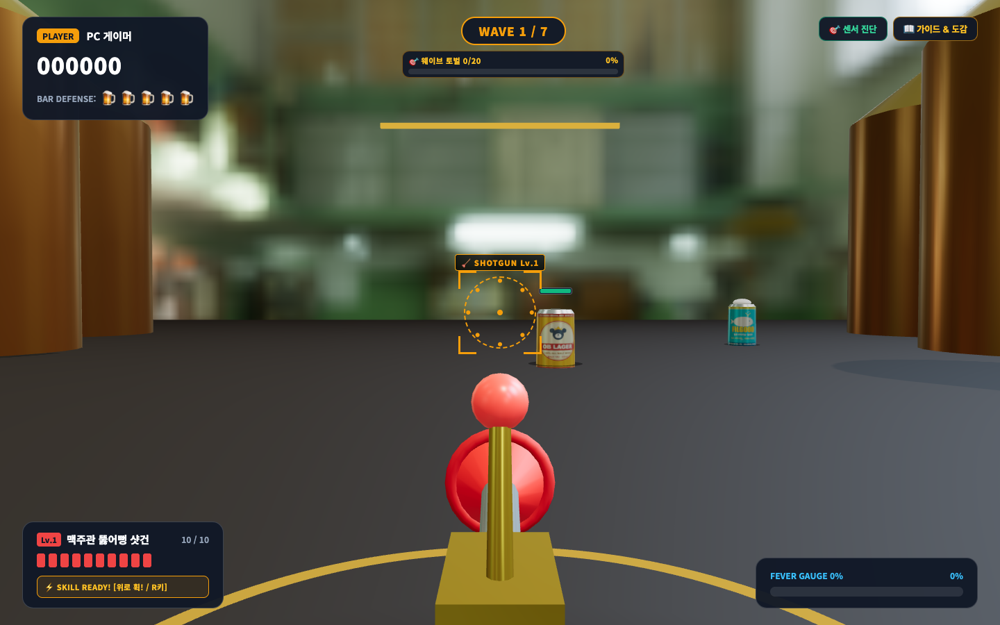 | 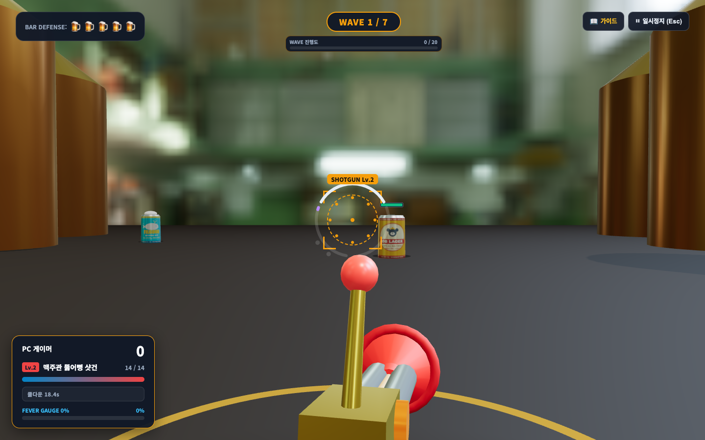 |  | 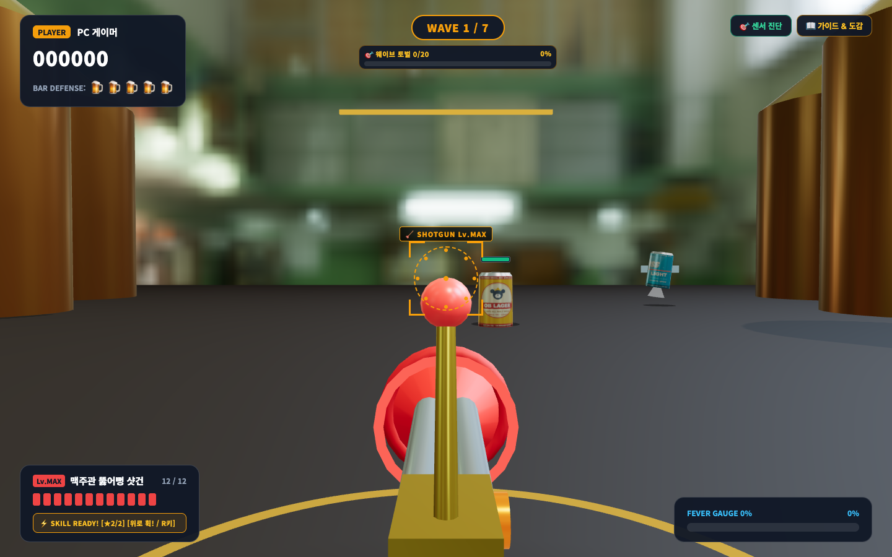 |

#### 2. 황금 병따개 리볼버 (`revolver`)
- **Lv.1**: 황금 병따개 머즐 해머 + 6구 탄창 실린더.
- **Lv.2 (헤비 롱배럴)**: 42cm 장총열 크롬 실린더 + 금박 각인 프레임.
- **Lv.3 (시안 레이저 스코프)**: 총기 상단에 시안 네온 홀로그램 스코프 링 장착 + 전방 레이저 빔 방출.
- **Lv.4 MAX (쿼드 머즐 브레이크)**: 4방향 가스 분출 포트 머즐 브레이크 + 발사 시 황금 스파크 폭발.

| 리볼버 Lv.1 (단발) | 리볼버 Lv.2 (롱배럴) | 리볼버 Lv.3 (레이저 스코프) | 리볼버 Lv.4 MAX (머즐 브레이크) |
| :---: | :---: | :---: | :---: |
| 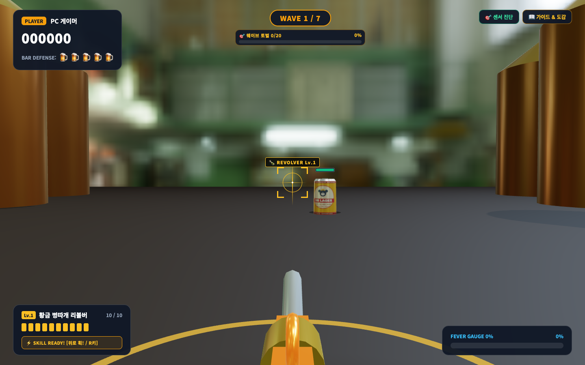 | 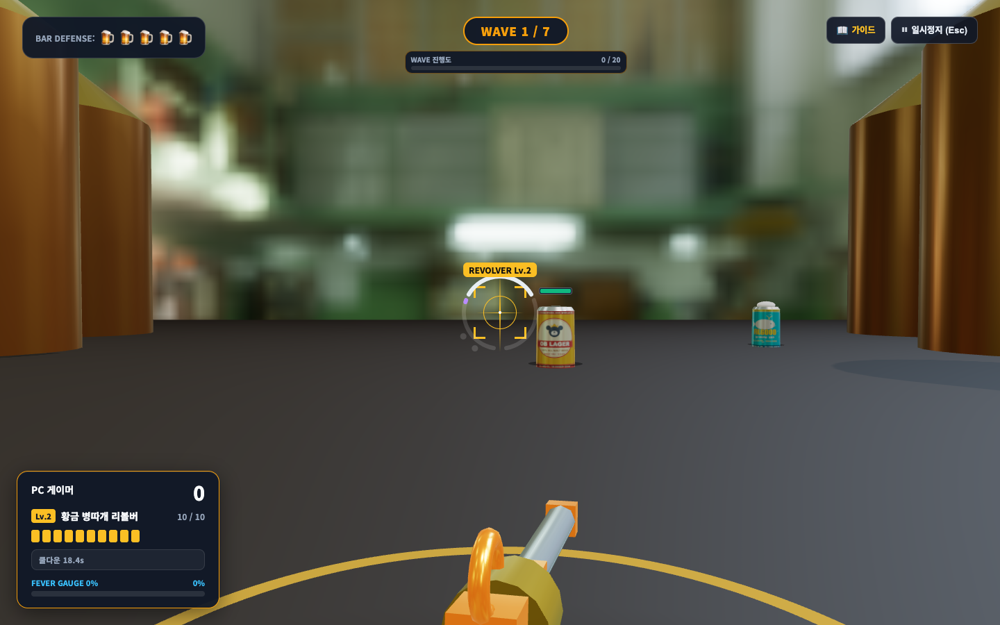 | 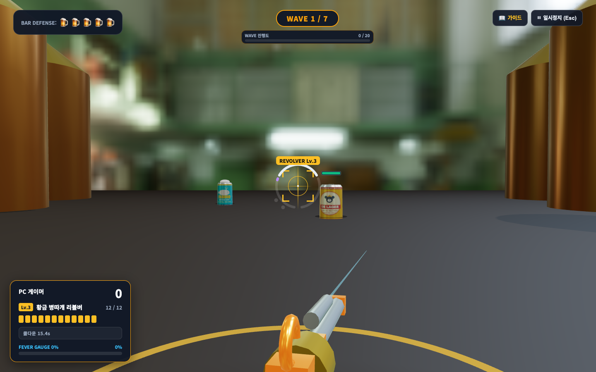 | 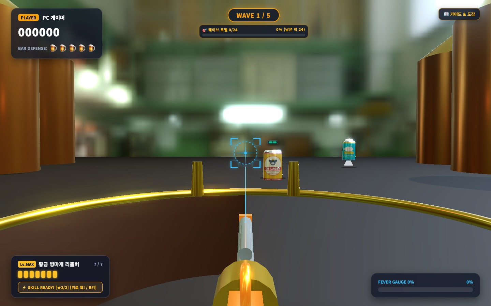 |

#### 3. 탄산 탭 개틀링 (`gatling`)
- **Lv.1**: 6각 원형으로 배치된 6총열 묶음 + 사격 및 쿨다운 시 회전 애니메이션 (`rotation.z`).
- **Lv.2 (카스 블루 쿨링 재킷)**: 카스 시안 블루 색상의 알루미늄 타공 방열 재킷 장착.
- **Lv.3 (듀얼 탄산 드럼통)**: 하단 양 측면에 대용량 카스 생맥주 드럼통 탄창 2개 장착.
- **Lv.4 MAX (12총열 아크 스파크)**: 2중 12총열 회전 클러스터 + 총구 끝단에 고압 플라즈마 탄산 스파크 점등.

| 개틀링 Lv.1 (6총열) | 개틀링 Lv.2 (블루 재킷) | 개틀링 Lv.3 (듀얼 드럼통) | 개틀링 Lv.4 MAX (12총열 아크) |
| :---: | :---: | :---: | :---: |
| 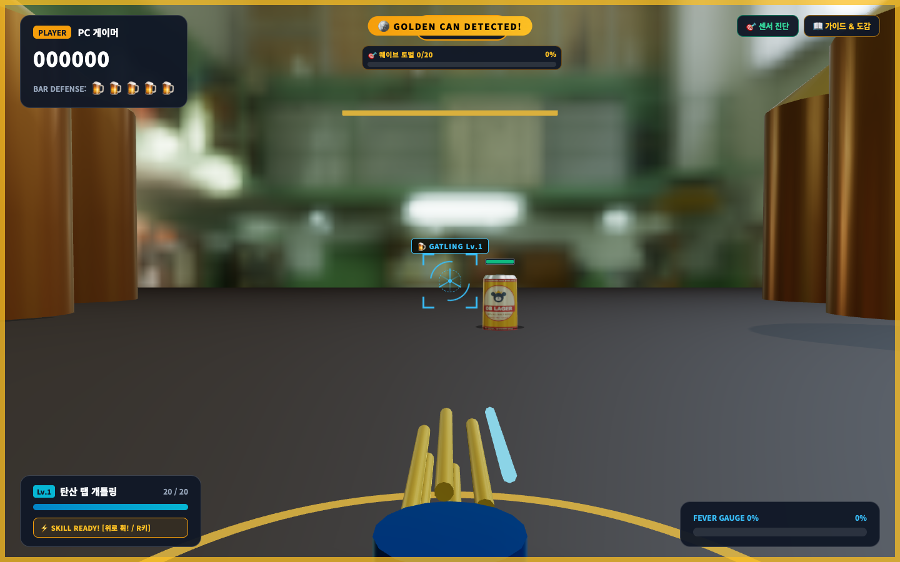 | 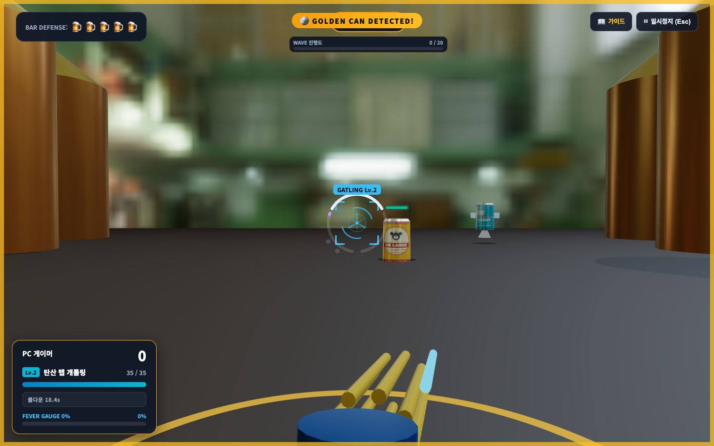 | 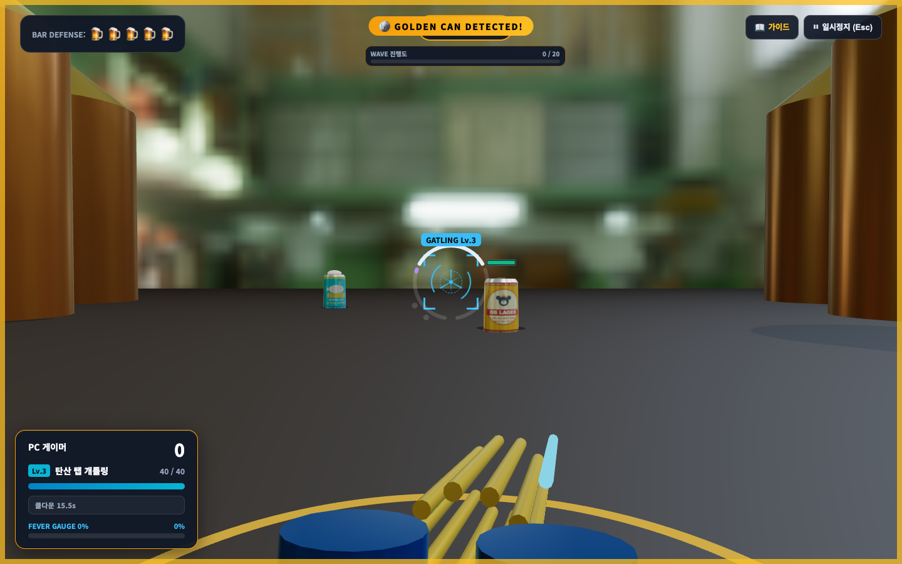 | 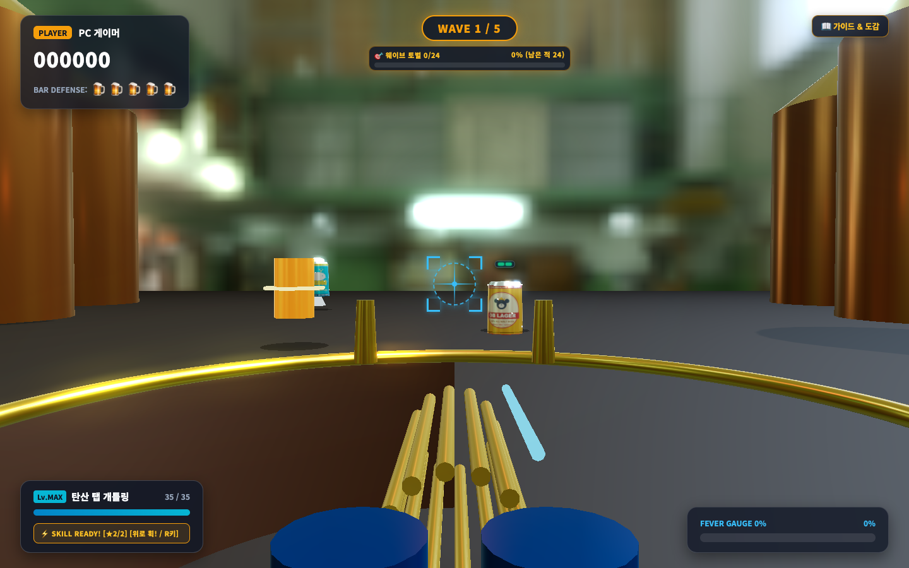 |

### ③ 2인 협동 3D 총기 배치 및 플레이어 시각 분리 (`DraftTapGun3D`)
- **1인 / 2인 총기 배치 오프셋**: 1인 플레이 시 화면 중앙(`x = 0`)에 탭 건 1자루가 배치되며, 2인 협동 플레이 시 화면 좌측(`1P: x = -0.32`)과 우측(`2P: x = +0.32`)에 각 플레이어의 탭 건이 독립 배치됩니다. 2P 총기에는 자연스러운 안쪽 조준을 위한 틸트 보정각(`GUN_YAW_COMP = 0.35`)이 적용됩니다.
- **플레이어 고유 발광 링**: 각 탭 건의 베이스 받침대 링에 플레이어 고유 색상(1P 앰버 골드 `#f59e0b`, 2P 시안 블루 `#38bdf8`)의 네온 발광 재질이 적용되어 자신의 총기를 직관적으로 식별할 수 있습니다.
- **독립 반동 및 조준 동기화**: 1P와 2P는 각자의 입력(모바일 자이로 또는 마우스)에 따라 독립적으로 조준각이 회전하고, 사격 시 개별 격발 반동 킥 애니메이션이 재생됩니다.

---

## 3. Lv.1 ~ Lv.4 (MAX) 상세 밸런스 수치표

레벨 1의 과도한 화력을 억제하고, 레벨업에 따른 성장 체감이 뚜렷하도록 설계되었습니다. 아래 수치는 기본 무기 표에 `GAME_TUNING`(`src/shared/gameTuning.ts`)을 적용한 **최종값**입니다: 연사 간격 ×0.7, 장전 ×1.2, 샷건 피해 ×1.0, 개틀링 피해 ×2, 탄창 샷건·리볼버 10/10/12/12 · 개틀링 20/25/30/35, 스킬 쿨타임 21/19/16/14초.

### 🪠 맥주관 뚫어뻥 샷건 (`shotgun`)
| 레벨 | 펠릿 수 | 펠릿당 공격력 | 총 공격력 | 넉백 | 탄창 | 장전 시간 | 연사 간격 | 스킬 쿨타임 |
| :---: | :---: | :---: | :---: | :---: | :---: | :---: | :---: | :---: |
| **Lv.1** | 3발 | 0.34 | **1.02** | - | 14발 | 1.7s | 224ms | 21s (2회 스택) |
| **Lv.2** | 4발 | 0.33 | **1.32** | 0.3m | 14발 | 1.6s | 210ms | 19s (2회 스택) |
| **Lv.3** | 5발 | 0.33 | **1.65** | 0.3m | 16발 | 1.4s | 196ms | 16s (2회 스택) |
| **Lv.4 (MAX)** | 6발 | 0.41 | **2.46** | 0.4m (+둔화) | 16발 | 1.3s | 182ms | 14s (2회 스택) |

**평타 퍼짐(추가 명중)**: 샷건 한 발은 십자선 주변 몬스터에게도 주 대상 피해의 일부를 줍니다(`GAME_TUNING.shotgunSpread`). 대상은 십자선에서 **화면 거리** 0.30(조준 좌표 단위, 1.0 = 화면 높이의 절반) 안의 가까운 순서이며 보스·방패를 올린 오비·아이템·착지 전 몬스터는 제외됩니다. 넉백·둔화는 주 대상만 받습니다.

| 레벨 | 추가 명중 마릿수 | 주 대상 피해 대비 |
| :---: | :---: | :---: |
| **Lv.1** | 2마리 | 10% |
| **Lv.2** | 2마리 | 15% |
| **Lv.3** | 3마리 | 20% |
| **Lv.4 (MAX)** | 3마리 | 25% |

> 보스는 넉백·기절·둔화에 면역입니다. 판정 범위는 `GAME_TUNING.hitZone.toleranceByWeapon`(샷건 1.40 / 리볼버 0.95 / 개틀링 1.05)에 몬스터 판정 x0.75와 화면비 보정이 곱해집니다.

### 🍾 황금 병따개 리볼버 (`revolver`)
| 레벨 | 공격력 | 관통 수 | 관통 데미지율 | 탄창 | 장전 시간 | 연사 간격 | 스킬 칼날 | 스킬 쿨타임 |
| :---: | :---: | :---: | :---: | :---: | :---: | :---: | :---: | :---: |
| **Lv.1** | **1.05** | 1마리 | 46.7% (0.49) | 10발 | 1.7s | 196ms | 3개·관통 0 | 21s (2회 스택) |
| **Lv.2** | **1.10** | 1마리 | 50.0% (0.55) | 10발 | 1.4s | 175ms | 3개·관통 1 | 19s (2회 스택) |
| **Lv.3** | **1.16** | 2마리 | 50.0% (0.58) | 12발 | 1.3s | 161ms | 5개·관통 1 | 16s (2회 스택) |
| **Lv.4 (MAX)** | **1.21** | 2마리 | **100.0% (1.21)** | 12발 | 1.2s | 147ms | 7개·관통 2 | 14s (2회 스택) |

### 🍺 탄산 탭 개틀링 (`gatling`)
| 레벨 | 발당 공격력 | 초당 발사 수 | DPS | 탄창 | 장전 시간 | 발사 간격 | 스킬 밀쳐내기 | 스킬 쿨타임 |
| :---: | :---: | :---: | :---: | :---: | :---: | :---: | :---: | :---: |
| **Lv.1** | **0.38** | 9.5발/s | **3.56** | 30발 | 1.7s | 105ms | 3m | 21s (2회 스택) |
| **Lv.2** | **0.48** | 11.4발/s | **5.47** | 35발 | 1.6s | 88ms | 3.5m | 19s (2회 스택) |
| **Lv.3** | **0.60** | 14.3발/s | **8.58** | 40발 | 1.4s | 70ms | 4m | 16s (2회 스택) |
| **Lv.4 (MAX)** | **0.75** | 17.2발/s | **12.90** | 50발 | 1.2s | 58ms | 5m | 14s (2회 스택) |

> **누르고 쏘기 규칙**: 버튼을 누른 채 쏘는 연사(`hold`)는 피해 감소 없이(2026-11-09 변경, `GAME_TUNING.fire.holdDamageByWeapon` 모든 무기 1.0) 발사 간격만 샷건·리볼버 ×0.7, 개틀링 ×0.85로 더 짧아집니다. 모바일 컨트롤러에서는 화면을 터치하는 순간 첫 발은 즉시 100% 단발 강타로 적중하며, 180ms 이상 누르고 있을 때부터 더 빠른 간격의 자동 연발로 전환됩니다. 피버 자동 발사는 탭 연사 속도로 나갑니다. 위 표의 DPS는 탭 기준입니다.

---

## 4. 스마트폰 '휙!(Snap)' 전용 액티브 스킬 물리 메커니즘

스마트폰을 위로 가볍게 '휙!' 젖히는 가속도 제스처(`detectSnapFire >= 2.2 m/s²`) 시, 화면 터치 조작 없이도 즉시 전용 필살기가 발동됩니다. (PC는 마우스 우클릭)

### ① 샷건: [사방 뚫어뻥 폭풍] (박힘 → 기절 → 폭발)
- **규칙(2026-11-09 개편, `GAME_TUNING.skills.plunger`)**: 방어선(바)에 가까운 일반 몬스터부터 **Lv.1~MAX 최대 4 / 5 / 6 / 8마리**에 뚫어뻥이 박힙니다(이미 박힌 몬스터는 제외). 박힌 몬스터는 **2.0 / 2.2 / 2.5 / 3.0초** 기절하고, 기절이 끝나는 순간 터져 **0.7 / 0.8 / 0.9 / 1.0** 피해를 **박힌 몬스터 자신에게만** 줍니다(박히는 순간의 즉시 피해는 없음). 기절 중 평타로 잡으면 폭발 피해 없이 폭발 연출만 나옵니다. **보스**는 박히지 않고 **4 / 5 / 6 / 6** 피해를 즉시 받습니다. 폭발 피해에는 공격력 강화 카드가 시전 시점에 반영되고, 킬 점수는 스킬을 쓴 플레이어 몫입니다.
- **물리 궤적**: 화면 외곽 8방향(`x: ±5.2`, `y: 1.2~4.2`, `z: 1.0`)에서 12~22개의 3D 뚫어뻥이 중력 가속도를 받으며 포물선 비행(박힌 몬스터와 보스 쪽으로만 날아감).
- **D10 물리 명세**:
  - **몬스터 적중 시**: 몬스터 바디에 찰싹 달라붙어 `Math.sin(age * 45) * 0.14`로 부르르 떨리며 기절(Stun).
  - **빗나간 탄 (안전 물리)**: 절대로 플레이어 카메라 시야(z = 1~2)를 가리지 않고, 원경 펍 바닥(`y = -1.15`)에 도달하여 탄성 바운스(`vy = Math.abs(vy) * 0.42`) 후 회전 낙하 소멸.

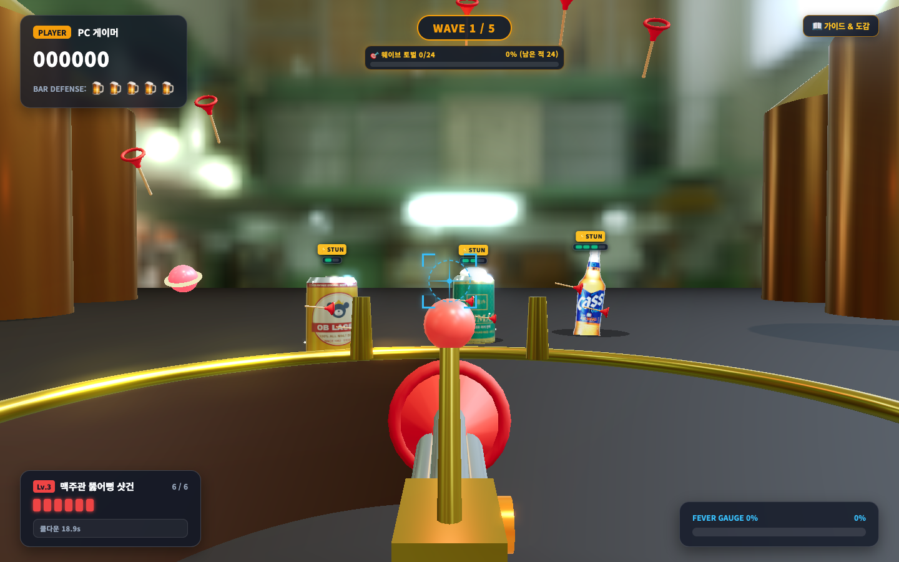
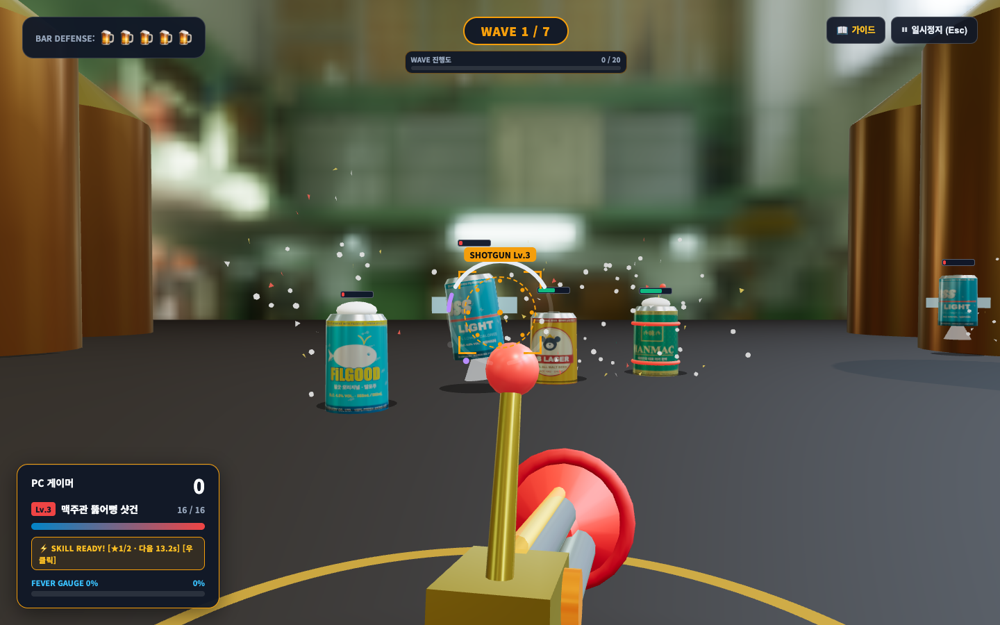

### ② 리볼버: [오프너 참격] (부채꼴 칼날)
- **물리 궤적**: 세로로 세운 황금 초승달 칼날이 총구 앞에서 출발해 부채꼴로 곧게 날아가 필드 끝까지 지나갑니다. 칼날 수는 레벨마다 3 / 3 / 5 / 7개입니다.
- **효과**: 칼날이 몬스터에 닿는 순간 피해가 들어갑니다(칼날 하나의 피해는 평타 한 발과 같습니다). 칼날은 레벨에 따라 0 / 1 / 1 / 2마리를 더 관통하고, 날아오는 포탄을 벱니다. 평타 관통과는 별개입니다.

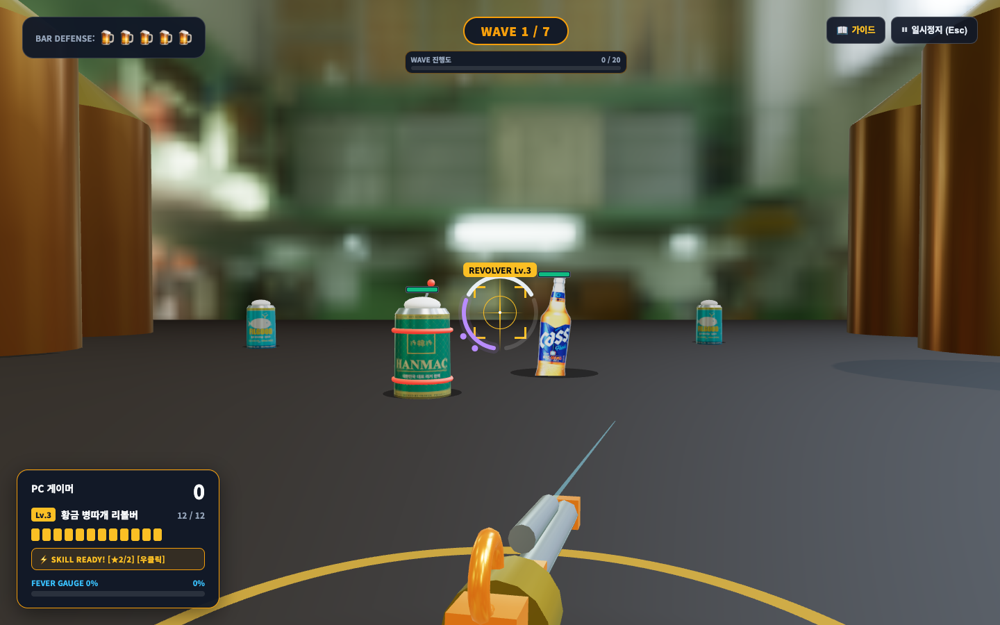

### ③ 개틀링: [거품 해일] (탄산 파도)
- **물리 궤적**: 작은 거품 수백 개가 필드 전체로 퍼지며 파도처럼 쓸고 나갑니다. 레벨이 오를수록 거품이 많아집니다.
- **효과**: 파도 앞면이 닿는 순간 몬스터를 3 / 3.5 / 4 / 5m 뒤로 미끄러뜨리고 둔화시킵니다. 밀어내기 전용이라 피해는 낮습니다. 보스는 피해만 받습니다.

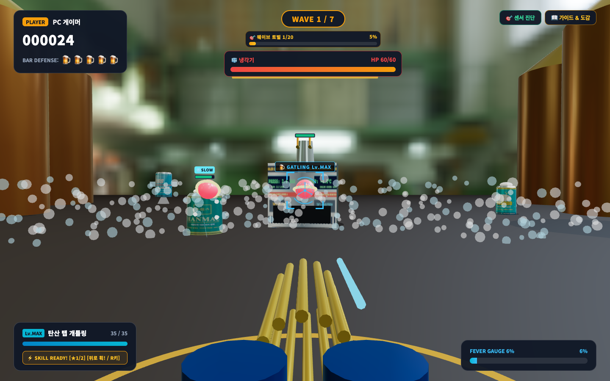


### ④ 2회 스택 시스템 (모든 무기 레벨)
- 무기 레벨과 상관없이 스킬을 **최대 2회(`[★][★]`)**까지 모아 둘 수 있습니다. 쿨다운이 지날 때마다 한 번씩 충전됩니다. 무기를 고르는 순간에는 **0회로 시작**하고, 첫 충전은 쿨다운(Lv.1 기준 21초) 뒤에 도착합니다.
- 위급 상황 시 '휙!' 제스처를 연속으로 2회 발동하여 기절 4초 또는 거품 해일 2연타를 구사할 수 있습니다.

---

## 5. 사격 선택(Shoot-to-Select) 보상 카드 및 전장 기믹

### ① 사격 선택 카드 9종 & 전장 일시정지 (Combat Freeze)
**웨이브를 클리어할 때**(3·5웨이브는 보스를 처치한 뒤), 그리고 **4·6웨이브 진행도 절반**(처치 수가 웨이브 몬스터 수의 절반에 닿을 때 한 번)에 전장의 모든 몬스터와 투사체가 즉시 정지(Combat Freeze)되며 펍 공간 중앙에 3장의 대형 3D 홀로그램 카드가 소환됩니다. 카드는 **9종 중 중복 없이 무작위 3장**이고(무기 카드도 다른 카드와 같은 확률), 이미 최대치인 카드는 풀에서 빠집니다. 한 판에 8장(1~6웨이브 클리어마다 한 번, 4·6웨이브 중간 카드)이 나옵니다. 원하는 카드에 조준선을 두고 사격하여 획득합니다.

- **3D 카드 대형화 & 가독성 최적화**: 높이 **`1.48m`** (`hitRadiusM: 1.75m`), 크기 **`1.80m × 2.40m`**로 대형화되었으며, 카드 앞면의 시야 방해 링을 제거하여 한글 설명이 1인칭 총기에 가려지지 않고 선명하게 읽힙니다. 카드 판정은 몬스터 판정 축소(x0.75)의 영향을 받지 않습니다.
- **새로 누른 입력만 인정 + 0.8초 입력 잠금 (Anti-Misclick)**: 카드가 뜰 때 누르고 있던 버튼의 연사(`hold`)나 피버 자동 발사(`fever`)는 카드를 고르지 못합니다. 버튼을 뗐다가 새로 누른 한 발만 카드를 고르며, 카드 스폰 직후 800ms 동안은 그 한 발도 무시됩니다. 카드 밖을 쏘면 탄약을 쓰지 않습니다.
- **전체 시간 정지 및 스킬 안전 잠금**: 카드를 고르는 동안 피버 남은 시간, 아이템 버프, 스킬 쿨다운, 재장전, 스폰·소환 타이머, 몬스터 기절·둔화가 모두 멈추고 선택 후 이어서 흐릅니다. 이 시간에는 마우스 우클릭 및 폰 '휙!' 스킬과 피버 발동이 완전히 막히며, 카드를 선택하고 전장으로 복귀한 직후 **0.3초(300ms) 동안 스킬 안전 잠금(Skill Lock)**이 작동하여 카드 사격 직후의 의도치 않은 스킬 오발을 방지합니다. 카운트다운 중에도 스킬은 발동되지 않습니다.
- **무기 레벨 상한**: 1웨이브 Lv.2 → 2~4웨이브 Lv.3 → 5웨이브부터 MAX(Lv.4). 무기 MAX면 무기 카드는 나오지 않습니다.


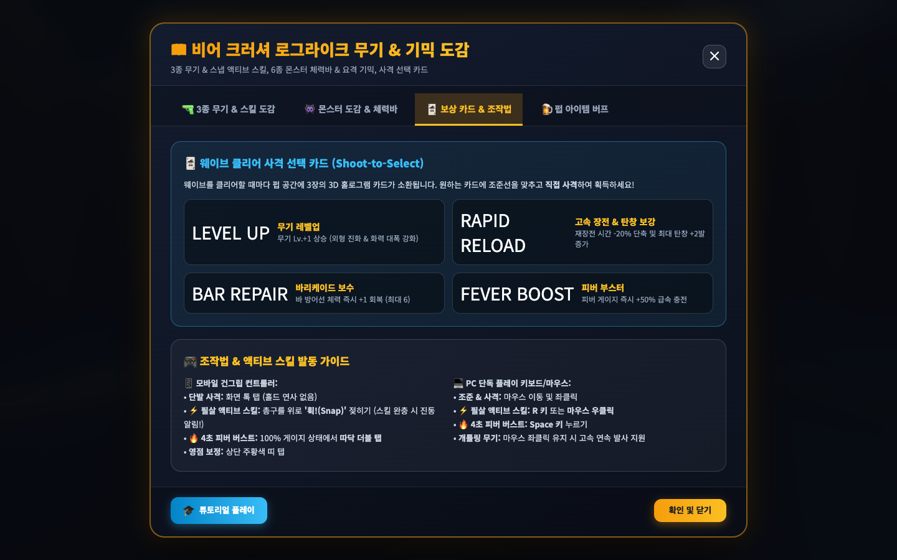

| # | 카드 | 효과 | 등장 조건 |
| :---: | :--- | :--- | :--- |
| 1 | **무기 레벨업 (Weapon Level Up)** | 현재 무기 레벨 +1 (화력 증폭 및 3D 외형 진화) | 무기 Lv.4 미만이고 웨이브 상한 미만 |
| 2 | **초고속 장전 (Rapid Reload)** | 재장전 시간 -20% & 최대 탄창 +2발 | 최대 3회 |
| 3 | **바리케이드 수리 (Bar Repair)** | 방어선 체력 **+2** 회복 (최대 체력은 늘지 않음) | 체력이 가득 차지 않음 |
| 4 | **피버 부스터 (Fever Booster)** | 피버 게이지 **+50%** 충전 | 피버가 차지 않았고 발동 중이 아님 |
| 5 | **행운의 보급품 (Lucky Drop)** | 아이템 드롭 확률 배율 +1 (최대 4배) | 최대 3회 |
| 6 | **공격력 강화 (Damage Up)** | 사격·스킬 피해 +10% | 최대 3회 |
| 7 | **스킬 가속 (Skill Haste)** | 스킬 쿨다운 -10% (곱연산) | 최대 3회 |
| 8 | **피버 연장 (Fever Extend)** | 피버 지속시간 +0.5초 | 최대 3회 |
| 9 | **조준 보정 (Aim Assist)** | 몬스터 명중 판정 범위 +5% | 최대 2회 |

### ② 모바일·PC 공통 홀드 자동 연발 (Hold Auto-Fire) — 단, 피해 감소
- **모바일 화면 꾸욱 터치 (180ms)**: 화면을 톡 탭하면 1발 단발 사격이 즉시 나가고, 손가락을 180ms 이상 누르고 있으면 무기별 발사 템포(58ms~224ms)에 맞춰 **'투두두두' 자동 연발**이 실행됩니다. 누르고 쏘는 연사도 피해 감소는 없습니다(위 누르고 쏘기 규칙).
- **PC 마우스 좌클릭 홀드**: 마우스 좌클릭을 유지하고 있으면 모든 무기가 고유 간격으로 자동 연발됩니다. 판정 범위가 좁아 화면을 훑는 난사로는 클리어하기 어렵고, 정확히 맞힌 탭 사격이 더 강합니다.

### ③ 명중 정밀도 데미지 배율
- **PERFECT (오차 25% 이내)**: **2.0배 데미지** 폭딜 (+15 PTS & 피버 +2% 충전).
- **GREAT (오차 55% 이내)**: **1.0배 정타 데미지** (+10 PTS) — 샷건·리볼버는 1레벨에서 기본 캔(1HP) 원샷 제압.
- **GOOD (오차 100% 이내)**: **0.5배 스침 데미지** (+5 PTS) — 스쳐 살아남은 캔은 머리 위에 100% 슬림 체력바가 즉시 표시됩니다.
- **웨이브 시간 보너스**: 웨이브마다 정해진 기준 시간 안에 끝내면 웨이브당 최대 700점(보스 웨이브는 2,800점)을 받고, 기준 시간의 1.6배에서 0점이 될 때까지 선형으로 줄어듭니다. 카드 선택·일시정지 시간은 제외되며, 웨이브를 깰 때마다 클리어 시간과 보너스가 표시됩니다. 보스를 살려 두고 부하만 잡으며 시간을 끌면 시간 보너스가 줄어듭니다.
- **저레벨 클리어 보너스**: 클리어할 때 무기 레벨이 낮을수록 기본 점수에 배율이 붙습니다(Lv.1 ×1.2, Lv.2 ×1.1, Lv.3 ×1.05, MAX ×1.0). 패배한 판에는 없습니다.
- **정밀도 보너스**: 클리어하면 한 판의 판정 비율(PERFECT 100% · GREAT 50% · GOOD 20% 가중, MISS 포함)의 제곱에 12,000점을 곱한 보너스가 한 번 더해집니다.
- **MISS**: 콤보·점수 페널티는 없지만, 빗나간 탄약과 **긴 장전(기본의 1.2배)**이 손해입니다. 피버는 PERFECT +2%, 처치 +4%로 천천히 차오릅니다.

### ④ 특수 전장 기믹 및 감각 피드백
- **🌟 황금 캔 (Golden Can)**:
  - 매 웨이브마다 1회 원경(`z: -12.0 ~ -15.0`)을 고속 횡단.
  - **스폰 즉각 감지 알림**: 출현 순간 맑은 코인 차임 사운드(`playGoldenCanChime`, 1318Hz ➔ 1661Hz)와 함께 PC 화면 테두리에 황금빛 네온 테두리 알림이 점등되어 시야가 좁아진 플레이어도 놓치지 않고 포착할 수 있습니다.
  - 격추 성공 시 **+50점 보너스**와 **스킬 1회 충전, 피버 게이지 +30%**를 받습니다(피버를 한 번에 채우지는 않습니다).
- **💩 똥 투사체 요격 (Interception)**:
  - 보스가 플레이어 방어선을 향해 날리는 갈색 똥 투사체(발사 순간 갈색 분출이 나오고, 아이템과 달리 빛나지 않습니다)가 바닥을 따라 다가올 때 사격하여 격추할 수 있습니다.
  - 요격 성공 시 투사체가 몬스터처럼 파티클과 함께 터지고 요격 전용 SFX가 재생됩니다(별도 배너 없음). 점수는 그대로 오릅니다.
- **🔥 4초 피버 (무제한 탄창 & 명중 점수 1.5배)**:
  - 피버 발동 즉시 현재 잔탄 수(0발)나 재장전 딜레이를 무시하고 **즉시 탄창이 100% 강제 리필**되며 `isReloading = false`로 즉시 난사가 개시됩니다.
  - 4초간 무한 탄창으로 자동 연사합니다. 연사 속도·피해는 평소 탭 사격과 같고(누르고 쏘기 감소 없음) 명중은 모두 GREAT 판정이며, 점수만 1.5배가 됩니다. 오비의 방패는 뚫지 못합니다.
- **📱 스냅 제스처 350ms 에임 프리즈 (손목 반동 흡수)**:
  - 스마트폰을 위로 '휙!' 튕길 때 물리적 손목 반동으로 인해 에임이 모니터 천장으로 튀는 현상을 막기 위해, 시전 순간 350ms 동안 에임을 모니터 정면에 견고하게 고정하여 총알 낭비를 방지합니다.

---

## 6. 무기별 전용 조준경(Crosshair) & 히트 판정 1:1 동기화

각 무기 아키타입의 고유한 탄착군 형태와 플레이 감각에 맞춰 전용 조준경 HUD를 렌더링하고, 화면에 보이는 조준경 영역과 `BeerCrusherEngine`의 실제 피격(Hit) 판정 범위를 1:1로 일치시켰습니다.

| 무기 종류 | 조준경 형태 & 크기 | 컬러 테마 | 킥 애니메이션 | 판정 허용 배율 | 조준 및 전투 특징 |
| :--- | :--- | :--- | :--- | :---: | :--- |
| **🪠 맥주관 뚫어뻥 샷건** | 120px 대형 펠릿 링 + 8방향 분산 도트 + 옥타곤 브래킷 | 앰버 오렌지 (`#f59e0b`) | 사격 시 **1.32배** 팽창 | **1.55배** | 120px 조준경 원 안에 몬스터 몸통이 조금이라도 걸치면 100% 명중 판정 (억울한 MISS 원천 제거) |
| **🍾 황금 병따개 리볼버** | 76px 초정밀 스나이퍼 십자선 + 3px 핀포인트 도트 + 상하 수직 관통선 | 럭셔리 골드 (`#fbbf24`) | 순간 조임 후 복귀 (스나이퍼 리코일) | **0.95배** (수직 **0.70배**) | 중심 조준 시 치명타를 주며, 수직 관통 가이드라인을 따라 상하 일렬로 선 적을 꿰뚫는 관통 손맛 보장 |
| **🍺 탄산 탭 개틀링** | 88px 3각 톱니 터빈 레티클 + 중앙 44px 스프레드 서클 | 일렉트릭 시안 (`#38bdf8`) | 사격 시 **초고속 스핀 회전** | **1.25배** | 고속 연사 중 발생하는 스프레드 영역을 모두 커버하여 연타 시 콤보 누실 방지 |

> 💡 **레벨별 시각 진화 & 피버 테마**:
> - 무기 레벨이 상승할 때마다 조준경 상단에 `🪠 SHOTGUN Lv.1` ~ `Lv.MAX` 뱃지가 실시간 표시됩니다.
> - 피버 버스트 발동 시 모든 조준경이 찬란한 **골드 네온 테마**로 변환되며, 상단에 `🔥 FEVER UNLIMITED` 뱃지가 점등되고 0.25초 단위로 초고속 스핀 회전합니다.
> - **2인 협동 조준선 및 판정 팝업 분리**: 1P 조준경은 앰버 골드(`1P`), 2P 조준경은 시안 블루(`2P`) 뱃지와 고유 테마 컬러로 렌더링되며, 사격 시 발생하는 판정 팝업(PERFECT/GREAT/GOOD/MISS) 및 탄도 궤적 파티클 역시 각 플레이어의 색상으로 명확히 구분됩니다.
