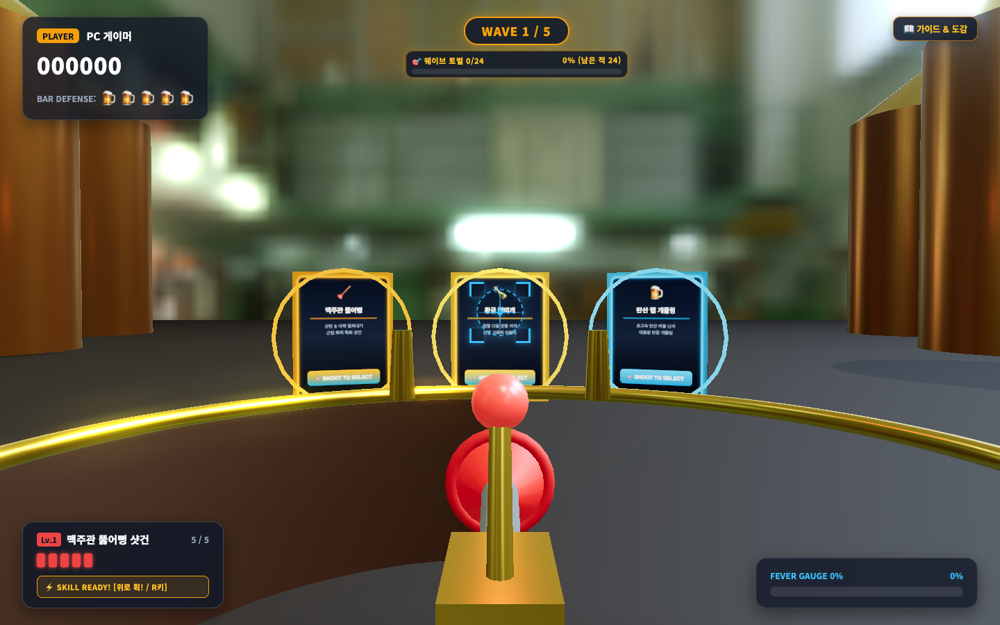
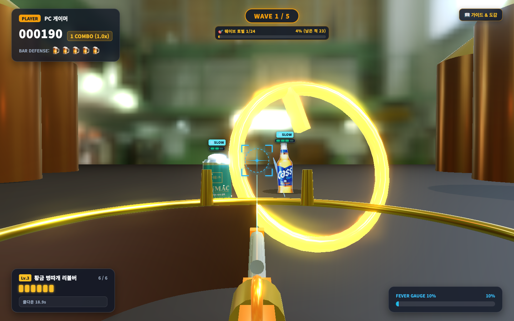
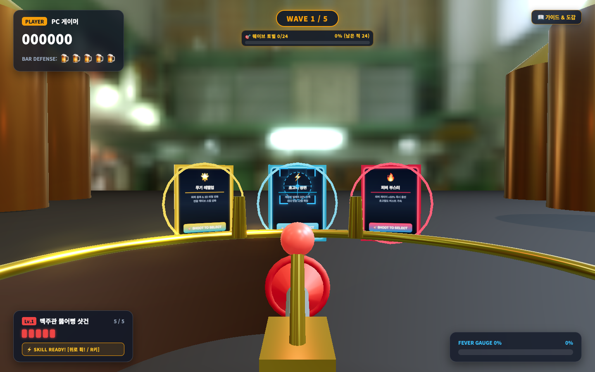

# 🍺 비어 크러셔: 로그라이크 3종 무기 & 스킬 가이드

본 문서는 **비어 크러셔 (Beer Crusher)**의 **3종 코믹 펍 무기 아키타입**, **Lv.1 ~ Lv.4(MAX) 단계별 프로시저럴 3D 에셋 외형 및 수치 밸런스**, **스마트폰 '휙!(Snap)' 가속도 제스처 기반 전용 액티브 스킬 물리 메커니즘**, 그리고 **웨이브 사격 선택(Shoot-to-Select) 보상 카드 & 전술 가이드**를 상세히 기술합니다.

---

## 1. 3종 코믹 펍 무기 아키타입 개요

플레이어는 게임 시작 시 또는 웨이브 진행 중 사격형 카드를 통해 3가지 독창적인 펍 테마 무기를 선택하고 진화시킬 수 있습니다.

```
       [생맥주 탭 베이스 머신]
              │
    ┌─────────┼─────────┐
    ▼         ▼         ▼
🪠 뚫어뻥    🍾 오프너   🍺 탄산 탭
   샷건      리볼버      개틀링
 (근접산탄) (관통저격) (초고속연사)
```




| 무기 종류 | 이름 | 컨셉 & 키워드 | 탄창 | 발사 간격 | 전용 액티브 스킬 |
| :--- | :--- | :--- | :---: | :---: | :--- |
| **`shotgun`** | **맥주관 뚫어뻥 샷건** | 근접 산탄 폭딜 & 넉백 밀쳐내기 | 5 ~ 7발 | 320 ~ 260ms | **사방 뚫어뻥 폭풍** (8방향 포물선 기절 폭격) |
| **`revolver`** | **황금 병따개 리볼버** | 초정밀 일직선 관통 & 불릿 타임 | 5 ~ 7발 | 280 ~ 210ms | **오프너 불릿 타임 & 참격** (대형 칼날 & 60% 슬로우) |
| **`gatling`** | **탄산 탭 개틀링** | 초고속 탄산 기포 난사 & 거품 파도 | 18 ~ 35발 | 150 ~ 80ms | **거품 해일 160도 오버히트** (광역 밀쳐내기 & 둔화) |

---

## 2. 프로시저럴 3D 에셋 외형 및 단계별 진화 명세

외부 3D 파일(FBX/GLTF) 없이 Three.js 내장 지오메트리와 물리 기반 셰이딩(PBR)으로 가볍고 정교하게 절차적(Procedural) 생성됩니다.

### ① 리얼리스틱 뚫어뻥 메쉬 (`createRealisticPlungerMesh`)
- **손잡이 (Wooden Stick)**: `CylinderGeometry(0.02, 0.02, 0.55, 12)` + 원목 오크 우드 텍스처 재질 (`#c89666`, roughness: 0.7)
- **손잡이 캡**: `SphereGeometry(0.023, 10, 8)`
- **3단 고무 흡착 벨 (Rubber Suction Bell)**:
  - 상단 넥: `CylinderGeometry(0.035, 0.045, 0.08, 16)`
  - 중단 벨 돔: `CylinderGeometry(0.045, 0.14, 0.14, 18, 1, true)`
  - 하단 흡착 림 (Suction Rim): `TorusGeometry(0.135, 0.022, 12, 24)` 딥 레드 고무 재질 (`#b91c1c`, roughness: 0.6)

### ② 3종 무기 Lv.1 ~ Lv.4 (MAX) 외형 진화 명세 (`DraftTapGun3D`)

#### 1. 맥주관 뚫어뻥 샷건 (`shotgun`)
- **Lv.1**: 리얼 고무 벨 뚫어뻥이 총구에 정면 장착된 단총열 샷건.
- **Lv.2 (듀얼 고압관)**: 브론즈 재질의 상하 트윈 총열(`CylinderGeometry(0.045)`) + 고압 황동 밸브 노즐.
- **Lv.3 (호박색 맥주관)**: 총열 측면을 휘감는 투명 앰버 아크릴 맥주 호스(`TubeGeometry`) 내부에 맥주 거품 기포가 순환.
- **Lv.4 MAX (쿼드 배럴 + 둔화 링)**: 4총열 다각 배럴 클러스터 + 전방 시안 네온 에너지 초크 링 점등.

| 샷건 Lv.1 (단총열) | 샷건 Lv.2 (듀얼 고압관) | 샷건 Lv.3 (호박색 맥주관) | 샷건 Lv.4 MAX (쿼드 배럴) |
| :---: | :---: | :---: | :---: |
|  |  |  |  |

#### 2. 황금 병따개 리볼버 (`revolver`)
- **Lv.1**: 황금 병따개 머즐 해머 + 6구 탄창 실린더.
- **Lv.2 (헤비 롱배럴)**: 42cm 장총열 크롬 실린더 + 금박 각인 프레임.
- **Lv.3 (시안 레이저 스코프)**: 총기 상단에 시안 네온 홀로그램 스코프 링 장착 + 전방 레이저 빔 방출.
- **Lv.4 MAX (쿼드 머즐 브레이크)**: 4방향 가스 분출 포트 머즐 브레이크 + 발사 시 황금 스파크 폭발.

| 리볼버 Lv.1 (단발) | 리볼버 Lv.2 (롱배럴) | 리볼버 Lv.3 (레이저 스코프) | 리볼버 Lv.4 MAX (머즐 브레이크) |
| :---: | :---: | :---: | :---: |
|  |  |  |  |

#### 3. 탄산 탭 개틀링 (`gatling`)
- **Lv.1**: 6각 원형으로 배치된 6총열 묶음 + 사격 및 쿨다운 시 회전 애니메이션 (`rotation.z`).
- **Lv.2 (카스 블루 쿨링 재킷)**: 카스 시안 블루 색상의 알루미늄 타공 방열 재킷 장착.
- **Lv.3 (듀얼 탄산 드럼통)**: 하단 양 측면에 대용량 카스 생맥주 드럼통 탄창 2개 장착.
- **Lv.4 MAX (12총열 아크 스파크)**: 2중 12총열 회전 클러스터 + 총구 끝단에 고압 플라즈마 탄산 스파크 점등.

| 개틀링 Lv.1 (6총열) | 개틀링 Lv.2 (블루 재킷) | 개틀링 Lv.3 (듀얼 드럼통) | 개틀링 Lv.4 MAX (12총열 아크) |
| :---: | :---: | :---: | :---: |
|  |  |  |  |

---

## 3. Lv.1 ~ Lv.4 (MAX) 상세 밸런스 수치표

레벨 1의 과도한 화력을 억제하고, 레벨업에 따른 성장 체감이 뚜렷하도록 설계되었습니다.

### 🪠 맥주관 뚫어뻥 샷건 (`shotgun`)
| 레벨 | 펠릿 수 | 펠릿당 공격력 | 총 공격력 | 탄착군 확산 | 넉백 | 탄창 | 장전 시간 | 연사 간격 | 스킬 쿨타임 |
| :---: | :---: | :---: | :---: | :---: | :---: | :---: | :---: | :---: | :---: |
| **Lv.1** | 3발 | 0.35 | **1.05** | 0.14 rad | - | 5발 | 1.4s | 320ms | 25s (1회) |
| **Lv.2** | 4발 | 0.40 | **1.60** | 0.16 rad | 0.3m | 5발 | 1.3s | 300ms | 22s (1회) |
| **Lv.3** | 5발 | 0.50 | **2.50** | 0.18 rad | 0.3m | 6발 | 1.2s | 280ms | 19s (1회) |
| **Lv.4 (MAX)** | 6발 | 0.60 | **3.60** | 0.20 rad | 0.4m (+둔화) | 7발 | 1.1s | 260ms | 16s (**2회 스택**) |

### 🍾 황금 병따개 리볼버 (`revolver`)
| 레벨 | 공격력 | 관통 수 | 관통 데미지율 | 탄창 | 장전 시간 | 연사 간격 | 스킬 슬로우 | 스킬 쿨타임 |
| :---: | :---: | :---: | :---: | :---: | :---: | :---: | :---: | :---: |
| **Lv.1** | 0.75 | 1마리 | 46.7% (0.35) | 5발 | 1.4s | 280ms | 3.5초 40% | 25s (1회) |
| **Lv.2** | 1.00 | 1마리 | 65.0% (0.65) | 5발 | 1.3s | 260ms | 3.8초 45% | 22s (1회) |
| **Lv.3** | 1.35 | 2마리 | 80.0% (1.08) | 6발 | 1.2s | 230ms | 4.5초 50% | 19s (1회) |
| **Lv.4 (MAX)** | 1.75 | 2마리 | **100.0% (1.75)** | 7발 | 1.0s | 210ms | 5.0초 **60%** | 16s (**2회 스택**) |

### 🍺 탄산 탭 개틀링 (`gatling`)
| 레벨 | 발당 공격력 | 초당 발사 수 | DPS | 탄창 | 장전 시간 | 발사 간격 | 스킬 밀쳐내기 | 스킬 쿨타임 |
| :---: | :---: | :---: | :---: | :---: | :---: | :---: | :---: | :---: |
| **Lv.1** | 0.15 | 6.6발/s | **1.00** | 18발 | 1.4s | 150ms | 1.0m (90도) | 25s (1회) |
| **Lv.2** | 0.20 | 8.3발/s | **1.66** | 22발 | 1.3s | 120ms | 1.1m (110도) | 22s (1회) |
| **Lv.3** | 0.25 | 10.0발/s | **2.50** | 28발 | 1.2s | 100ms | 1.2m (135도) | 19s (1회) |
| **Lv.4 (MAX)** | 0.35 | 12.5발/s | **4.38** | 35발 | 1.0s | 80ms | 1.4m (**160도**) | 16s (**2회 스택**) |

---

## 4. 스마트폰 '휙!(Snap)' 전용 액티브 스킬 물리 메커니즘

스마트폰을 위로 가볍게 '휙!' 젖히는 가속도 제스처(`detectSnapFire >= 2.2 m/s²`) 시, 화면 터치 조작 없이도 즉시 전용 필살기가 발동됩니다. (PC는 `R` 키 또는 마우스 우클릭)

### ① 샷건: [사방 뚫어뻥 폭풍] (8방향 포물선 폭격)
- **물리 궤적**: 화면 외곽 8방향(`x: ±5.2`, `y: 1.2~4.2`, `z: 1.0`)에서 12~22개의 3D 뚫어뻥이 중력 가속도를 받으며 포물선 비행.
- **D10 물리 명세**:
  - **몬스터 적중 시**: 몬스터 바디에 찰싹 달라붙어 `Math.sin(age * 45) * 0.14`로 부르르 떨리며 1.0~2.0초간 기절(Stun).
  - **빗나간 탄 (안전 물리)**: 절대로 플레이어 카메라 시야(z = 1~2)를 가리지 않고, 원경 펍 바닥(`y = -1.15`)에 도달하여 탄성 바운스(`vy = Math.abs(vy) * 0.42`) 후 회전 낙하 소멸.


### ② 리볼버: [오프너 불릿 타임 & 참격] (초정밀 회전 블레이드)
- **물리 궤적**: 직경 1.5m의 대형 황금 병따개 블레이드가 수평으로 고속 회전(`rotation.y += dt * 26`)하며 타원형 부메랑 궤적으로 비행.
- **효과**: 전 몬스터를 베고 지나가며 3.5~5.0초 동안 전체 전장을 40~60% 슬로우 모션 상태로 만듭니다.



### ③ 개틀링: [거품 해일 160도 오버히트] (탄산 파도)
- **물리 궤적**: 총구에서 160도 부채꼴 각도로 55개 이상의 화이트/시안 거품 구체가 종파 진동 파도(`sin(dist * 1.5)`)를 그리며 전방으로 쇄도.
- **효과**: 전방의 모든 몬스터를 1.0~1.4m 뒤로 밀어내고 둔화시킵니다.


### ④ 2회 스택 시스템 (MAX 레벨 도달 시)
- MAX(Lv.4) 레벨에 도달하면 스킬 최대 스톡이 1회에서 **2회(`[★][★]`)**로 증가합니다.
- 위급 상황 시 '휙!' 제스처를 연속으로 2회 발동하여 기절 4초 또는 거품 해일 2연타를 구사할 수 있습니다.

---

## 5. 사격 선택(Shoot-to-Select) 보상 카드 및 전장 기믹

### ① 웨이브 클리어 사격 선택 카드 4종
웨이브 종료 시 펍 공간 중앙에 3장의 홀로그램 카드가 소환되며, 원하는 카드에 조준선을 두고 사격하여 획득합니다.




1. **무기 레벨업 (Weapon Level Up)**: 현재 장착 무기 레벨 +1 (화력 증폭 및 3D 외형 진화)
2. **고속 장전 (Rapid Reload)**: 재장전 속도 25% 가속 & 탄창 +2발 확장
3. **바리케이드 수리 (Bar Repair)**: 맥주 펍 방어선 생명 +1 즉시 회복
4. **피버 부스터 (Fever Booster)**: 피버 게이지 +35% 즉시 충전

### ② 특수 전장 기믹
- **🌟 황금 캔 (Golden Can)**:
  - 매 웨이브마다 1회 원경(`z: -12.0 ~ -15.0`)을 고속 횡단.
  - 격추 성공 시 **+500점 보너스** 및 **액티브 스킬 & 피버 게이지가 즉시 100% 완충**됩니다.
- **🫧 거품/병뚜껑 투사체 요격 (Interception)**:
  - 한맥과 보스가 플레이어 방어선을 향해 날리는 투사체를 공중에서 사격하여 격추할 수 있습니다.
  - 방어선에 도달할 경우 바 생명이 1 차감됩니다.
- **🔥 4초 초고밀도 피버 버스트**:
  - 피버 게이지 100% LOCK 상태에서 더블탭 시 4초간 무한 탄창 + 0.08초 폭풍 난사(2배 데미지).
