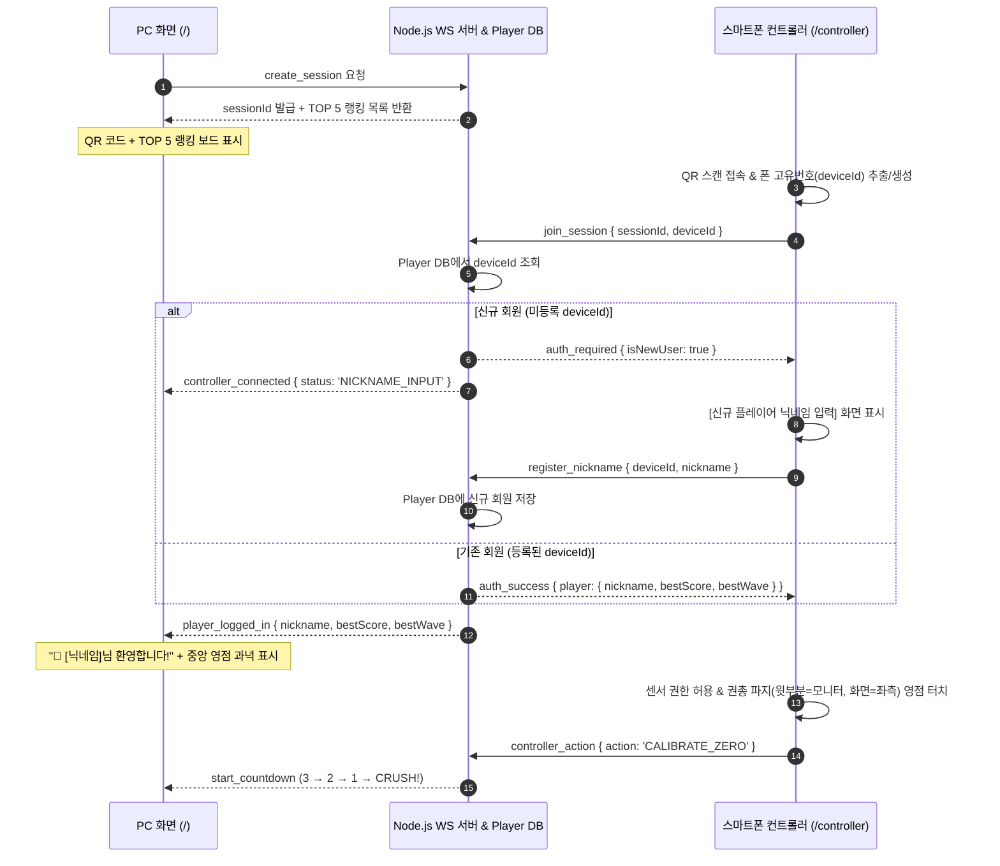

# 비어 크러셔 (Beer Crusher) 상세설계서

- **문서 버전**: 2.2 (정밀도 명중 배율 · 보상 카드 9종 & Combat Freeze 전체 정지 · 연사/장전 규칙 · 7웨이브 · 몬스터 5종 특색 · 보스전 3회 반영. 모든 난이도 수치는 `src/shared/gameTuning.ts`의 `GAME_TUNING`)
- **작성일**: 2026-11-04 (최종 개정)
- **기준 문서**: `docs/비어 크러셔 요구사항 분석서.md`, `.memory/decisions/2026-11-03-weapon-crosshairs-and-gameplay-polish.md`, `.memory/decisions/2026-11-04-combat-balance-and-boss-pattern.md`, `docs/무기_및_스킬_가이드.md`
- **참조 프로토타입**: `docs/stage-concepts-preview.html` (Three.js 3D 스테이지·타겟 시뮬레이터)

---

## 1. 시스템 아키텍처 및 기술 스택

### 1.1 기술 스택 명세

| 계층 | 기술 / 라이브러리 | 선정 이유 및 역할 |
| --- | --- | --- |
| **번들러 & 개발 서버** | `Vite` + `@vitejs/plugin-basic-ssl` | 모바일 브라우저의 센서 API(`DeviceOrientation`, `DeviceMotion`) 보안 요구사항 충족을 위해 로컬 HTTPS 서버 기본 구동 |
| **프론트엔드 UI** | `React 18` + `TypeScript` | PC 6단계 오버레이 화면(QR 대기·TOP 5 랭킹, 로그인/영점 안내, 카운트다운, HUD, 일시정지, 결과) 및 스마트폰 컨트롤러 화면 상태 관리 |
| **3D 렌더링 엔진** | `Three.js` (`WebGLRenderer`) | 60fps 고정 시점 3D 렌더링, 부채꼴 브루어리 & 펍 홀 배경, OB맥주 6종 타겟·아이템 4종·파편/거품 파티클 물리 연산 |
| **실시간 통신 & 인증 서버** | `Node.js` + `ws` + `JSON/SQLite Store` | PC 호스트와 모바일 컨트롤러 간 1:1 세션 룸 매칭, 폰 고유번호(`deviceId`) 기반 자동 로그인/닉네임 등록, TOP 5 랭킹 영구 저장 및 60Hz 센서 패킷 중계 |
| **사운드 엔진** | `Web Audio API` | 외부 음원 파일 없이도 발사음, PERFECT 크리티컬 타격음, 캔 파열음, 유리잔 파쇄음, 피버 배경음을 저지연으로 즉시 합성 |
| **QR 코드 생성** | `qrcode` (Canvas/SVG 렌더링) | PC의 로컬 네트워크 IP(`https://<LAN_IP>:5173/controller?session=<ID>`)를 자동 감지하여 즉시 스캔 가능한 QR 생성 |

### 1.2 전체 시스템 구성 및 페어링·로그인 흐름도



### 1.3 프로젝트 디렉토리 구조

```text
ob-crash-game/
├── index.html
├── package.json
├── tsconfig.json
├── vite.config.ts                 # HTTPS 플러그인 및 WebSocket 미들웨어 설정
├── data/
│   └── game.db                    # SQLite: 플레이어(deviceId별 닉네임)와 판 기록 영구 저장소
├── public/
│   └── textures/                  # (선택) 실제 OB맥주 제품 라벨 PNG/JPG 교체용 슬롯 폴더
├── server/
│   ├── wsServer.ts                # 1:1 세션 매칭, 고유번호 로그인/닉네임 등록, 30초 재접속, 패킷 릴레이
│   ├── playerStore.ts             # deviceId 조회·신규 등록·최고 기록 갱신·TOP 5 랭킹 산출 모듈
│   └── networkInfo.ts             # 로컬 Wi-Fi IPv4 주소 자동 감지 유틸리티
└── src/
    ├── main.tsx                   # 엔트리 포인트 (경로에 따라 PC 호스트 vs 모바일 컨트롤러 분기)
    ├── App.tsx
    ├── shared/
    │   ├── constants.ts           # 게임 밸런스 상수 (판정 반경 비율, SPAWN_R 등). 난이도 수치는 gameTuning.ts(GAME_TUNING)에 집중
    │   ├── types.ts               # 타겟 6종, 아이템 4종, 판정 3단계, 플레이어/랭킹 타입 정의
    │   └── protocol.ts            # PC ↔ 서버 ↔ 스마트폰 WebSocket 메시지 스키마
    ├── pc/
    │   ├── PcGamePage.tsx         # PC 메인 컨테이너 (ThreeCanvas + HUD 오버레이 + 모달 전환)
    │   ├── components/
    │   │   ├── PairingModal.tsx   # 화면 1: QR 코드 + TOP 5 명예의 전당 랭킹 + [PC 단독 시작]
    │   │   ├── CalibrationOverlay.tsx # 화면 2: 로그인 유저 환영 배너 + 권총 파지 정면 영점 과녁
    │   │   ├── CountdownOverlay.tsx   # 화면 3: 3-2-1-CRUSH 카운트다운
    │   │   ├── InGameHud.tsx      # 화면 4: 네 모서리 아케이드 HUD + 중앙 조준선/피버링/자동장전바
    │   │   ├── MinimapRadar.tsx   # 우하단 28m 부채꼴 미니맵 캔버스 (부채꼴 방사형 적 표시)
    │   │   ├── PauseModal.tsx     # 화면 5: 연결 끊김 30초 재접속 타이머 모달
    │   │   └── ResultModal.tsx    # 화면 6: 전적(PERFECT/GREAT 비율) + TOP 5 랭킹 갱신 + 다시 시작
    │   ├── engine/
    │   │   ├── BeerCrusherEngine.ts # Three.js 루프, 부채꼴 방사형 스폰/이동, 화면 투영 판정
    │   │   ├── BreweryStage3D.ts  # 시안 1: 부채꼴 브루어리 & 네온 펍 홀 3D 배경 메쉬 생성기
    │   │   ├── TargetFactory3D.ts # 6종 타겟(캔 4종, 병맥주, 냉각기 보스) 3D 모델
    │   │   ├── ItemFactory3D.ts   # 4종 드롭 아이템 3D 모델 생성기
    │   │   ├── DraftTapGun3D.ts   # 우하단 1인칭 생맥주 디스펜서 탭건 메쉬 및 반동 제어
    │   │   ├── LabelTextureGen.ts # 고해상도 브랜드 라벨 CanvasTexture 생성 및 외부 이미지 로더
    │   │   └── ParticleSystem3D.ts # 알루미늄/유리 파편 및 맥주 물보라·크림 거품 파티클
    │   └── audio/
    │       └── SoundSynthesizer.ts # Web Audio API 기반 발사·PERFECT·캔파열·유리파쇄·피버 사운드
    └── controller/
        ├── MobileControllerPage.tsx # 스마트폰 컨트롤러 루트
        ├── components/
        │   ├── LoginAndPermissionGate.tsx # 폰 화면 1: 고유번호 자동인식 / 신규 닉네임 입력 + 센서 권한
        │   ├── ZeroingGuide.tsx   # 폰 화면 2: 권총 파지(윗부분=모니터, 화면=좌측) 최초 영점 설정
        │   └── GunGripPad.tsx     # 폰 화면 3: 앞쪽 15%(영점 버튼) + 몸쪽 85%(연사 홀드·피버 더블탭 통합 패드)
        └── sensors/
            ├── DeviceIdentity.ts  # 폰 고유번호(deviceId: 영구 UUID + 기기 핑거프린트) 생성/조회
            ├── GunGripTracker.ts  # 권총 파지(+Y=모니터 총구, +Z=좌측 액정, +X=천장 스냅) 3D 쿼터니언 센서
            ├── UnifiedTouchPad.ts # 85% 통합 터치 영역: 0.25s 홀드(연사) vs 0.3s 더블탭(피버 발동) 판별
            └── HapticFeedback.ts  # Android 진동 패턴 및 iOS 화면 플래시 대체 피드백
```

---

## 2. 폰 고유번호(`deviceId`) 로그인 및 실시간 통신 프로토콜 설계

### 2.1 폰 고유번호(`deviceId`) 생성 및 플레이어 DB 스키마 (`playerStore.ts`)

1. **고유번호 추출 (`DeviceIdentity.ts`)**:
   - 스마트폰 브라우저에서 최초 QR 접속 시 `localStorage.getItem('ob_crusher_device_id')` 및 쿠키를 확인하고, 없으면 `crypto.randomUUID()`와 디바이스 특성 해시(OS, 화면 해상도, 하드웨어 코어 수 조합)를 결합한 고유 ID(`dev_...`)를 생성하여 영구 저장한다.
2. **서버 저장소 (`data/game.db`, SQLite)**: 스키마 원문은 `.memory/decisions/2026-11-08-sqlite-db-design.md`의 "최종 스키마 DDL"을 따른다.

   | 테이블 | 내용 |
   |---|---|
   | `players` | `id`(deviceId), 닉네임(2~10자), `auth_provider`, `last_seen_at` |
   | `games` | 판 단위: 방, 모드(solo/coop), `team_key`, 규칙 버전, 상태(playing/finished/abandoned), 결과·점수·웨이브·시간 |
   | `game_players` | 판 참가자별: 슬롯, 입력 장치, 무기, 점수 내역, 처치·정확도·피격 등 통계(미제출은 NULL) |
   | `game_waves` | 판의 웨이브별 시간, 보너스, 피격 수 |
   | `game_player_card_picks` | 플레이어가 고른 카드 순서 |

### 2.2 WebSocket 패킷 정의 (`src/shared/protocol.ts`)

```typescript
// 1. 스마트폰 접속 및 고유번호 로그인 패킷
export interface JoinSessionPacket {
  type: 'join_session';
  sessionId: string;
  deviceId: string;
}

export interface RegisterNicknamePacket {
  type: 'register_nickname';
  sessionId: string;
  deviceId: string;
  nickname: string;
}

export interface AuthStatusPacket {
  type: 'auth_status';
  isNewUser: boolean;
  player: PlayerRecord | null;
  top5Ranking: Array<Pick<PlayerRecord, 'nickname' | 'bestScore' | 'bestWave'>>;
}

// 2. 스마트폰 → PC (고주파 60Hz 권총 파지 센서 프레임)
export interface SensorFramePacket {
  type: 'SENSOR_FRAME';
  roomId: string;
  deviceId: string;
  payload: {
    aimX: number; // -1.0 ~ +1.0 (정면 영점 대비 수평 조준)
    aimY: number; // -1.0 ~ +1.0 (정면 영점 대비 수직 조준)
    pitchDeg: number;
    yawDeg: number;
    rollDeg: number;
    snapFire: boolean; // +X축 상단 스냅 단발 사격 트리거
    rapidFireHold: boolean; // 85% 통합 패드 0.25s 홀드 연사 상태
    feverTriggered: boolean; // 85% 통합 패드 0.3s 더블탭 피버 발동 트리거
    isCocked: boolean; // 화면 터치 홀드로 코킹(장전) 및 조준 고정 상태 여부
    skillSnapTriggered?: boolean; // 상단 '휙!(Snap)' 가속도 제스처 액티브 스킬 트리거
    timestamp: number;
  };
}

// 3. PC ↔ 스마트폰 (액티브 스킬 상태 동기화 및 햅틱 패킷)
export interface SkillStateSyncPacket {
  type: 'SKILL_STATE_SYNC';
  roomId?: string;
  weaponKind: 'shotgun' | 'revolver' | 'gatling';
  weaponLevel: 1 | 2 | 3 | 4;
  skillStock: number; // 0, 1, 2 (최대 2스택)
  maxSkillStock: number;
  skillCooldownRemainingMs: number;
  skillCooldownTotalMs: number;
}

// 4. PC → 스마트폰 (상태 동기화 — 피버 100% 완충 및 자동 재장전 상태 전달)
export interface GameStateSyncPacket {
  type: 'game_state_sync';
  phase: 'WAITING_QR' | 'LOGIN_WAIT' | 'CALIBRATING' | 'COUNTDOWN' | 'PLAYING' | 'WAVE_BREAK' | 'PAUSED' | 'RESULT';
  nickname: string;
  wave: number;
  ammo: number;
  maxAmmo: number;
  isAutoReloading: boolean;
  feverGauge: number;  // 0 ~ 100 (100 도달 시 Lock되어 감소하지 않음)
  isFever: boolean;
  hp: number;
  score: number;
}
```

---

## 3. 권총 파지 센서 인식(`GunGripTracker.ts`) 및 통합 터치 설계

### 3.1 권총 파지 자세의 3차원 기기 축 정의

사용자는 스마트폰을 총처럼 쥐고 조준한다:
- **기기 `+Y축` (휴대폰 윗부분 · 상단 베젤)**: **모니터 정면(총구 방향, Barrel Forward Vector)**을 가리킨다.
- **기기 `+Z축` (휴대폰 액정 화면 법선)**: **좌측(왼쪽)**을 바라본다 (오른손 파지 시 엄지 또는 왼손으로 터치).
- **기기 `+X축` (휴대폰 오른쪽 긴 테두리)**: **천장(위쪽, Up Vector)**을 향한다.

```text
          [천장(위쪽) 방향 = 기기 +X축 (오른쪽 긴 테두리)]
                          ▲
                          │   (손목 위로 스냅 시 +X축 가속도 피크 발생!)
         +────────────────┴────────────────+
         │  [앞쪽 15%]  │    [몸쪽 85%]    │
  모니터 │   🎯 영점    │   통합 터치 패드 │  내 몸쪽 (손잡이)
  ◀──────┤  재설정 버튼 │  • 꾹 누름: 연사 │
  총구   │              │  • 더블탭 : 피버 │
 (+Y축)  +─────────────────────────────────+
         (액정 화면이 좌측[왼쪽, +Z축]을 바라봄)
```

### 3.2 짐벌락 없는 3D 쿼터니언 총구 벡터 조준 공식

휴대폰을 옆으로 세워(액정이 좌측을 향하도록 약 90° 롤링) 쥐면 일반 오일러 각(`beta`, `gamma`)을 단순 뺄셈할 경우 짐벌락(축 뒤집힘)이 발생한다. 이를 완벽히 해결하기 위해 **Three.js 쿼터니언(Quaternion)으로 휴대폰 윗부분(`+Y축`) 단위 벡터를 3D 월드 공간에 투영**하여 좌우(Yaw)·상하(Pitch) 각도를 추출한다:

```typescript
// W3C DeviceOrientation (alpha, beta, gamma) → 3D Quaternion 변환
const deg2rad = Math.PI / 180;
const rad2deg = 180 / Math.PI;

function getDeviceQuaternion(alpha: number, beta: number, gamma: number): THREE.Quaternion {
  const euler = new THREE.Euler(beta * deg2rad, alpha * deg2rad, -gamma * deg2rad, 'YXZ');
  return new THREE.Quaternion().setFromEuler(euler);
}

// 1. [정면 영점] 버튼을 누른 순간의 기준 총구 방향(+Y축)과 천장 방향(+X축) 저장
let zeroForward = new THREE.Vector3(0, 1, 0);
let zeroRight = new THREE.Vector3(0, 0, -1); // 모니터 기준 우측 벡터
let zeroUp = new THREE.Vector3(1, 0, 0);     // 모니터 기준 상단 벡터 (기기 오른쪽 테두리 +X)

function calibrateZero(alpha: number, beta: number, gamma: number) {
  const qZero = getDeviceQuaternion(alpha, beta, gamma);
  // 기기 윗부분(+Y)이 가리키는 월드 방향을 정면(Forward) 기준으로 설정
  zeroForward = new THREE.Vector3(0, 1, 0).applyQuaternion(qZero).normalize();
  // 지면 수직축(0, 0, 1)과 외적하여 수평 우측(Right) 및 수직 상단(Up) 직교 기저 생성
  const worldUp = new THREE.Vector3(0, 0, 1);
  zeroRight = new THREE.Vector3().crossVectors(zeroForward, worldUp).normalize();
  zeroUp = new THREE.Vector3().crossVectors(zeroRight, zeroForward).normalize();
}

// 2. 매 센서 프레임(60Hz)마다 현재 총구(+Y축)가 가리키는 상대 좌우(yaw)·상하(pitch) 각도 계산
function computeGunAimAngles(alpha: number, beta: number, gamma: number) {
  const qCurr = getDeviceQuaternion(alpha, beta, gamma);
  const currBarrel = new THREE.Vector3(0, 1, 0).applyQuaternion(qCurr).normalize();

  // 기준 직교 기저(zeroForward, zeroRight, zeroUp)에 현재 총구 벡터를 내적(투영)
  const forwardComp = currBarrel.dot(zeroForward);
  const rightComp = currBarrel.dot(zeroRight);
  const upComp = currBarrel.dot(zeroUp);

  const yawDelta = Math.atan2(rightComp, forwardComp) * rad2deg;   // 좌우 각도 (-35° ~ +35°)
  const pitchDelta = Math.atan2(upComp, forwardComp) * rad2deg;    // 상하 각도 (-20° ~ +20°)
  return { yawDelta, pitchDelta };
}
```

### 3.3 권총 파지 '휙!' 스냅 액티브 스킬 및 85% 통합 터치 판별기

1. **상향 스냅 제스처 (`detectSnapFire` → 액티브 스킬 트리거)**:
   - 권총 파지 상태에서 스마트폰을 위로 '휙!' 튕기면 천장을 향하고 있는 기기 오른쪽 테두리(`+X축`) 방향으로 강한 양(+)의 선형 가속도가 발생한다.
   - `Math.abs(acceleration.x) >= 12.0` (임계치 12m/s²) 감지 시 `skillSnapTriggered = true`로 전달되어 **현재 장착 중인 무기의 액티브 스킬을 즉시 시전**한다 (스킬 스택 소진).
   - 발동 직후 `0.15초`간 조준선을 고정(`frozenT = 0.15`)하여 스냅 반동으로 인한 에임 튐을 방지한다.
   - 스킬 쿨타임 완료 및 2스택 완충 시 모바일 컨트롤러에 햅틱 피드백(`triggerHaptic([60, 40, 90])`)을 주어 촉각으로 시전 준비 완료를 인지시킨다.
2. **몸쪽 85% 통합 터치 패드 (`UnifiedTouchPad.ts`)**:
   - `pointerdown`: 터치 시작 시각 기록 및 단발 사격 즉시 격발.
   - **연사 (Hold - `FR-INP-05`)**: 손가락을 떼지 않고 `180ms(0.18초)`가 지나면 `rapidFireHold = true` 전송 → 손을 뗄 때(`pointerup`) 즉시 연사 종료. 무기 고유 발사 간격(`fireIntervalMs`: 샷건 380ms, 리볼버 250ms, 개틀링 140~83ms)에 맞춰 호쾌한 자동 연속 사격(`투두두두`) 지원.
   - **피버 발동 (Double Tap)**: `180ms` 미만에 손을 뗐을 때, 직전 짧은 탭 시각과의 간격이 `300ms(0.3초) 이내`이면 **`feverTriggered = true`** 전송! 피버 게이지가 100%일 때 **4초 초고밀도 피버 버스트 (공격력 2.0배, 탄창 무제한 난사)** 즉시 발동.

---

## 4. 부채꼴(시점 모양) 방사형 스폰 및 `PERFECT` 3단계 정밀도 판정 설계

### 4.1 부채꼴(시점 모양) 방사형 스폰 및 보스 14m 안전 정지·소환 알고리즘 (`BeerCrusherEngine.ts`)

배경 카메라 시점은 정면(`rotation.y = 0`)에 고정한 상태에서, 미니맵의 부채꼴 시야각(`±HF`) 전체 원호(`R = 28m`)에서 몬스터가 골고루 스폰되어 부채꼴 꼭짓점(플레이어 `0, 0, 0`)을 향해 사방에서 달려오도록 설계한다:

```typescript
// 화면 종횡비(W/H)와 수직 FOV(50°)로부터 수평 시야각 반각(HF, 약 ±39.6°) 계산
const halfHorizontalFov = Math.atan(Math.tan((FOV * Math.PI) / 360) * (W / H));
const SPAWN_RADIUS = 28.0; // 부채꼴 외곽 스폰 반경 28m
const REACH_RADIUS = 1.8;  // 플레이어 앞 바닥 네온 방어선 반경 1.8m
const BOSS_STOP_RADIUS = 14.0; // 보스 안전 정지 거리 14m

function spawnEnemyInFan(kind: TargetKind) {
  // 일반 적은 부채꼴 시야 전체(-92% ~ +92% 각도, 약 ±36.5°)에서 골고루 등장, 보스는 중앙(±10°) 등장
  const maxAngle = kind === 'boss' ? 0.18 : halfHorizontalFov * 0.92;
  const theta = (Math.random() * 2 - 1) * maxAngle; // 부채꼴 방위각 (rad)

  // 반경 R = 28m 부채꼴 원호(Arc) 위의 초기 좌표 계산
  const x0 = Math.sin(theta) * SPAWN_RADIUS;
  const z0 = -Math.cos(theta) * SPAWN_RADIUS;
  const y0 = kind === 'caslight' ? 2.1 + Math.random() * 0.7 : CAN[kind].h / 2;

  const mesh = makeCan(kind);
  mesh.position.set(x0, y0, z0);
  mesh.rotation.y = -theta; // 적 모델이 플레이어(원점) 방향을 정면으로 바라보게 회전
  scene.add(mesh);

  targets.push({
    kind,
    mesh,
    theta,           // 고유 진입 부채꼴 각도
    radius: SPAWN_RADIUS, // 현재 플레이어로부터의 방사형 거리 (28m → 1.8m 감소)
    ...
  });
}

// 매 프레임 부채꼴 중심(플레이어)을 향한 방사형 전진 및 몬스터/보스 패턴 업데이트
// (실제 구현: BeerCrusherEngine.update, 수치는 GAME_TUNING.monsters / GAME_TUNING.boss)
function updateEnemyRadialMovement(target: TargetEntity, dt: number) {
  if (target.kind === 'boss') {
    // 3·5·7웨이브 냉각기 보스는 방어선 전방 14m에 정지하고 theta만 좌우로 움직인다.
    // 소환은 시간이 아니라 각 보스의 체력 구간(99/66/33%)으로 정해지며, 구간마다 한 번에 4·5·6마리를 필드 10~18m에 낙하시킨다(필드 상한 없음). 보스는 일반 몬스터가 totalSpawns의 절반(올림) 소환되면 등장하고, 보스가 살아 있는 동안 일반 몬스터는 보스·부하를 뺀 수로 상한을 세어 계속 보충된다.
    target.radius = Math.max(BOSS_STOP_RADIUS, target.radius - target.speed * dt);
    updateBossMovement(now); // 1대: 좌우 왕복, 2대: 교차, 대왕 동반: 양옆 + 대왕 중앙
  } else if (target.kind === 'pilgood' && target.radius <= PILGOOD_CHARGE_RADIUS) {
    target.radius -= target.speed * PILGOOD_CHARGE_MULT * dt;   // 지상 돌격
  } else {
    target.radius -= target.speed * dt;
  }
  // 카스 라이트: thetaRad = initialTheta + sin(t * 0.004 + radius * 0.7) * 0.25 (크게 흔들림)
  // 오비: guardPhaseMs 기준 0.8초 방패 올림 / 2.4초 내림. 방패 중 shootAt은 shieldBlocked를 반환(스킬만 관통)
  // 병맥주: 처치 시 splitBottle()이 양옆에 체력 1의 작은 병 2마리를 생성(재분열 없음)

  const prog = clamp((SPAWN_RADIUS - target.radius) / (SPAWN_RADIUS - REACH_RADIUS), 0, 1);

  // 기본 방사형 위치 (원호 반경 target.radius를 따라 플레이어를 향해 직진 수렴)
  let currentTheta = target.theta;
  if (target.kind === 'caslight') {
    // 카스 라이트는 부채꼴 각도 위에서 좌우 지그재그 비행 추가
    currentTheta += Math.sin(target.t * 2.2 + target.ph) * 0.08 * (1 - prog * 0.5);
  }

  target.mesh.position.x = Math.sin(currentTheta) * target.radius;
  target.mesh.position.z = -Math.cos(currentTheta) * target.radius;

  // 일반 적의 반경이 1.8m 방어선 안으로 들어오면 피격 처리
  if (target.kind !== 'boss' && target.radius <= REACH_RADIUS) {
    handlePlayerReached(target);
  }
}
```

### 4.2 `PERFECT / GREAT / GOOD` 정밀도 데미지 배율 및 피버 게이지 공식

조준 정확도에 따라 데미지가 직결되는 정밀도 배율 공식입니다. 난사를 억제하기 위해 판정 범위는 몬스터 x0.75(화면비 보정 포함), 무기별 판정 배율은 `GAME_TUNING.hitZone.toleranceByWeapon`(샷건 1.40 / 리볼버 0.95 / 개틀링 1.05)이며, 누르고 쏘는 연사(`hold`)는 피해가 줄어듭니다:

```typescript
const PERFECT_R = 0.25; // 오차율 25% 이내: PERFECT (데미지 2.0배, 피버 +2%, 15점)
const GREAT_R   = 0.55; // 오차율 55% 이내: GREAT   (데미지 1.0배, 피버 +0%, 10점)
// 오차율 55% 초과 ~ 1.00 이하: GOOD (데미지 0.5배, 피버 +0%, 5점)
// 처치 시 피버 +4% (GAME_TUNING.fever), 보스 몸통 타격은 피버 0
// 누르고 쏘기(hold): 피해 감소 없음(모든 무기 x1.0), 발사 간격은 샷건·리볼버 x1.0 / 개틀링 x0.85 (2026-11-09)

function processHit(target: TargetEntity, errorRatio: number, weaponBaseDamage: number) {
  let grade: 'PERFECT' | 'GREAT' | 'GOOD' = 'GOOD';
  let gradeMultiplier = 0.5;
  let addScore = 50;
  let feverGain = 0;
  let popupColor = '#34D399'; // 에메랄드

  if (errorRatio <= PERFECT_R) {
    grade = 'PERFECT';
    gradeMultiplier = 2.0;
    addScore = 150;
    feverGain = 2; // PERFECT 명중 시 피버 2% 충전
    popupColor = '#F43F5E'; // 크림슨 레드
    S.perfectHits++;
  } else if (errorRatio <= GREAT_R) {
    grade = 'GREAT';
    gradeMultiplier = 1.0;
    addScore = 100;
    feverGain = 0;
    popupColor = '#FBBF24'; // 앰버 골드
    S.greatHits++;
  }
  S.totalHits++;

  // 피버 모드 시 공격력 2.0배 버프 적용
  const feverMultiplier = S.fever ? 2.0 : 1.0;
  const finalDamage = Math.round(weaponBaseDamage * gradeMultiplier * feverMultiplier * 100) / 100;
  target.hp -= finalDamage;

  S.combo++;
  S.score += addScore;

  // 피버 게이지 충전 (PERFECT 적중 시 +2%)
  if (!S.fever && feverGain > 0) {
    S.gauge = Math.min(100, S.gauge + feverGain);
  }

  showHitPopup(`${grade}! -${finalDamage} HP (+${addScore})`, popupColor);

  // 적 처치 시: 피버 게이지 +4% 추가 충전 및 전술 아이템 드롭(기본 4%) 판정
  if (target.hp <= 0) {
    if (!S.fever) {
      S.gauge = Math.min(100, S.gauge + 4); // 적 처치 시 피버 4% 보너스 충전!
    }
    killTarget(target);
  }
}

// 빗나감(MISS) 처리 — 불합리한 콤보 감점/피버 게이지 차감 페널티를 일절 폐지!
function missShot() {
  // 콤보 및 피버 게이지를 차감하지 않고 화면에 MISS 팝업만 표시
  showHitPopup('MISS', '#94a3b8');
}
```

### 4.3 무기별 조준경 1:1 히트 판정 동기화 (`weaponHitToleranceMult`)

기존의 단일 점(Point) 판정으로 인해 샷건/개틀링의 조준경 원 안에 몬스터가 들어왔음에도 `MISS`가 발생하던 결함을 완벽히 해결하기 위해, 엔진의 `shootAt` 함수에서 무기 아키타입별 피격 허용 배율을 적용합니다.

```typescript
// 무기별 유효 피격 판정 배율
const weaponHitToleranceMult =
  weaponKind === 'shotgun' ? 1.55 :
  weaponKind === 'gatling' ? 1.25 :
  0.95; // revolver

// 리볼버 수직 관통 가이드라인 보정 (세로 오차 30% 완화)
const verticalScale = weaponKind === 'revolver' ? 0.70 : 0.85;

const dy = target.customNormY !== undefined
  ? (aimY - proj.targetNormY)
  : (aimY - proj.targetNormY) * verticalScale;

const dist = Math.hypot(dx, dy);
const effectiveHitRadius = proj.apparentHitRadius * weaponHitToleranceMult;

if (dist <= effectiveHitRadius) {
  // 조준경 원 안에 걸친 타겟 유효타 명중 보장!
  const judgment = evaluateHitJudgment(dist, effectiveHitRadius, options);
}
```

- 🪠 **맥주관 뚫어뻥 샷건 (`1.55배`)**: 120px 대형 펠릿 탄착군 링 안에 걸치면 100% 명중 판정
- 🍾 **황금 병따개 리볼버 (`0.95배`, 수직 `0.70배`)**: 정밀 스나이퍼 헤어라인과 상하 수직 관통선을 따른 일렬 쾌속 관통
- 🍺 **탄산 탭 개틀링 (`1.25배`)**: 88px 회전 터빈 레티클 및 44px 내부 스프레드 서클 영역 전체 커버

---

## 5. PC 화면 및 스마트폰 컨트롤러 화면 레이아웃 명세

### 5.1 PC 대기 화면 (`PairingModal.tsx` — QR 페어링 + TOP 5 랭킹 보드)

```text
+-----------------------------------------------------------------------------------+
| [3D 배경: 부채꼴 오비맥주 브루어리 & 네온 펍 홀]                                  |
|                                                                                   |
|   +-----------------------------------+   +-----------------------------------+   |
|   |   🍺 BEER CRUSHER — QR 연결       |   |   🏆 명예의 전당 (TOP 5 CRUSHERS) |   |
|   |                                   |   |                                   |   |
|   |        +-----------------+        |   |   1위  맥주왕랄라   2,845점 (W5) |   |
|   |        |   [ QR CODE ]   |        |   |   2위  카스스나이퍼 2,410점 (W4) |   |
|   |        +-----------------+        |   |   3위  한맥러버     1,980점 (W4) |   |
|   |   • QR 스캔 시 폰 고유번호로      |   |   4위  필굿고래     1,620점 (W3) |   |
|   |     자동 로그인됩니다!            |   |   5위  생맥주킬러   1,250점 (W3) |   |
|   |   • 신규 회원은 폰에서 닉네임을   |   |                                   |   |
|   |     입력해주세요.                 |   |   * 폰 고유번호로 내 최고 기록이  |   |
|   |                                   |   |     자동 저장·갱신됩니다.         |   |
|   | [🖱️ PC 마우스/키보드로 바로 시작] |   +-----------------------------------+   |
|   +-----------------------------------+                                           |
+-----------------------------------------------------------------------------------+
```

### 5.2 스마트폰 권총 파지 컨트롤러 화면 (`GunGripPad.tsx`)

휴대폰 윗부분이 모니터를 향하고 액정이 좌측을 바라보므로, 앞쪽 15%에 영점 버튼과 무기·스킬 배지를 두고 나머지 **85% 전체를 격발, 연사(꾸욱 누르기), 피버(더블탭), 스냅('휙!' 액티브 스킬) 겸용 통합 터치 패드**로 구성한다.

```text
+-----------------------------------------+
| [앞쪽 끝단 15% — 모니터(총구) 방향]     |
| ● [닉네임] (14ms)      [🪠 뚫어뻥 Lv.2]  |
|      [ 🎯 정면 영점 ]    스킬: ⚡ 2/2    |
+-----------------------------------------+
| [중앙 ~ 내 몸쪽 85% — 통합 터치 영역]   |
|                                         |
|   ┌─────────────────────────────────┐   |
|   │                                 │   |
|   │     🔫 권총 파지 통합 패드      │   |
|   │  (화면을 안 보고 조작하세요!)   │   |
|   │                                 │   |
|   │  1. 가볍게 터치    : 단발 사격  │   |
|   │  2. 꾸욱 누르기    : 연속 사격  │   |
|   │  3. 두 번 톡톡     : 피버 버스트 │   |
|   │  4. 위로 '휙!' 스냅: 액티브스킬  │   |
|   │     (⚡ 스킬 완충 시 진동 알림) │   |
|   │                                 │   |
|   │  * 탄창: 8 / 10 (자동 재장전)   │   |
|   └─────────────────────────────────┘   |
|                                         |
+-----------------------------------------+
```

### 5.3 PC 동적 조준경 HUD (`CrosshairOverlay.tsx`)

3종 무기 아키타입별 특성과 레벨에 맞춰 화면 중앙 조준경이 실시간 분기 렌더링됩니다:
- 🪠 **샷건 (`shotgun`)**: 120px 대형 펠릿 탄착군 링 + 8방향 펠릿 확산 도트 + 옥타곤 브래킷 (오렌지 `#f59e0b`). 발사 시 1.32배 팽창 킥 애니메이션.
- 🍾 **리볼버 (`revolver`)**: 76px 초정밀 스나이퍼 십자선 + 3px 핀포인트 도트 + 상하 수직 관통 가이드라인 (골드 `#fbbf24`). 사격 시 순간 조임 리코일.
- 🍺 **개틀링 (`gatling`)**: 88px 회전형 3각 톱니 터빈 레티클 + 중앙 44px 스프레드 서클 (시안 `#38bdf8`). 사격 시 고속 스핀 회전.
- 상단 뱃지: `🪠 SHOTGUN Lv.1` ~ `Lv.MAX` 또는 버프 상태(`🔥 FEVER UNLIMITED`, `WIDE 1.6X`, `AIM LOCKED`) 실시간 표시.

---

## 6. 무기·스킬·기믹 서브시스템 인터페이스 연동

비어 크러셔의 세부 콘텐츠 데이터는 역할별 전문 문서로 단일화되어 관리됩니다:
- 🔫 **무기 3종, 조준경 HUD, 피격 판정 배율, 4단계 진화, 스냅 액티브 스킬, 3D 보상 카드**: [docs/무기_및_스킬_가이드.md](./무기_및_스킬_가이드.md) 참조
- 👾 **몬스터 6종 비주얼·이동 패턴, 3D HP바, 황금 캔/투사체 요격 기믹, 아이템 4종**: [docs/몬스터_도감_설명서.md](./몬스터_도감_설명서.md) 참조
- 🎯 **영점 교정, 3단계 튜토리얼 시나리오, 샌드박스 테스트 랩**: [docs/튜토리얼_훈련장_가이드.md](./튜토리얼_훈련장_가이드.md) 참조

### 6.1 무기 관리 시스템 (`WeaponSystem.ts`) 아키텍처

`WeaponSystem`은 현재 선택된 무기(`WeaponKind`), 레벨(`WeaponLevel`), 잔탄수(`ammo`), 재장전 타이머, 스킬 스톡(`skillStock: 0~2`, 모든 레벨 최대 2회)을 캡슐화하여 관리합니다.

```typescript
export class WeaponSystem {
  private weaponKind: WeaponKind = 'shotgun';
  private weaponLevel: WeaponLevel = 1;
  private ammo = 5;
  private isReloading = false;
  private skillStock = 1;

  public consumeShot(nowMs: number, isFeverActive: boolean): { fired: boolean; ammo: number; isReloading: boolean };
  public refillAmmoOnFever(): void;
  public upgradeWeaponLevel(): WeaponLevel;
  public consumeSkill(nowMs: number): boolean;
  public getState(): WeaponState;
}
```

### 6.2 3D 렌더링 & 파티클 연동 파이프라인

1. **프로시저럴 3D 탭건 & 진화 (`DraftTapGun3D.ts`)**:
   - `updateWeaponMesh(kind, level)` 호출 시 기존 메쉬를 안전하게 Dispose하고 새 지오메트리/머티리얼을 장착합니다.
2. **스킬 액션 VFX 파티클 (`ParticleEffects3D.ts`)**:
   - `triggerSkillEffect(kind)`로 샷건의 8방향 뚫어뻥 포물선 비행을 생성합니다. 리볼버 칼날과 개틀링 거품은 엔진 상태를 따라 `syncSkillBlades`, `syncSkillFoam`으로 그립니다.
3. **몬스터 100% 슬림 연속 체력 게이지 바 투영 (`ArcadeOverlayHUD.tsx`)**:
   - 모든 몬스터 상단에 100% 슬림 연속 체력 게이지 바(`height: 4px`, 잔여 HP 비례 부드러운 게이지)를 실시간 투영합니다.
   - 단, 1HP 잡몹(필굿, 카스라이트)은 기본 상태에서 화면 시야를 가리지 않도록 숨겨두되, 0.5x 데미지 등으로 스쳐 맞아 잔여 체력이 남은 경우(`hp < maxHp && hp > 0`) 즉시 머리 위에 슬림 게이지 바를 노출합니다.

### 6.3 아케이드 전장 기믹 및 킬 게이지 보상 연동

1. **황금 캔 스폰 알림**:
   - `BeerCrusherEngine.spawnGoldenCanTarget` 실행 시 `SoundSynthesizer.playGoldenCanChime()` 및 화면 사방 골드 네온 플래시를 동기화합니다.
2. **투사체 요격**:
   - `shootAt`에서 `target.isProjectile === true`인 타겟 적중 시 요격 이벤트 플래그(`interceptedProjectile: true`)를 반환하여 투사체를 파티클과 함께 폭발시키고 요격음을 재생합니다(배너 없음).
   - 투사체는 바닥 높이(`GAME_TUNING.shell.baseY`)에 있고 고정 화면 높이(`customNormY`)를 쓰지 않아, 판정 위치가 보이는 모델을 따라갑니다.
3. **보상 카드 9종 (Shoot-to-Select) & Combat Freeze**:
   - 웨이브 클리어 및 4·6웨이브 중간 킬 수(22/26) 달성 시 전장 전체에 시간 정지(Combat Freeze)를 발동합니다. `update`는 피버·버프·재장전·스폰/소환 타이머·몬스터 기절/둔화 타이머를 실제 경과 시간만큼 뒤로 밀고(`freezeTimers`) 일찍 반환하며, 스킬 쿨다운은 `weaponSystem.update`를 건너뛰어 멈춥니다. 이 동안 `activateFever`/`triggerWeaponSkill`도 막힙니다.
   - 카드는 `buildRewardCardPool()`이 만든 풀(무기 상한·최대 스택·체력 가득·피버 상태 반영)에서 `dropRng`로 중복 없이 3장을 뽑습니다(`weapon_level_up`, `rapid_reload`, `bar_repair`(+2), `fever_boost`(+50), `lucky_drop`, `damage_up`, `skill_cooldown`, `fever_extend`, `hit_zone_up`). 풀이 3장 미만이면 수리·부스터·장전으로 채웁니다.
   - 카드 선택은 `shootAt(..., source)`의 `ShotSource`로 제어합니다. `'hold'`/`'fever'`는 카드를 고르지 못하고, 새로 누른 `'press'`만 `shootCardSelect`를 통과하며 스폰 후 800ms는 입력 잠금입니다. 카드 밖 사격은 탄약을 쓰지 않습니다.
4. **적 처치 전술 아이템 드롭**:
   - 일반 몬스터 처치 시 4%(보스 소환 부하는 20%) 기본 확률로 바닥에 펍 전술 아이템 3종(`GAME_TUNING.itemDropKinds`: `power_shot`, `wide_scope`, `ice_freeze`)을 즉시 드롭합니다. `bar_repair`는 정의만 남기고 드롭 후보에서 제외했습니다. 신규 카드 `lucky_drop` 습득 시 드롭 빈도가 2배/3배/4배(`0.04 * (1 + stacks)`)로 영구 증가합니다.

## 플레이 기록과 판별 랭킹
- 판이 시작되면 PC가 `GAME_BEGIN`을 보내 서버가 `games`(playing)와 `game_players`를 만들고 `gameId`를 돌려줍니다. 무기를 고르면 `WEAPON_CHOSEN`, 일시정지 메뉴에서 나가면 `GAME_ABANDON`을 보냅니다. 끝나면 `GAME_SCORE_SUBMIT`(`gameId` 포함)의 `stats`(`PlayRunStats`)를 서버가 검증(`isValidPlayRunStats`)해 같은 행을 채웁니다(`PlayRecordStore`, SQLite `data/game.db`).
- 랭킹 메시지의 `rankings`는 판별 상위 5개(`RunRankingEntry`)이며 현재 `RANKING_RULESET_VERSION`의 끝난 판에서 쿼리로 만듭니다. 프로필의 `bestScore`·`totalGames`도 같은 방식으로 산출합니다.

---

## 7. 2인 협동(Co-op) 및 확장 아키텍처

### 7.1 입력 어댑터 및 플레이어 동작 처리부 (`PlayerActionProcessor`)

입력 장치의 물리적 다양성(모바일 자이로/터치 vs PC 마우스)을 추상화하여 일관된 게임 액션으로 변환합니다:
- **`InputAdapter` 추상화**: 모바일 센서 패킷을 처리하는 `PhoneInputAdapter`와 마우스 이벤트를 처리하는 `MouseInputAdapter`로 분리됩니다.
- **`PlayerActionProcessor` 핵심 파이프라인**:
  - **화면 좌표 투영**: 정규화 각도(`-1.0 ~ +1.0`)를 화면 픽셀 좌표로 변환합니다.
  - **홀드 첫 발 즉시 격발**: 터치패드/마우스 버튼을 누르는 순간(`fireDown`) 첫 발은 즉시 100% 데미지 단발 강타로 격발되며, 누르고 있는 동안 무기 발사 간격에 맞춰 연사 감쇠(60%/85%)가 적용된 자동 연발로 전환됩니다.
  - **스킬 안전 잠금 (Skill Lock)**: 카드 선택 중 및 카운트다운 중에는 스킬이 무시되며, 카드 선택 직후 0.3초(300ms) 동안 `pickLockUntilMs`가 작동하여 오발을 방지합니다.
  - **단일 화면 버튼 경로**: 화면의 클릭 가능한 버튼 사격은 모두 `pressScreenButton` 함수를 단일 진입점으로 경유하여 처리됩니다.

### 7.2 인원수 규칙(`playerCountRules`) 및 모드 규칙(`modeRules`), `TutorialDirector`

- **D24 설계 원칙 (인원수는 값만 다르고 로직은 하나)**: 엔진과 컴포넌트 내부에서 `isCoop`, `players.length === 2` 등의 조건문 분기를 금지하고, 인원수와 모드에 따른 모든 동적 수치는 규칙 테이블을 통해 주입합니다.
- **인원수 규칙 (`playerCountRules.ts`)**: 참가 인원수(1인/2인)에 따른 몬스터 체력 배율, 동시 스폰 수 배율, 보스 체력 배율 등을 정의합니다.
- **모드 규칙 (`modeRules.ts`)**: 일반 `ARCADE` 모드와 샌드박스 `TUTORIAL` 모드의 룰셋(방어선 무적 여부, 랭킹 서버 점수 전송 여부 등)을 분리합니다.
- **튜토리얼 디렉터 (`TutorialDirector.ts`)**: 4단계 인터랙티브 사격 미션(정밀 원샷 ➔ 홀드 연발 ➔ 액티브 스킬 ➔ 피버 무한 난사)의 조건 체크 및 단계 전환을 전담합니다.

### 7.3 WebSocket 슬롯 프로토콜 및 세션 라이프사이클

1:1 룸 내에서 1P/2P 2개 슬롯을 관리하는 상태 머신 프로토콜을 구현합니다:
- **슬롯 제어 메시지**:
  - `JOIN_SLOT`: 플레이어가 1P 또는 2P 슬롯에 참가.
  - `CHOOSE_INPUT`: 슬롯의 입력 방식을 모바일(폰) 또는 PC 마우스로 결정 (마우스는 1명만 점유 가능).
  - `READY`: 슬롯 준비 완료 상태 토글 (양쪽 슬롯이 모두 준비되면 시작 게이트 통과).
  - `SLOT_STATE`: 룸 내 슬롯 상태(장치 ID, 닉네임, 입력 장치, 준비 상태) 브로드캐스트.
- **30초 단절 유예 (`DISCONNECT_GRACE`)**: 2인 플레이 중 폰 연결이 끊기면 30초 카운트다운 동안 자리를 보존하며, 만료 시 나감 처리되고 남은 플레이어는 1인 상태로 게임을 계속 진행합니다. 끊긴 플레이어가 재접속하면 즉시 원래 슬롯으로 복귀합니다.
- **팀 랭킹 (`teamRankings`)**: 2인 협동 점수는 솔로 랭킹과 분리되어 팀 랭킹에 합산 등록되며, 두 플레이어의 고유 ID 조합(`buildTeamKey`)으로 식별됩니다.

### 7.4 3D 총기 배치 및 시각 프레젠테이션 분리 (`playerPresentation.ts`)

- **SSOT 프레젠테이션 (`getPlayerPresentation`)**: 플레이어 수와 인덱스에 따라 1P(앰버 `#f59e0b`)와 2P(시안 `#38bdf8`)의 테마 색상, 뱃지 레이블, 조준선 스타일을 단일 함수에서 제공합니다. UI 컴포넌트는 `playerCount`를 직접 검사하지 않고 이 프레젠테이션 객체만 참조합니다.
- **듀얼 탭 건 3D 배치 (`GUN_OFFSETS_BY_COUNT`)**: 1인 플레이 시 중앙(`x = 0`), 2인 플레이 시 좌우(`1P: x = -0.32, 2P: x = +0.32`)로 배치되며, 2P 총기에는 틸트 보정(`GUN_YAW_COMP = 0.35`) 및 고유 발광 받침 링이 적용됩니다.
