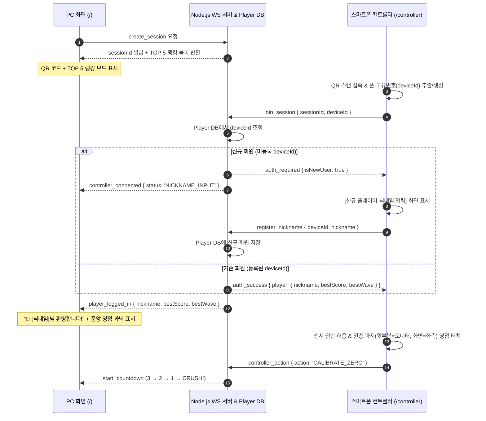

# 비어 크러셔 (Beer Crusher) 상세설계서

- **문서 버전**: 1.1 (권총 파지 3D 총구 센서 · 85:15 통합 터치 · 부채꼴 스폰 · 폰 고유번호 로그인 · PERFECT 반영)
- **작성일**: 2026-11-01
- **기준 문서**: `docs/비어 크러셔 요구사항 분석서.md` (v1.1), `.memory/decisions/2026-11-01-beer-crusher.md`
- **참조 프로토타입**: `docs/stage-concepts-preview.html` (Three.js 3D 스테이지·타겟 시뮬레이터)

---

## 1. 시스템 아키텍처 및 기술 스택

### 1.1 기술 스택 명세

| 계층 | 기술 / 라이브러리 | 선정 이유 및 역할 |
| --- | --- | --- |
| **번들러 & 개발 서버** | `Vite` + `@vitejs/plugin-basic-ssl` | 모바일 브라우저의 센서 API(`DeviceOrientation`, `DeviceMotion`) 보안 요구사항 충족을 위해 로컬 HTTPS 서버 기본 구동 |
| **프론트엔드 UI** | `React 18` + `TypeScript` | PC 6단계 오버레이 화면(QR 대기·TOP 5 랭킹, 로그인/영점 안내, 카운트다운, HUD, 일시정지, 결과) 및 스마트폰 컨트롤러 화면 상태 관리 |
| **3D 렌더링 엔진** | `Three.js` (`WebGLRenderer`) | 60fps 고정 시점 3D 렌더링, 부채꼴 브루어리 & 펍 홀 배경, OB맥주 6종 타겟·아이템 4종·파편/거품 파티클 물리 연산 |
| **실시간 통신 & 인증 서버** | `Node.js` + `ws` + `JSON/SQLite Store` | PC 호스트와 모바일 컨트롤러 간 1:1 세션 룸 매칭, 폰 고유번호(`deviceId`) 기반 자동 로그인/닉네임 등록, TOP 5 랭킹 영구 저장 및 60Hz 센서 패킷 중계 |
| **사운드 엔진** | `Web Audio API` | 외부 음원 파일 없이도 발사음, PERFECT 크리티컬 타격음, 캔 파열음, 유리잔 파쇄음, 피버 배경음을 저지연으로 즉시 합성 |
| **QR 코드 생성** | `qrcode` (Canvas/SVG 렌더링) | PC의 로컬 네트워크 IP(`https://<LAN_IP>:5173/controller?session=<ID>`)를 자동 감지하여 즉시 스캔 가능한 QR 생성 |

### 1.2 전체 시스템 구성 및 페어링·로그인 흐름도



### 1.3 프로젝트 디렉토리 구조

```text
ob-crash-game/
├── index.html
├── package.json
├── tsconfig.json
├── vite.config.ts                 # HTTPS 플러그인 및 WebSocket 미들웨어 설정
├── data/
│   └── players.json               # 폰 고유번호(deviceId)별 닉네임, 최고 점수, 최고 웨이브 영구 저장소
├── public/
│   └── textures/                  # (선택) 실제 OB맥주 제품 라벨 PNG/JPG 교체용 슬롯 폴더
├── server/
│   ├── wsServer.ts                # 1:1 세션 매칭, 고유번호 로그인/닉네임 등록, 30초 재접속, 패킷 릴레이
│   ├── playerStore.ts             # deviceId 조회·신규 등록·최고 기록 갱신·TOP 5 랭킹 산출 모듈
│   └── networkInfo.ts             # 로컬 Wi-Fi IPv4 주소 자동 감지 유틸리티
└── src/
    ├── main.tsx                   # 엔트리 포인트 (경로에 따라 PC 호스트 vs 모바일 컨트롤러 분기)
    ├── App.tsx
    ├── shared/
    │   ├── constants.ts           # 게임 밸런스 상수 (PERFECT_R=0.15, GREAT_R=0.45, SPAWN_R=28 등)
    │   ├── types.ts               # 타겟 6종, 아이템 4종, 판정 3단계, 플레이어/랭킹 타입 정의
    │   └── protocol.ts            # PC ↔ 서버 ↔ 스마트폰 WebSocket 메시지 스키마
    ├── pc/
    │   ├── PcGamePage.tsx         # PC 메인 컨테이너 (ThreeCanvas + HUD 오버레이 + 모달 전환)
    │   ├── components/
    │   │   ├── PairingModal.tsx   # 화면 1: QR 코드 + TOP 5 명예의 전당 랭킹 + [PC 단독 시작]
    │   │   ├── CalibrationOverlay.tsx # 화면 2: 로그인 유저 환영 배너 + 권총 파지 정면 영점 과녁
    │   │   ├── CountdownOverlay.tsx   # 화면 3: 3-2-1-CRUSH 카운트다운
    │   │   ├── InGameHud.tsx      # 화면 4: 네 모서리 아케이드 HUD + 중앙 조준선/피버링/자동장전바
    │   │   ├── MinimapRadar.tsx   # 우하단 28m 부채꼴 미니맵 캔버스 (부채꼴 방사형 적 표시)
    │   │   ├── PauseModal.tsx     # 화면 5: 연결 끊김 30초 재접속 타이머 모달
    │   │   └── ResultModal.tsx    # 화면 6: 전적(PERFECT/GREAT 비율) + TOP 5 랭킹 갱신 + 다시 시작
    │   ├── engine/
    │   │   ├── BeerCrusherEngine.ts # Three.js 루프, 부채꼴 방사형 스폰/이동, 화면 투영 판정
    │   │   ├── BreweryStage3D.ts  # 시안 1: 부채꼴 브루어리 & 네온 펍 홀 3D 배경 메쉬 생성기
    │   │   ├── TargetFactory3D.ts # 6종 타겟(캔 4종, 생맥주 유리잔, 생맥주 냉각기 보스) 3D 모델
    │   │   ├── ItemFactory3D.ts   # 4종 드롭 아이템 3D 모델 생성기
    │   │   ├── DraftTapGun3D.ts   # 우하단 1인칭 생맥주 디스펜서 탭건 메쉬 및 반동 제어
    │   │   ├── LabelTextureGen.ts # 고해상도 브랜드 라벨 CanvasTexture 생성 및 외부 이미지 로더
    │   │   └── ParticleSystem3D.ts # 알루미늄/유리 파편 및 맥주 물보라·크림 거품 파티클
    │   └── audio/
    │       └── SoundSynthesizer.ts # Web Audio API 기반 발사·PERFECT·캔파열·유리파쇄·피버 사운드
    └── controller/
        ├── MobileControllerPage.tsx # 스마트폰 컨트롤러 루트
        ├── components/
        │   ├── LoginAndPermissionGate.tsx # 폰 화면 1: 고유번호 자동인식 / 신규 닉네임 입력 + 센서 권한
        │   ├── ZeroingGuide.tsx   # 폰 화면 2: 권총 파지(윗부분=모니터, 화면=좌측) 최초 영점 설정
        │   └── GunGripPad.tsx     # 폰 화면 3: 앞쪽 15%(영점 버튼) + 몸쪽 85%(연사 홀드·피버 더블탭 통합 패드)
        └── sensors/
            ├── DeviceIdentity.ts  # 폰 고유번호(deviceId: 영구 UUID + 기기 핑거프린트) 생성/조회
            ├── GunGripTracker.ts  # 권총 파지(+Y=모니터 총구, +Z=좌측 액정, +X=천장 스냅) 3D 쿼터니언 센서
            ├── UnifiedTouchPad.ts # 85% 통합 터치 영역: 0.25s 홀드(연사) vs 0.3s 더블탭(피버 발동) 판별
            └── HapticFeedback.ts  # Android 진동 패턴 및 iOS 화면 플래시 대체 피드백
```

---

## 2. 폰 고유번호(`deviceId`) 로그인 및 실시간 통신 프로토콜 설계

### 2.1 폰 고유번호(`deviceId`) 생성 및 플레이어 DB 스키마 (`playerStore.ts`)

1. **고유번호 추출 (`DeviceIdentity.ts`)**:
   - 스마트폰 브라우저에서 최초 QR 접속 시 `localStorage.getItem('ob_crusher_device_id')` 및 쿠키를 확인하고, 없으면 `crypto.randomUUID()`와 디바이스 특성 해시(OS, 화면 해상도, 하드웨어 코어 수 조합)를 결합한 고유 ID(`dev_...`)를 생성하여 영구 저장한다.
2. **서버 플레이어 레코드 (`data/players.json`)**:
   ```typescript
   export interface PlayerRecord {
     deviceId: string;     // 폰 고유 식별번호 (Primary Key)
     nickname: string;     // 플레이어 닉네임 (2~10자)
     bestScore: number;    // 역대 최고 점수
     bestWave: number;     // 역대 최고 도달 웨이브
     bestCombo: number;    // 역대 최고 콤보
     playCount: number;    // 누적 플레이 횟수
     createdAt: string;
     updatedAt: string;
   }
   ```

### 2.2 WebSocket 패킷 정의 (`src/shared/protocol.ts`)

```typescript
// 1. 스마트폰 접속 및 고유번호 로그인 패킷
export interface JoinSessionPacket {
  type: 'join_session';
  sessionId: string;
  deviceId: string;
}

export interface RegisterNicknamePacket {
  type: 'register_nickname';
  sessionId: string;
  deviceId: string;
  nickname: string;
}

export interface AuthStatusPacket {
  type: 'auth_status';
  isNewUser: boolean;
  player: PlayerRecord | null;
  top5Ranking: Array<Pick<PlayerRecord, 'nickname' | 'bestScore' | 'bestWave'>>;
}

// 2. 스마트폰 → PC (고주파 60Hz 권총 파지 센서 프레임)
export interface SensorFramePacket {
  type: 'sensor_frame';
  seq: number;
  ts: number;
  yawDelta: number;    // 총구(+Y축)의 영점 대비 좌우 회전 각도 (도, -35 ~ +35)
  pitchDelta: number;  // 총구(+Y축)의 영점 대비 상하 고도 각도 (도, -20 ~ +20)
}

// 3. 스마트폰 → PC (즉시 액션 이벤트 — 재장전은 자동이므로 수동 RELOAD 패킷 없음)
export interface ControllerActionPacket {
  type: 'controller_action';
  action:
    | 'CALIBRATE_ZERO' // 앞쪽 15% [정면 영점] 버튼 터치
    | 'SNAP_SHOT'      // 권총 파지 손목 위로 스냅 (+X축 상향 가속도 >= 12m/s²)
    | 'HOLD_START'     // 몸쪽 85% 통합 패드 꾸욱 누르기 (0.25s 이상 홀드 → 연사 시작)
    | 'HOLD_END'       // 몸쪽 85% 통합 패드에서 손 뗌 (연사 즉시 중단)
    | 'FEVER'          // 몸쪽 85% 통합 패드 두 번 터치 (0.3s 이내 더블탭 → 피버 발동)
    | 'RESTART';       // 결과 화면에서 다시 시작 요청
  ts: number;
}

// 4. PC → 스마트폰 (상태 동기화 — 피버 100% 완충 및 자동 재장전 상태 전달)
export interface GameStateSyncPacket {
  type: 'game_state_sync';
  phase: 'WAITING_QR' | 'LOGIN_WAIT' | 'CALIBRATING' | 'COUNTDOWN' | 'PLAYING' | 'WAVE_BREAK' | 'PAUSED' | 'RESULT';
  nickname: string;
  wave: number;
  ammo: number;
  maxAmmo: number;
  isAutoReloading: boolean;
  feverGauge: number;  // 0 ~ 100 (100 도달 시 Lock되어 감소하지 않음)
  isFever: boolean;
  hp: number;
  score: number;
}
```

---

## 3. 권총 파지 센서 인식(`GunGripTracker.ts`) 및 통합 터치 설계

### 3.1 권총 파지 자세의 3차원 기기 축 정의

사용자는 스마트폰을 총처럼 쥐고 조준한다:
- **기기 `+Y축` (휴대폰 윗부분 · 상단 베젤)**: **모니터 정면(총구 방향, Barrel Forward Vector)**을 가리킨다.
- **기기 `+Z축` (휴대폰 액정 화면 법선)**: **좌측(왼쪽)**을 바라본다 (오른손 파지 시 엄지 또는 왼손으로 터치).
- **기기 `+X축` (휴대폰 오른쪽 긴 테두리)**: **천장(위쪽, Up Vector)**을 향한다.

```text
          [천장(위쪽) 방향 = 기기 +X축 (오른쪽 긴 테두리)]
                          ▲
                          │   (손목 위로 스냅 시 +X축 가속도 피크 발생!)
         +────────────────┴────────────────+
         │  [앞쪽 15%]  │    [몸쪽 85%]    │
  모니터 │   🎯 영점    │   통합 터치 패드 │  내 몸쪽 (손잡이)
  ◀──────┤  재설정 버튼 │  • 꾹 누름: 연사 │
  총구   │              │  • 더블탭 : 피버 │
 (+Y축)  +─────────────────────────────────+
         (액정 화면이 좌측[왼쪽, +Z축]을 바라봄)
```

### 3.2 짐벌락 없는 3D 쿼터니언 총구 벡터 조준 공식

휴대폰을 옆으로 세워(액정이 좌측을 향하도록 약 90° 롤링) 쥐면 일반 오일러 각(`beta`, `gamma`)을 단순 뺄셈할 경우 짐벌락(축 뒤집힘)이 발생한다. 이를 완벽히 해결하기 위해 **Three.js 쿼터니언(Quaternion)으로 휴대폰 윗부분(`+Y축`) 단위 벡터를 3D 월드 공간에 투영**하여 좌우(Yaw)·상하(Pitch) 각도를 추출한다:

```typescript
// W3C DeviceOrientation (alpha, beta, gamma) → 3D Quaternion 변환
const deg2rad = Math.PI / 180;
const rad2deg = 180 / Math.PI;

function getDeviceQuaternion(alpha: number, beta: number, gamma: number): THREE.Quaternion {
  const euler = new THREE.Euler(beta * deg2rad, alpha * deg2rad, -gamma * deg2rad, 'YXZ');
  return new THREE.Quaternion().setFromEuler(euler);
}

// 1. [정면 영점] 버튼을 누른 순간의 기준 총구 방향(+Y축)과 천장 방향(+X축) 저장
let zeroForward = new THREE.Vector3(0, 1, 0);
let zeroRight = new THREE.Vector3(0, 0, -1); // 모니터 기준 우측 벡터
let zeroUp = new THREE.Vector3(1, 0, 0);     // 모니터 기준 상단 벡터 (기기 오른쪽 테두리 +X)

function calibrateZero(alpha: number, beta: number, gamma: number) {
  const qZero = getDeviceQuaternion(alpha, beta, gamma);
  // 기기 윗부분(+Y)이 가리키는 월드 방향을 정면(Forward) 기준으로 설정
  zeroForward = new THREE.Vector3(0, 1, 0).applyQuaternion(qZero).normalize();
  // 지면 수직축(0, 0, 1)과 외적하여 수평 우측(Right) 및 수직 상단(Up) 직교 기저 생성
  const worldUp = new THREE.Vector3(0, 0, 1);
  zeroRight = new THREE.Vector3().crossVectors(zeroForward, worldUp).normalize();
  zeroUp = new THREE.Vector3().crossVectors(zeroRight, zeroForward).normalize();
}

// 2. 매 센서 프레임(60Hz)마다 현재 총구(+Y축)가 가리키는 상대 좌우(yaw)·상하(pitch) 각도 계산
function computeGunAimAngles(alpha: number, beta: number, gamma: number) {
  const qCurr = getDeviceQuaternion(alpha, beta, gamma);
  const currBarrel = new THREE.Vector3(0, 1, 0).applyQuaternion(qCurr).normalize();

  // 기준 직교 기저(zeroForward, zeroRight, zeroUp)에 현재 총구 벡터를 내적(투영)
  const forwardComp = currBarrel.dot(zeroForward);
  const rightComp = currBarrel.dot(zeroRight);
  const upComp = currBarrel.dot(zeroUp);

  const yawDelta = Math.atan2(rightComp, forwardComp) * rad2deg;   // 좌우 각도 (-35° ~ +35°)
  const pitchDelta = Math.atan2(upComp, forwardComp) * rad2deg;    // 상하 각도 (-20° ~ +20°)
  return { yawDelta, pitchDelta };
}
```

### 3.3 권총 파지 단발 스냅 인식 및 85% 통합 터치 판별기

1. **단발 스냅 (`+X축` 상향 가속도 감지)**:
   - 권총 파지 상태에서 손목을 위로 탁 튕기면 천장을 향하고 있는 기기 오른쪽 테두리(`+X축`) 방향으로 강한 양(+)의 선형 가속도가 발생한다.
   - `Math.abs(acceleration.x) >= 12.0` (또는 상향 회전 각속도 피크) 감지 시 `SNAP_SHOT`을 전송하고, 직후 `0.15초`간 조준선을 고정(`frozenT = 0.15`)하여 스냅 반동으로 조준점이 위로 튀는 것을 방지한다.
2. **몸쪽 85% 통합 터치 패드 (`UnifiedTouchPad.ts`)**:
   - `pointerdown`: 터치 시작 시각 기록 및 `250ms(0.25초)` 타이머 시작.
   - **연사 (Hold)**: 손가락을 떼지 않고 `250ms`가 지나면 `HOLD_START` 전송 → 손을 뗄 때(`pointerup`) `HOLD_END` 전송하여 연사 즉시 종료.
   - **피버 발동 (Double Tap)**: `250ms` 미만에 손을 뗐을 때, 직전 짧은 탭 시각과의 간격이 `300ms(0.3초) 이내`이면 **`FEVER`** 패킷 전송! (피버 게이지가 100일 때 8초 피버 즉시 발동)

---

## 4. 부채꼴(시점 모양) 방사형 스폰 및 `PERFECT` 3단계 판정 설계

### 4.1 부채꼴(시점 모양) 방사형 스폰 알고리즘 (`BeerCrusherEngine.ts`)

배경 카메라 시점은 정면(`rotation.y = 0`)에 고정한 상태에서, 미니맵의 부채꼴 시야각(`±HF`) 전체 원호(`R = 28m`)에서 몬스터가 골고루 스폰되어 부채꼴 꼭짓점(플레이어 `0, 0, 0`)을 향해 사방에서 달려오도록 설계한다:

```typescript
// 화면 종횡비(W/H)와 수직 FOV(50°)로부터 수평 시야각 반각(HF, 약 ±39.6°) 계산
const halfHorizontalFov = Math.atan(Math.tan((FOV * Math.PI) / 360) * (W / H));
const SPAWN_RADIUS = 28.0; // 부채꼴 외곽 스폰 반경 28m
const REACH_RADIUS = 1.8;  // 플레이어 앞 바 카운터 피격 반경 1.8m

function spawnEnemyInFan(kind: TargetKind) {
  // 일반 적은 부채꼴 시야 전체(-92% ~ +92% 각도, 약 ±36.5°)에서 골고루 등장, 보스는 중앙(±10°) 등장
  const maxAngle = kind === 'boss' ? 0.18 : halfHorizontalFov * 0.92;
  const theta = (Math.random() * 2 - 1) * maxAngle; // 부채꼴 방위각 (rad)

  // 반경 R = 28m 부채꼴 원호(Arc) 위의 초기 좌표 계산
  const x0 = Math.sin(theta) * SPAWN_RADIUS;
  const z0 = -Math.cos(theta) * SPAWN_RADIUS;
  const y0 = kind === 'caslight' ? 2.1 + Math.random() * 0.7 : CAN[kind].h / 2;

  const mesh = makeCan(kind);
  mesh.position.set(x0, y0, z0);
  mesh.rotation.y = -theta; // 적 모델이 플레이어(원점) 방향을 정면으로 바라보게 회전
  scene.add(mesh);

  targets.push({
    kind,
    mesh,
    theta,           // 고유 진입 부채꼴 각도
    radius: SPAWN_RADIUS, // 현재 플레이어로부터의 방사형 거리 (28m → 1.8m 감소)
    ...
  });
}

// 매 프레임 부채꼴 중심(플레이어)을 향한 방사형 전진 업데이트
function updateEnemyRadialMovement(target: TargetEntity, dt: number) {
  target.radius -= target.speed * dt;
  const prog = clamp((SPAWN_RADIUS - target.radius) / (SPAWN_RADIUS - REACH_RADIUS), 0, 1);

  // 기본 방사형 위치 (원호 반경 target.radius를 따라 플레이어를 향해 직진 수렴)
  let currentTheta = target.theta;
  if (target.kind === 'caslight') {
    // 카스 라이트는 부채꼴 각도 위에서 좌우 지그재그 비행 추가
    currentTheta += Math.sin(target.t * 2.2 + target.ph) * 0.08 * (1 - prog * 0.5);
  }

  target.mesh.position.x = Math.sin(currentTheta) * target.radius;
  target.mesh.position.z = -Math.cos(currentTheta) * target.radius;

  // 반경이 1.8m 방어선 안으로 들어오면 피격 처리
  if (target.radius <= REACH_RADIUS) {
    handlePlayerReached(target);
  }
}
```

### 4.2 `PERFECT / GREAT / GOOD` 3단계 판정 및 피버 100% Lock 로직

```typescript
const PERFECT_R = 0.15; // 오차율 0.15 이하: PERFECT (150점, 게이지 +30)
const GREAT_R   = 0.45; // 오차율 0.45 이하: GREAT   (100점, 게이지 +20)
// 오차율 0.45 초과 ~ 1.00 이하: GOOD (50점, 게이지 +10)

function processHit(target: TargetEntity, errorRatio: number) {
  let grade: 'PERFECT' | 'GREAT' | 'GOOD' = 'GOOD';
  let addScore = 50;
  let baseGauge = 10;
  let popupColor = '#34D399';

  if (errorRatio <= PERFECT_R) {
    grade = 'PERFECT';
    addScore = 150;
    baseGauge = 30;
    popupColor = '#F43F5E'; // 강렬한 크림슨/골드 하이라이트
    S.perfectHits++;
  } else if (errorRatio <= GREAT_R) {
    grade = 'GREAT';
    addScore = 100;
    baseGauge = 20;
    popupColor = '#FBBF24';
    S.greatHits++;
  }
  S.totalHits++;

  target.hp -= S.powerT > 0 ? 2 : 1;
  S.combo++;
  S.score += addScore;

  // 콤보 배율 (5 이상 1.5배, 10 이상 2배) 피버 게이지 충전
  const comboMult = S.combo >= 10 ? 2 : S.combo >= 5 ? 1.5 : 1;
  if (!S.fever) {
    S.gauge = Math.min(100, S.gauge + baseGauge * comboMult);
  }

  showHitPopup(`${grade}! +${addScore}`, popupColor);
  if (target.hp <= 0) killTarget(target);
}

// 빗나감 처리 — 피버 게이지가 100까지 다 찬 상태에서는 잘못 맞춰도 절대 내려가지 않음!
function missShot() {
  S.combo = 0;
  if (!S.fever && S.gauge < 100) {
    S.gauge = Math.max(0, S.gauge - 5);
  }
}
```

---

## 5. PC 화면 및 스마트폰 컨트롤러 화면 레이아웃 명세

### 5.1 PC 대기 화면 (`PairingModal.tsx` — QR 페어링 + TOP 5 랭킹 보드)

```text
+-----------------------------------------------------------------------------------+
| [3D 배경: 부채꼴 오비맥주 브루어리 & 네온 펍 홀]                                  |
|                                                                                   |
|   +-----------------------------------+   +-----------------------------------+   |
|   |   🍺 BEER CRUSHER — QR 연결       |   |   🏆 명예의 전당 (TOP 5 CRUSHERS) |   |
|   |                                   |   |                                   |   |
|   |        +-----------------+        |   |   1위  맥주왕랄라   28,450점 (W5) |   |
|   |        |   [ QR CODE ]   |        |   |   2위  카스스나이퍼 24,100점 (W4) |   |
|   |        +-----------------+        |   |   3위  한맥러버     19,800점 (W4) |   |
|   |   • QR 스캔 시 폰 고유번호로      |   |   4위  필굿고래     16,200점 (W3) |   |
|   |     자동 로그인됩니다!            |   |   5위  생맥주킬러   12,500점 (W3) |   |
|   |   • 신규 회원은 폰에서 닉네임을   |   |                                   |   |
|   |     입력해주세요.                 |   |   * 폰 고유번호로 내 최고 기록이  |   |
|   |                                   |   |     자동 저장·갱신됩니다.         |   |
|   | [🖱️ PC 마우스/키보드로 바로 시작] |   +-----------------------------------+   |
|   +-----------------------------------+                                           |
+-----------------------------------------------------------------------------------+
```

### 5.2 스마트폰 권총 파지 컨트롤러 화면 (`GunGripPad.tsx`)

휴대폰 윗부분이 모니터를 향하고 액정이 좌측을 바라보므로, 앞쪽 15%에 영점 버튼을 두고 나머지 **85% 전체를 연사(꾸욱 누르기)와 피버(두 번 터치) 겸용 통합 터치 패드**로 구성한다.

```text
+-----------------------------------------+
| [앞쪽 끝단 15% — 모니터(총구) 방향]     |
| ● [닉네임] (14ms)        탄창: 8 / 10   |
|       [ 🎯 정면 영점 재설정 ]           |
+-----------------------------------------+
| [중앙 ~ 내 몸쪽 85% — 통합 터치 영역]   |
|                                         |
|   ┌─────────────────────────────────┐   |
|   │                                 │   |
|   │     🔫 권총 파지 통합 패드      │   |
|   │  (화면을 안 보고 터치하세요!)   │   |
|   │                                 │   |
|   │  1. 위로 손목 스냅 : 단발 사격  │   |
|   │  2. 꾸욱 누르기    : 연속 사격  │   |
|   │  3. 두 번 톡톡 터치: FEVER 발동 │   |
|   │     (현재 피버 게이지: 100% 🔥) │   |
|   │                                 │   |
|   │  * 탄 소진 시 1.2초 자동 재장전 │   |
|   └─────────────────────────────────┘   |
|                                         |
+-----------------------------------------+
```
