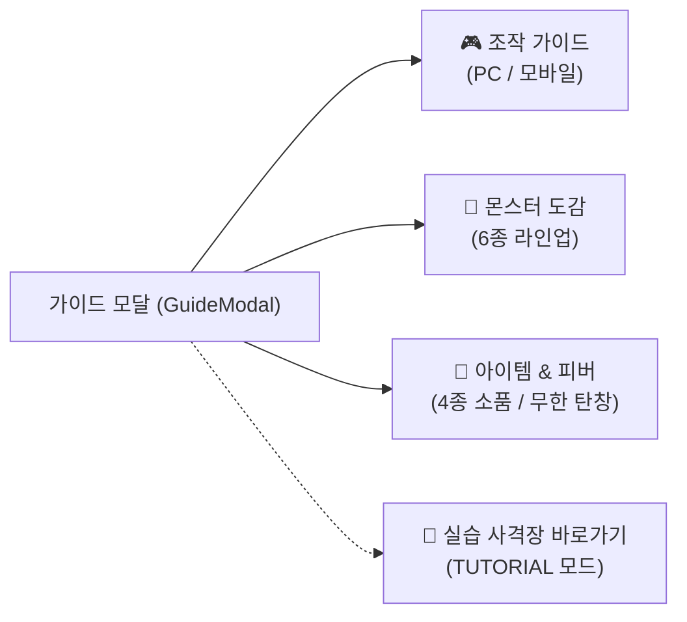
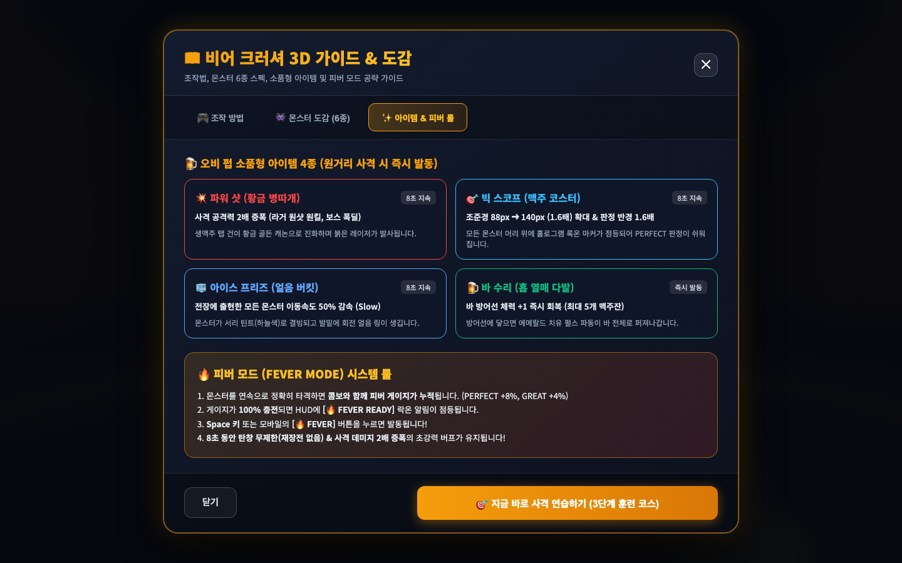
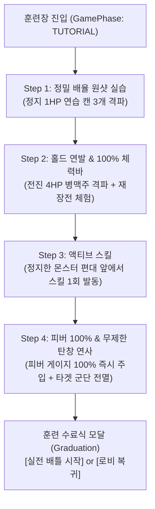
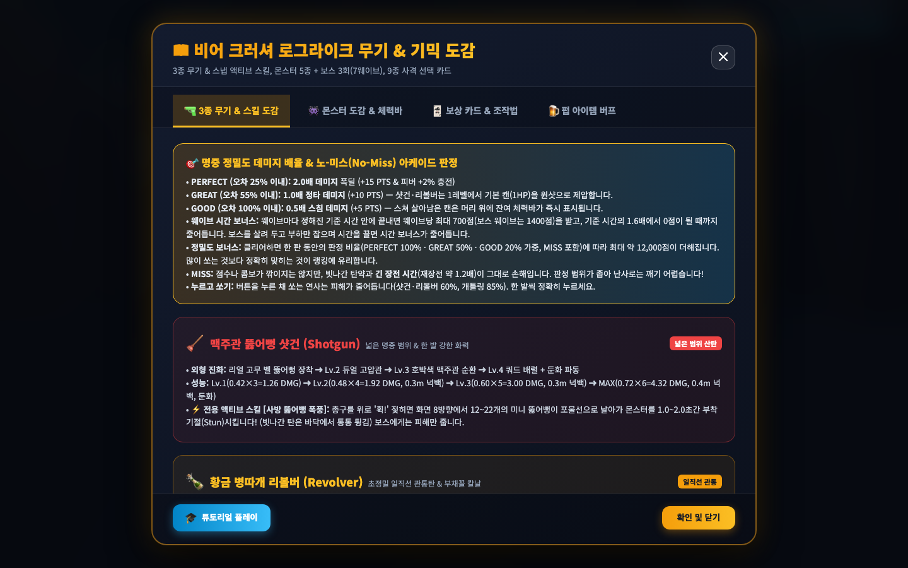
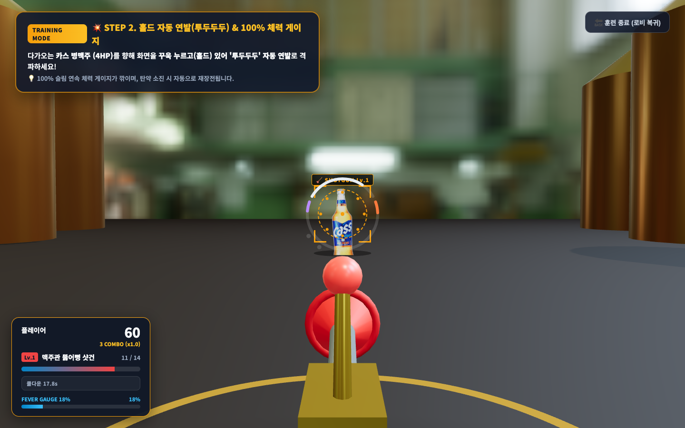
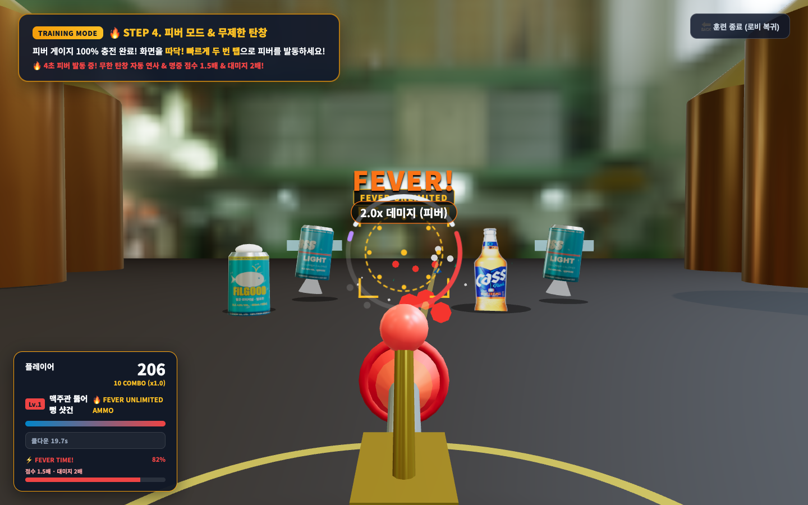
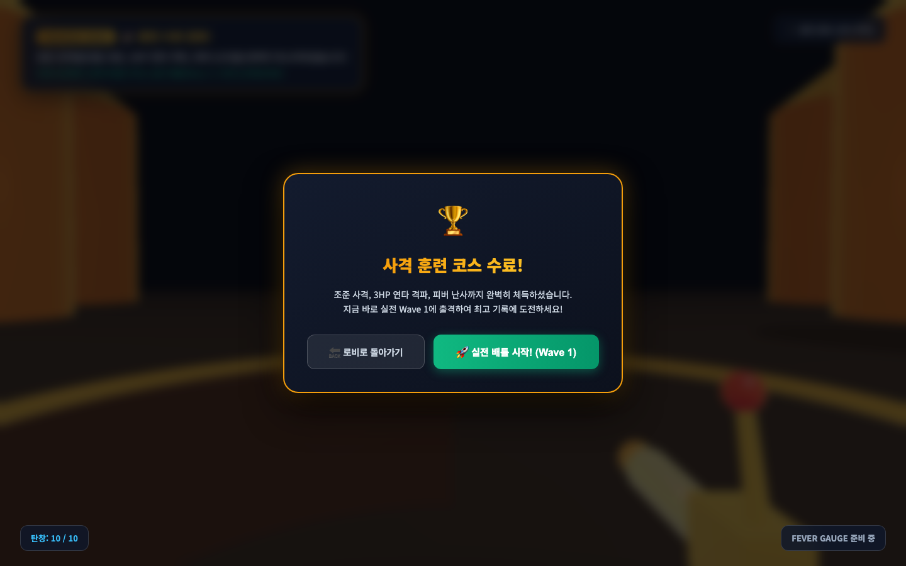

# 🍺 비어 크러셔 3D: 공식 튜토리얼 & 실습 사격 훈련장 가이드

> **Beer Crusher 3D Arcade v2 Tutorial & Shooting Range Strategy Guide**  
> 본 문서는 오비맥주 비어 크러셔 3D 아케이드의 **조작법·몬스터 도감·아이템 룰을 언제든 열람할 수 있는 통합 가이드 모달(Guide Codex)**과,  
> 3D 전장에서 직접 **조준 사격 ➔ 4HP 홀드 자동 연발 & 100% 체력바 ➔ 액티브 스킬 ➔ 피버 100% 무제한 탄창 연사**를 단계별로 체득하는 **4단계 미션 클리어형 실습 사격 훈련장(Shooting Range)**의 모든 기능과 화면을 총망라한 공식 설명서입니다.

---

## 📑 목차
1. [가이드 & 훈련장 진입 방법](#-1-가이드--훈련장-진입-방법)
2. [📖 파트 1. 탭형 통합 가이드 모달 (Guide Codex Modal)](#-파트-1-탭형-통합-가이드-모달-guide-codex-modal)
   - [탭 1: 조작 가이드 (Controls)](#1-조작-가이드-controls)
   - [탭 2: 몬스터 6종 실물 도감 (Monsters)](#2-몬스터-6종-실물-도감-monsters)
   - [탭 3: 소품 아이템 4종 & 피버 룰 (Items & Fever)](#3-소품-아이템-4종--피버-룰-items--fever)
3. [🎯 파트 2. 4단계 인터랙티브 실습 사격 훈련장 (Interactive Shooting Range)](#-파트-2-4단계-인터랙티브-실습-사격-훈련장-interactive-shooting-range)
   - [훈련장 전용 샌드박스 안전 시스템](#-훈련장-전용-샌드박스-안전-시스템)
   - [Step 1: 기본 조준 & 정밀 배율 원샷 실습](#step-1-기본-조준--정밀-배율-원샷-실습-target-practice)
   - [Step 2: 홀드 자동 연발(투두두두) & 100% 체력 게이지 체감](#step-2-홀드-자동-연발투두두두--100-체력-게이지-체감-rapid-fire--gauge-bar)
   - [Step 3: 액티브 스킬 발동](#step-3-액티브-스킬-발동-active-skill)
   - [Step 4: 피버 100% 발동 & 무제한 탄창 연사](#step-4-피버-100-발동--무제한-탄창-연사-fever-rush)
   - [훈련 수료 및 실전 배틀 출격](#-훈련-수료-graduation--실전-배틀-출격)
4. [⌨️ 파트 3. PC vs 모바일 조작키 & 제스처 종합 매핑](#️-파트-3-pc-vs-모바일-조작키--제스처-종합-매핑)
5. [💡 파트 4. 훈련장에서 체득하는 실전 고득점 핵심 테크닉](#-파트-4-훈련장에서-체득하는-실전-고득점-핵심-테크닉)

---

## 🚀 1. 가이드 & 훈련장 진입 방법

플레이어는 게임 시작 전 로비나 인게임 도중 언제든지 가이드와 실습 사격장을 이용할 수 있습니다.

| 진입 위치 | 버튼 명칭 | 진입 대상 | 설명 |
| :--- | :--- | :--- | :--- |
| **대기실 (QR 페어링 모달)** | `📖 게임 설명서 & 도감` | **가이드 모달** | 로비 하단 노란색 버튼. 조작법/도감 열람 |
| **대기실 (QR 페어링 모달)** | `🎯 사격 훈련장` | **실습 사격장** | 로비 하단 주황색 버튼. 실습 모드로 즉시 진입 |
| **가이드 모달 하단** | `🎯 지금 바로 사격 연습하기` | **실습 사격장** | 도감 열람 후 즉시 실습 훈련장으로 이동 |
| **인게임 상단 HUD** | `📖 가이드 & 도감` | **가이드 모달** | 전투 중 일시정지 후 조작법/아이템 재확인 |

---

## 📖 파트 1. 탭형 통합 가이드 모달 (Guide Codex Modal)

게임 화면에 오버레이되는 반투명 네온 글래스모피즘 모달로, 3개 탭으로 구성되어 있습니다.

---

### 1. 조작 가이드 (Controls)

PC 모니터 앞에서의 마우스/키보드 조작법과 스마트폰을 무선 권총으로 활용하는 건 그립(Gun Grip) 조작법을 한눈에 비교 안내합니다.

#### 🖥️ PC 마우스 & 키보드 조작법
* **조준**: 마우스 이동 (화면 내 레이저 조준경 연동)
* **발사**: 마우스 좌클릭 (단발 격발)
* **연사**: 마우스 좌클릭 길게 누르기 (초당 4발 자동 연사)
* **스킬**: 마우스 우클릭 (재장전은 탄창이 비면 자동)
* **일시정지**: `Esc` 키 또는 화면 상단 `⏸ 일시정지` 버튼 → `이어하기`(3초 카운트다운 뒤 재개) / `다시시작`(무기 선택부터, 이번 판 점수는 저장되지 않음)
* **피버 발동**: 게이지 100% 충전 시 마우스 더블클릭

#### 📱 스마트폰 모바일 권총 조작법 (Wi-Fi 페어링)
* **권총 파지**: 스마트폰 상단을 PC 모니터 정면으로 조준하고 화면이 왼쪽을 향하도록 권총처럼 파지
* **발사 (단발)**: 화면 터치패드 가볍게 탭
* **연사 (연타)**: 화면 터치패드 0.25초 이상 꾹 누르기
* **피버 발동**: 화면 터치패드 빠르게 2회 연속 탭 (더블탭)
* **정면 영점 재조정**: 조준점이 틀어졌을 때 상단 `🎯 정면 영점 재설정` 버튼 터치

---

### 2. 몬스터 6종 실물 도감 (Monsters)

비어 크러셔 3D에 등장하는 오비맥주 캔 4종, 카스 500ml 병맥주, 업소용 생맥주 냉각기 최종 보스의 실물 3D 렌더링 카드와 핵심 스펙을 인게임에서 바로 열람할 수 있습니다.

> 💡 몬스터 6종의 정밀 피격 반경, S자 곡선 비행 궤적, 바운스 모션 및 웨이브별 상세 공략은 [docs/몬스터_도감_설명서.md](./몬스터_도감_설명서.md)에서 자세히 확인하실 수 있습니다.

---

### 3. 소품 아이템 4종 & 피버 룰 (Items & Fever)

웨이브 도중 머리 위에 네온 3D 빌보드 라벨 카드를 달고 떠오르는 오비 펍 소품형 아이템 4종과 피버 시스템의 규칙을 설명합니다.

* 💥 **파워 샷 (황금 병따개)**: 8초간 사격 데미지 2배! 총기가 **황금 골든 캐논**으로 진화.
* 🎯 **빅 스코프 (맥주 코스터)**: 8초간 조준경 크기 1.6배 확대 및 홀로그램 가이드 빔 전개.
* 🧊 **아이스 프리즈 (은색 얼음 버킷)**: 8초간 전장 몬스터 이동 속도 50% 둔화.
* 🍺 **바 수리 (초록 홉 열매)**: 바 방어선 체력 즉시 +1 회복. 실전에서는 드롭되지 않고 튜토리얼·훈련장에서만 나옵니다.

> 💡 3종 무기 아키타입, 조준경 1:1 동기화, '휙!' 스냅 액티브 스킬 및 사격 선택 카드는 [docs/무기_및_스킬_가이드.md](./무기_및_스킬_가이드.md)를 참조하세요.

#### 🔥 피버 타임 (Fever Time) 100% 발동 룰
* **충전 공식**: `PERFECT` 정밀 명중 시 +2%, 적 격파(KILL) 시 +4% 충전 (`GREAT`/`GOOD`/`MISS` 시 피버 차감 없음).
* **100% 충전 시**: 마우스 더블클릭 또는 모바일 화면을 더블탭하여 발동!
* **4초간 효과**: 사격 데미지 2.0배, **무제한 탄창 난사(탄약 감소 0, 재장전 딜레이 없음)**, 화면 전체 골드 네온 플래시.

---

## 🎯 파트 2. 4단계 인터랙티브 실습 사격 훈련장 (Interactive Shooting Range)

글로만 읽는 설명서를 넘어, 플레이어가 직접 3D 월드에서 조작 감각을 몸으로 익힐 수 있는 **4단계 미션 클리어형 실습 사격장**입니다.

---

### 🛡️ 훈련장 전용 샌드박스 안전 시스템

실습 사격장에서는 초보 플레이어가 부담 없이 연습할 수 있도록 엔진 레벨의 **샌드박스 격리(Sandbox Isolation)**가 적용되어 있습니다.

> [!NOTE]
> 1. **방어선 무적 보호 (Invulnerable)**: 훈련 중 몬스터가 방어선에 도달하더라도 플레이어 라이프가 깎이지 않습니다.
> 2. **실전 동일 판정 규격**: 튜토리얼·훈련장의 타겟 피격 판정 범위 및 조준 규격은 실전 아케이드와 완전히 동일하게 적용됩니다.
> 3. **통합 HUD 적용**: 튜토리얼 화면 좌하단에는 실전 아케이드와 동일한 단일 플레이어 패널(1P 앰버 테마)이 표시되어 실제 전투와 같은 탄약/피버/스킬/상태 피드백을 확인합니다.
> 4. **랭킹 서버 격리 (Score Isolation)**: 훈련 중 획득한 점수는 백엔드 랭킹 서버로 전송되지 않아 공식 순위표가 오염되지 않습니다.
> 5. **언제든 자유로운 퇴장**: 우측 상단 `[훈련 종료]` 버튼으로 언제든지 대기실로 돌아갈 수 있습니다.

---

### Step 1: 기본 조준 & 정밀 배율 원샷 실습 (Target Practice)

플레이어의 조준선(크로스헤어) 정렬과 정밀도 데미지 배율(2.0x / 1.0x / 0.5x)을 익히는 단계입니다. (튜토리얼의 판정 범위와 규칙은 실전과 동일합니다.)

* **훈련 목표**: 좌측·중앙·우측에 떠 있는 **정지 상태의 1HP 연습 캔 표적 3개**를 차례대로 조준하여 사격으로 격파하세요.
* **화면 안내**: 상단 네온 카드에 `[1단계] 정밀 조준 배율(2.0x/1.0x/0.5x) & 원샷 - 남은 표적: 3개` 안내문 표시.
* **실습 포인트**:
  - 마우스 또는 모바일 자이로를 움직여 조준경 원 안에 타겟을 정확히 배치하세요.
  - 중심부 `PERFECT(2.0배)` 또는 `GREAT(1.0배)` 명중 시 1발에 즉시 파괴되며, 외곽 `GOOD(0.5배)` 스침 시(튜토리얼은 샷건 1레벨 기준 약 0.63 피해) 약 0.37의 체력이 남아 100% 슬림 체력바가 머리 위에 표시됩니다.
  - 튜토리얼에서는 빗나가도 부담이 없으니 편안하게 조준 감각을 익히세요. (실전에서는 빗나간 탄약과 긴 장전이 손해입니다.)
  - 3개를 모두 파괴하면 "딩동댕!" 효과음과 함께 **Step 2**로 자동 전환됩니다.

---

### Step 2: 홀드 자동 연발(투두두두) & 100% 체력 게이지 체감 (Rapid Fire & Gauge Bar)

실전처럼 전진해오는 4HP 엘리트 병맥주를 홀드 자동 연발로 격파하고, 100% 연속 슬림 게이지 체력바와 자동 재장전 딜레이를 체감하는 단계입니다.

* **훈련 목표**: 전방 18m에서 바를 향해 걸어오는 **4HP 카스 병맥주 1병**을 홀드 자동 연발로 격파하세요.
* **화면 안내**: `[2단계] 홀드 자동 연발(투두두두) & 100% 체력 게이지! - 4HP 카스 병맥주를 격파하세요!` 표시.
* **실습 포인트**:
  - 스마트폰 화면을 **꾸욱 누르고 있거나(180ms 홀드)** PC 마우스 좌클릭을 유지하면 무기별 발사 간격으로 **'투두두두' 자동 연발**이 시원하게 나갑니다! (폰 패드를 누를 때 첫 발은 즉시 100% 데미지 단발 강타로 격발된 후 연발로 전환됩니다.)
  - 병맥주 머리 위의 100% 비례 슬림 연속 게이지 바가 데미지에 비례해 부드럽게 깎이는 것을 확인하세요.
  - 탄창을 모두 쏘면 탄창이 비며 `RELOADING...` 경고가 뜨고, 자동으로 재장전되는 쿨다운 리듬을 미리 체험할 수 있습니다.
  - 격파 성공 시 **Step 3**으로 자동 전진합니다.

---

### Step 3: 액티브 스킬 발동 (Active Skill)

무기 고유의 필살기를 한 번 직접 써 보는 단계입니다. (카드 선택 화면이나 카운트다운 중, 또는 카드 선택 직후 0.3초간은 오발 방지를 위해 스킬이 잠깁니다.)

* **훈련 목표**: 전방에 서 있는 몬스터 편대 앞에서 스킬을 **1회 발동**하세요.
* **화면 안내**: `[3단계] ⚡ 액티브 스킬 (우클릭 / 폰 휙!)` 표시.
* **실습 포인트**:
  - PC는 **마우스 우클릭**, 폰은 총구를 위로 **'휙!'** 젖히면 스킬이 발동됩니다. 튜토리얼 무기는 샷건이라 화면의 모든 몬스터가 기절하고 피해를 입습니다.
  - 일반 사격으로 편대를 먼저 없애도 단계는 끝나지 않고 편대가 다시 세워집니다. 스킬을 쓰면 **Step 4**로 전진합니다.

---

### Step 4: 피버 100% 발동 & 무제한 탄창 연사 (Fever Rush)

게임의 하이라이트인 피버 타임의 폭발적인 화력과 손맛을 극대화하여 체험하는 단계입니다.

* **훈련 목표**: 즉시 100%로 충전된 피버 게이지를 발동시키고, 4초 동안 쏟아져 나오는 타겟 편대를 무제한 탄창으로 전멸시키세요!
* **화면 안내**: `[4단계] 🔥 피버 모드 & 무제한 탄창! - 마우스 더블클릭(또는 모바일 더블탭)으로 피버를 켜세요!` 표시.
* **실습 포인트**:
  - 엔진에서 즉시 `forceSetFeverGauge(100)`이 주입되어 화면 하단 FEVER 게이지가 번쩍입니다.
  - PC 마우스 더블클릭(또는 모바일 더블탭)을 하는 순간 화면 전체에 네온 플래시가 번쩍이고 총기가 골든 캐논으로 진화합니다.
  - 전방에 필굿/카스라이트 6개의 편대가 스폰되며, 4초간 탄약 소진 없이 자동 연사로 몰아치며 명중 점수 1.5배를 챙기세요!
  - 편대를 전멸시키거나 4초가 지나면 훈련이 성공적으로 종료됩니다.

---

### 🎓 훈련 수료 (Graduation) & 실전 배틀 출격

4단계 훈련을 모두 통과하면 축하 팡파르와 함께 훈련 수료 모달이 팝업됩니다.

* **선택지 1: `🔥 실전 배틀 시작 (Wave 1)` (초록색 버튼)**
  - 로비를 거치지 않고 곧바로 Wave 1 실전 아케이드 모드로 돌입합니다!
  - 훈련 상태가 깨끗하게 리셋되고 라이프 5개, 탄약 10발로 정규 스코어링 배틀이 시작됩니다.
* **선택지 2: `🏠 로비로 돌아가기` (회색 버튼)**
  - 대기실(QR 페어링 모달)로 복귀하여 모바일 컨트롤러를 추가로 연결하거나 설정을 조정할 수 있습니다.

---

## ⌨️ 파트 3. PC vs 모바일 조작키 & 제스처 종합 매핑

| 조작 액션 | 🖥️ PC 마우스 / 키보드 | 📱 스마트폰 모바일 컨트롤러 | 비고 |
| :--- | :--- | :--- | :--- |
| **타겟 조준** | 마우스 커서 이동 | 스마트폰 상단을 모니터 방향으로 틸트 (자이로 센서) | 초당 60회 절대 각도 전송 |
| **단발 사격** | 마우스 좌클릭 톡 탭 | 터치패드 영역 가볍게 1회 탭 | 0ms 즉시 단발 사격 (100% 데미지) |
| **홀드 자동 연발** | 마우스 좌클릭 길게 누르기 (홀드) | 터치패드 영역 180ms 이상 꾸욱 누르기 | 첫 발 100% 강타 후 무기별 템포로 자동 연발 (데미지 감쇠 적용) |
| **액티브 스킬 시전** | 마우스 우클릭 | 총구를 위로 **'휙!(Snap)'** 젖히기 | 350ms 안정화 에임 고정 (카드 선택 중/선택 직후 0.3s/카운트다운 중 잠금) |
| **탄창 재장전** | 탄창 소진 시 자동 재장전 | 탄창 소진 시 자동 재장전 | 무기별 1.2s~1.7s 소요 |
| **피버 모드 발동** | 마우스 더블클릭 (게이지 100% 시) | 터치패드 빠르게 2회 탭 (더블탭) | 4초간 무한 탄창 자동 연사 & 명중 점수 1.5배 |
| **영점 재조정** | (PC는 화면 테두리 제한 자동 보정) | 상단 `🎯 정면 영점 재설정` 버튼 터치 | 게임 도중 언제든 리셋 가능 |
| **가이드 도감 열기** | HUD 우측 상단 `[📖 가이드 & 도감]` 클릭 | (PC 화면에서 조작) | 게임 일시정지 후 확인 가능 |

---

## 💡 파트 4. 훈련장에서 체득하는 실전 고득점 핵심 테크닉

1. **정밀도 데미지 배율(PERFECT 2.0x 치명타)을 노려라**:
   - 조준 오차를 판정 반경의 25% 이내로 맞추면 데미지가 2.0배로 증폭되며 피버가 +2% 충전됩니다.
   - 실전에서는 판정 범위가 좁고 빗나가면 탄약과 긴 장전을 잃으니, 조준선 중앙을 정확히 노려 한 발씩 사격하세요.
2. **4HP 병맥주는 연타로 제압**:
   - Step 2의 카스 병맥주는 체력이 4이므로 여러 발이 필요합니다. 실전에서는 누르고 쏘는 자동 연발의 피해가 줄어드니, 정확한 탭 연타와 피버를 활용하세요. (실전의 병맥주는 깨지면 작은 병 2마리로 분열합니다.)
3. **피버 타임에는 탄약을 신경 쓰지 않아도 됩니다**:
   - 피버 타임 동안에는 쏴도 탄창이 줄지 않습니다(무한 탄창). 다만 피버가 탄창을 채워 주지는 않으니, 피버 직전에 쓰던 탄창과 장전 상태는 그대로 이어집니다. 장전 중에 피버를 켜면 장전은 계속 진행됩니다.
   - 탄약이 0발이라도 피버 게이지가 100%라면 즉시 마우스 더블클릭(모바일 더블탭)으로 피버를 켜서 탄약 걱정 없이 연사하세요!
4. **보스전(3·5·7웨이브) 대응**:
   - 보스는 방어선 전방 14m에 멈춰 좌우로 움직이며, 체력이 줄 때마다(99·66·33%) 부하 맥주를 소환합니다(필드 10~18m에 위에서 떨어집니다). 보스 몸통을 맞혀도 피버가 차지 않으니 부하를 처치해 피버와 보급품 아이템을 모으세요.
   - 보스는 일반 몬스터가 절반쯤 나온 시점에 합류하고, 보스가 살아 있는 동안에도 일반 몬스터가 계속 나옵니다. 보스전 중에는 웨이브 진행 바 대신 보스 체력 바와 카드 처치 카운터만 보입니다.
   - 마지막 보스전은 냉각기와 대왕을 모두 처치해야 승리합니다.

---

> **기록 및 문서 버전 정보**  
> * 문서 개정일: 2026-11-04  
> * 작성 엔진: BeerCrusherEngine 3D v2.2.0  
> * 연동 컴포넌트: `GuideModal.tsx`, `TutorialGuideOverlay.tsx`, `BeerCrusherEngine.ts`, `PCGamePage.tsx`
