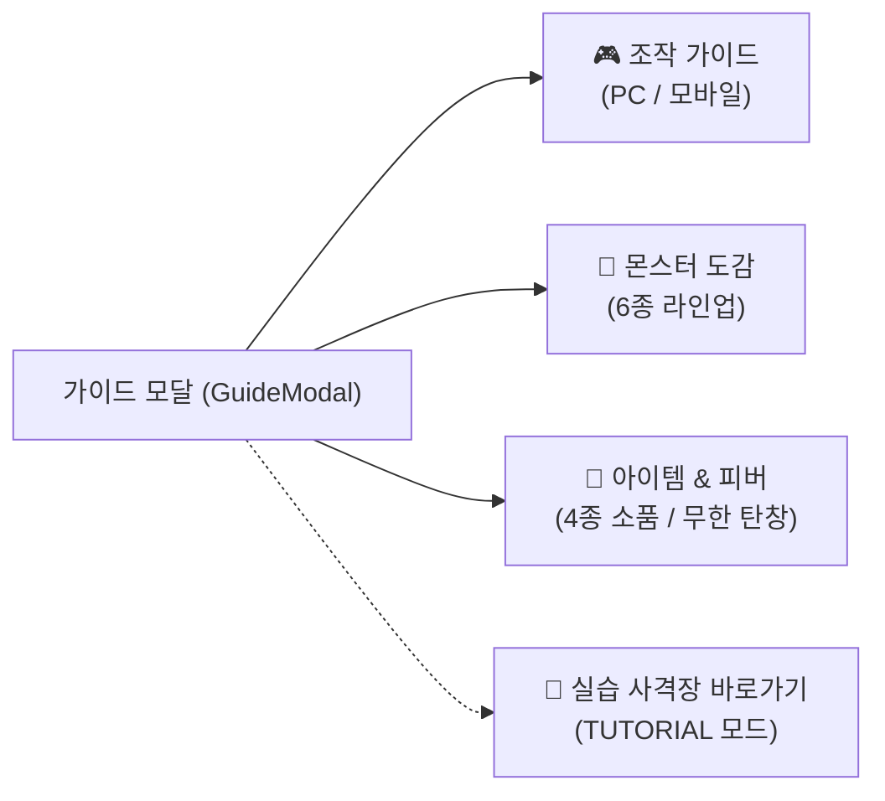
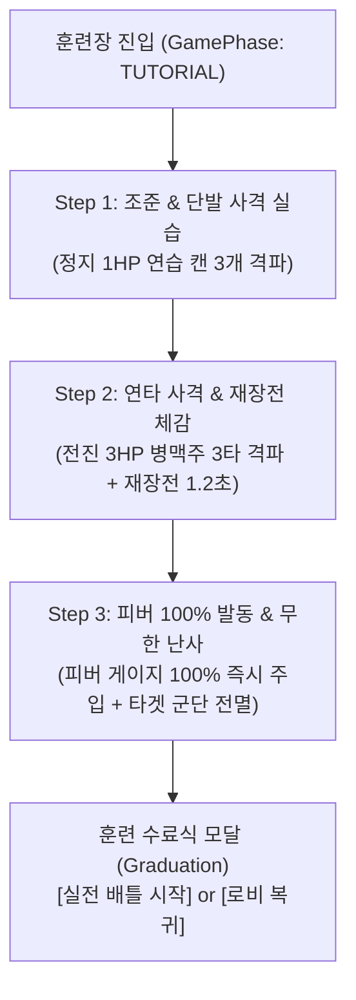

# 🍺 비어 크러셔 3D: 공식 튜토리얼 & 실습 사격 훈련장 가이드

> **Beer Crusher 3D Arcade v2 Tutorial & Shooting Range Strategy Guide**  
> 본 문서는 오비맥주 비어 크러셔 3D 아케이드의 **조작법·몬스터 도감·아이템 룰을 언제든 열람할 수 있는 통합 가이드 모달(Guide Codex)**과,  
> 3D 전장에서 직접 **조준 사격 ➔ 3HP 연타/재장전 ➔ 피버 100% 무한 난사**를 단계별로 체득하는 **3단계 미션 클리어형 실습 사격 훈련장(Shooting Range)**의 모든 기능과 화면을 총망라한 공식 설명서입니다.

---

## 📑 목차
1. [가이드 & 훈련장 진입 방법](#-1-가이드--훈련장-진입-방법)
2. [📖 파트 1. 탭형 통합 가이드 모달 (Guide Codex Modal)](#-파트-1-탭형-통합-가이드-모달-guide-codex-modal)
   - [탭 1: 조작 가이드 (Controls)](#1-조작-가이드-controls)
   - [탭 2: 몬스터 6종 실물 도감 (Monsters)](#2-몬스터-6종-실물-도감-monsters)
   - [탭 3: 소품 아이템 4종 & 피버 룰 (Items & Fever)](#3-소품-아이템-4종--피버-룰-items--fever)
3. [🎯 파트 2. 3단계 인터랙티브 실습 사격 훈련장 (Interactive Shooting Range)](#-파트-2-3단계-인터랙티브-실습-사격-훈련장-interactive-shooting-range)
   - [훈련장 전용 샌드박스 안전 시스템](#-훈련장-전용-샌드박스-안전-시스템)
   - [Step 1: 기본 조준 & 단발 사격 실습](#step-1-기본-조준--단발-사격-실습-target-practice)
   - [Step 2: 전진 타겟 연타 사격 & 재장전 체감](#step-2-전진-타겟-연타-사격--재장전-체감-rapid-fire--reload)
   - [Step 3: 피버 100% 발동 & 무한 탄창 난사](#step-3-피버-100-발동--무한-탄창-난사-fever-rush)
   - [훈련 수료 및 실전 배틀 출격](#-훈련-수료-graduation--실전-배틀-출격)
4. [⌨️ 파트 3. PC vs 모바일 조작키 & 제스처 종합 매핑](#️-파트-3-pc-vs-모바일-조작키--제스처-종합-매핑)
5. [💡 파트 4. 훈련장에서 체득하는 실전 고득점 핵심 테크닉](#-파트-4-훈련장에서-체득하는-실전-고득점-핵심-테크닉)

---

## 🚀 1. 가이드 & 훈련장 진입 방법

플레이어는 게임 시작 전 로비나 인게임 도중 언제든지 가이드와 실습 사격장을 이용할 수 있습니다.

| 진입 위치 | 버튼 명칭 | 진입 대상 | 설명 |
| :--- | :--- | :--- | :--- |
| **대기실 (QR 페어링 모달)** | `📖 게임 설명서 & 도감` | **가이드 모달** | 로비 하단 노란색 버튼. 조작법/도감 열람 |
| **대기실 (QR 페어링 모달)** | `🎯 사격 훈련장` | **실습 사격장** | 로비 하단 주황색 버튼. 실습 모드로 즉시 진입 |
| **가이드 모달 하단** | `🎯 지금 바로 사격 연습하기` | **실습 사격장** | 도감 열람 후 즉시 실습 훈련장으로 이동 |
| **인게임 상단 HUD** | `📖 가이드 & 도감` | **가이드 모달** | 전투 중 일시정지 후 조작법/아이템 재확인 |

---

## 📖 파트 1. 탭형 통합 가이드 모달 (Guide Codex Modal)

게임 화면에 오버레이되는 반투명 네온 글래스모피즘 모달로, 3개 탭으로 구성되어 있습니다.

---

### 1. 조작 가이드 (Controls)

PC 모니터 앞에서의 마우스/키보드 조작법과 스마트폰을 무선 권총으로 활용하는 건 그립(Gun Grip) 조작법을 한눈에 비교 안내합니다.

#### 🖥️ PC 마우스 & 키보드 조작법
* **조준**: 마우스 이동 (화면 내 레이저 조준경 연동)
* **발사**: 마우스 좌클릭 (단발 격발)
* **연사**: 마우스 좌클릭 길게 누르기 (초당 4발 자동 연사)
* **재장전**: `R` 키 누르기 (탄창 10발 소진 시 1.2초 후 자동 재장전)
* **피버 발동**: 게이지 100% 충전 시 `Space` 바

#### 📱 스마트폰 모바일 권총 조작법 (Wi-Fi 페어링)
* **권총 파지**: 스마트폰 상단을 PC 모니터 정면으로 조준하고 화면이 왼쪽을 향하도록 권총처럼 파지
* **발사 (단발)**: 화면 터치패드 가볍게 탭
* **연사 (연타)**: 화면 터치패드 0.25초 이상 꾹 누르기
* **피버 발동**: 화면 터치패드 빠르게 2회 연속 탭 (더블탭)
* **정면 영점 재조정**: 조준점이 틀어졌을 때 상단 `🎯 정면 영점 재설정` 버튼 터치

---

### 2. 몬스터 6종 실물 도감 (Monsters)

비어 크러셔 3D에 등장하는 오비맥주 캔 4종, 카스 500ml 병맥주, 업소용 생맥주 냉각기 최종 보스의 실물 3D 렌더링 카드와 핵심 스펙을 보여줍니다.

#### 📊 몬스터 6종 핵심 프로필 요약
1. **필굿 (FiLGOOD)**: `공중 활공형` / `HP 1` / `접근 속도 4.2m/s (최고속)`
   - 탄산 제트로 고속 돌격하는 최고속 타겟. 원거리 스냅샷 요망.
2. **카스 라이트 (Cass Light)**: `공중 비행형` / `HP 1` / `접근 속도 3.6m/s`
   - 아이스 윙을 퍼덕이며 좌우로 틸트 기동.
3. **오비 라거 (OB Lager)**: `지상 접지형` / `HP 2` / `접근 속도 3.0m/s`
   - 통통 바운스하며 다가오는 탱커. 단발로는 죽지 않으며 2연타(더블탭) 필요.
4. **한맥 (HANMAC)**: `지상 접지형` / `HP 2` / `접근 속도 3.2m/s`
   - 100% 국산 쌀 엠블럼 엘리트. 처치 시 90점 고득점 지급.
5. **카스 프레시 병맥주 (Cass Bottle)**: `지상 크루저` / `HP 3` / `접근 속도 2.3m/s`
   - 3HP 고내구도 유리병. 격파 시 "뻥!" 소리와 함께 병뚜껑 솟구침 & 맥주 분수 파티클 비산.
6. **업소용 생맥주 냉각기 보스 (Boss)**: `거대 보스` / `HP 40` / `접근 속도 1.1m/s`
   - **방어선 침투 시 플레이어 체력 5개를 모두 소진시켜 즉시 게임오버!** 피버/파워샷으로 집중 포화 필수.

---

### 3. 소품 아이템 4종 & 피버 룰 (Items & Fever)

웨이브 도중 머리 위에 네온 3D 빌보드 라벨 카드를 달고 떠오르는 오비 펍 소품형 아이템 4종과 피버 시스템의 규칙을 상세히 설명합니다.

#### 🎁 전술 아이템 4종 효과
* 💥 **파워 샷 (황금 병따개)**: 8초간 사격 데미지 2배! 총기가 **황금 골든 캐논**으로 진화하며 총구에 화염 오라 발생.
* 🎯 **빅 스코프 (맥주 코스터)**: 8초간 조준경 크기가 1.6배 커지고 홀로그램 가이드 빔 전개, 모든 타겟 록온.
* 🧊 **아이스 프리즈 (은색 얼음 버킷)**: 8초간 모든 몬스터 이동 속도 50% 둔화 및 푸른 서리 결빙 효과.
* 🍺 **바 수리 (초록 홉 열매)**: 즉시 플레이어 목숨(라이프) +1 회복 및 바 방어선 에메랄드 힐 펄스 방출.

#### 🔥 피버 타임 (Fever Time) 100% 발동 룰
* 타겟을 연속 명중시켜 콤보를 쌓으면 피버 게이지가 차오릅니다 (`PERFECT`: +12%, `GREAT`: +8%, `HIT`: +5%).
* **100% 충전 시**: Space바 또는 모바일 화면을 더블탭하여 발동!
* **8초간 효과**: 사격 데미지 2배, **무제한 탄창 난사(탄약 감소 0, 재장전 딜레이 없음)**, 화면 전체 네온 플래시.

---

## 🎯 파트 2. 3단계 인터랙티브 실습 사격 훈련장 (Interactive Shooting Range)

글로만 읽는 설명서를 넘어, 플레이어가 직접 3D 월드에서 조작 감각을 몸으로 익힐 수 있는 **3단계 미션 클리어형 실습 사격장**입니다.

---

### 🛡️ 훈련장 전용 샌드박스 안전 시스템

실습 사격장에서는 초보 플레이어가 부담 없이 연습할 수 있도록 엔진 레벨의 **샌드박스 격리(Sandbox Isolation)**가 적용되어 있습니다.

> [!NOTE]
> 1. **방어선 무적 보호 (Invulnerable)**: 훈련 중 몬스터가 방어선에 도달하더라도 플레이어 라이프가 깎이지 않습니다.
> 2. **랭킹 서버 격리 (Score Isolation)**: 훈련 중 획득한 점수는 백엔드 랭킹 서버로 전송되지 않아 공식 순위표가 오염되지 않습니다.
> 3. **언제든 자유로운 퇴장**: 우측 상단 `[훈련 종료]` 버튼으로 언제든지 대기실로 돌아갈 수 있습니다.

---

### Step 1: 기본 조준 & 단발 사격 실습 (Target Practice)

플레이어의 조준선(크로스헤어) 정렬과 단발 사격 타이밍을 익히는 단계입니다.

* **훈련 목표**: 좌측·중앙·우측에 떠 있는 **정지 상태의 1HP 연습 캔 표적 3개**를 차례대로 조준하여 단발 사격으로 격파하세요.
* **화면 안내**: 상단 네온 카드에 `[1단계] 조준 & 단발 사격 실습! - 남은 표적: 3개` 안내문 표시.
* **실습 포인트**:
  - 마우스 또는 모바일 자이로를 움직여 조준경 원 안에 타겟을 정확히 배치하세요.
  - 마우스 좌클릭(모바일 화면 탭)으로 격발 시 산뜻한 타격음과 함께 캔이 찌그러지며 파괴됩니다.
  - 3개를 모두 파괴하면 "딩동댕!" 효과음과 함께 **Step 2**로 자동 전환됩니다.

---

### Step 2: 전진 타겟 연타 사격 & 재장전 체감 (Rapid Fire & Reload)

실전처럼 전진해오는 다중 체력(HP) 몬스터의 연타 격파 및 10발 탄창 소진 시 재장전 딜레이를 체감하는 단계입니다.

* **훈련 목표**: 전방 18m에서 바를 향해 걸어오는 **3HP 카스 병맥주 1병**을 3연타로 사격하여 격파하세요.
* **화면 안내**: `[2단계] 연타 사격 & 재장전 체감! - 3HP 카스 병맥주를 3연타로 격파하세요!` 표시.
* **실습 포인트**:
  - 단발 사격으로는 병맥주가 깨지지 않습니다. 1타, 2타 피격 시 유리가 번쩍이며 튕겨 나옵니다.
  - 마우스 버튼을 길게 누르거나(모바일 꾹 누르기) 빠르게 3회 탭하여 3타를 명중시키면 "뻥!" 소리와 함께 병뚜껑이 날아가며 격파됩니다.
  - 10발을 모두 쏘면 탄창이 비며 `RELOADING... (1.2s)` 경고가 뜨고, 1.2초 뒤 자동으로 재장전되는 쿨다운 리듬을 미리 체험할 수 있습니다.
  - 격파 성공 시 **Step 3**으로 자동 전진합니다.

---

### Step 3: 피버 100% 발동 & 무한 탄창 난사 (Fever Rush)

게임의 하이라이트인 피버 타임의 폭발적인 화력과 손맛을 극대화하여 체험하는 단계입니다.

* **훈련 목표**: 즉시 100%로 충전된 피버 게이지를 발동시키고, 8초 동안 쏟아져 나오는 타겟 군단을 무한 탄창으로 전멸시키세요!
* **화면 안내**: `[3단계] 🔥 피버 100% 발동! - Space바(또는 모바일 더블탭)를 눌러 피버를 켜세요!` 표시.
* **실습 포인트**:
  - 엔진에서 즉시 `forceSetFeverGauge(100)`이 주입되어 화면 하단 FEVER 게이지가 번쩍입니다.
  - PC `Space` 키(또는 모바일 더블탭)를 누르는 순간 화면 전체에 네온 플래시가 번쩍이고 총기가 황금 캐논으로 진화합니다.
  - 전방에 필굿/카스라이트 6개의 편대가 스폰되며, 8초간 탄약 소진 없이 광속 난사로 싹쓸이하는 카타르시스를 즐기세요!
  - 편대를 전멸시키거나 8초가 지나면 훈련이 성공적으로 종료됩니다.

---

### 🎓 훈련 수료 (Graduation) & 실전 배틀 출격

3단계 훈련을 모두 통과하면 축하 팡파르와 함께 훈련 수료 모달이 팝업됩니다.

* **선택지 1: `🔥 실전 배틀 시작 (Wave 1)` (초록색 버튼)**
  - 로비를 거치지 않고 곧바로 Wave 1 실전 아케이드 모드로 돌입합니다!
  - 훈련 상태가 깨끗하게 리셋되고 라이프 5개, 탄약 10발로 정규 스코어링 배틀이 시작됩니다.
* **선택지 2: `🏠 로비로 돌아가기` (회색 버튼)**
  - 대기실(QR 페어링 모달)로 복귀하여 모바일 컨트롤러를 추가로 연결하거나 설정을 조정할 수 있습니다.

---

## ⌨️ 파트 3. PC vs 모바일 조작키 & 제스처 종합 매핑

| 조작 액션 | 🖥️ PC 마우스 / 키보드 | 📱 스마트폰 모바일 컨트롤러 | 비고 |
| :--- | :--- | :--- | :--- |
| **타겟 조준** | 마우스 커서 이동 | 스마트폰 상단을 모니터 방향으로 틸트 (자이로 센서) | 초당 60회 절대 각도 전송 |
| **단발 사격** | 마우스 좌클릭 | 터치패드 영역 가볍게 1회 탭 | 0ms 즉시 격발 (홀드 연타 없음) |
| **탄창 재장전** | `R` 키 입력 (또는 10발 소진 시 자동) | 10발 소진 시 1.2초 후 자동 재장전 | 재장전 중 사격 불가 |
| **피버 모드 발동** | `Space` 바 누르기 (게이지 100% 시) | 터치패드 빠르게 2회 탭 (더블탭) | 10초간 무한 탄창 & 2배 데미지 & 무한 연사 |
| **영점 재조정** | (PC는 화면 테두리 제한 자동 보정) | 상단 `🎯 정면 영점 재설정` 버튼 터치 | 게임 도중 언제든 리셋 가능 |
| **가이드 도감 열기** | HUD 우측 상단 `[📖 가이드 & 도감]` 클릭 | (PC 화면에서 조작) | 게임 진행 중 확인 가능 |

---

## 💡 파트 4. 훈련장에서 체득하는 실전 고득점 핵심 테크닉

1. **콤보 유지의 핵심은 '단발 정확도'**:
   - 연사로 마구 쏘다 빗나가면(MISS) 그동안 쌓아 올린 콤보가 초기화되고 피버 게이지가 깎입니다.
   - 훈련장 Step 1에서 정지 타겟을 원샷원킬 하듯, 실전에서도 공중 고속 타겟(필굿)은 침착하게 원샷 저격하는 것이 고득점의 지름길입니다.
2. **3HP 병맥주는 연사보다 '더블탭+스냅'**:
   - Step 2의 카스 병맥주는 체력이 3이므로, 마우스 클릭을 다다닥 3연타로 끊어 쏘면 반동 딜레이 없이 0.5초 만에 파괴할 수 있습니다.
3. **피버 타임 돌입 전 재장전은 불필요**:
   - 피버 타임이 발동되는 즉시 잔여 탄약 수와 관계없이 탄창이 무한대로 전환됩니다.
   - 탄약이 1발 남았더라도 피버 게이지가 100%라면 즉시 Space바(모바일 더블탭)를 눌러 무한 난사로 전환하세요!
4. **Wave 5 보스 레이드 대비**:
   - Step 3에서 체험한 피버 무한 난사와 파워 샷(💥 데미지 2배) 아이템을 연계하면, 체력 40의 냉각기 보스도 단 4초 만에 파괴할 수 있습니다.

---

> **기록 및 문서 버전 정보**  
> * 문서 생성일: 2026-11-02  
> * 작성 엔진: BeerCrusherEngine 3D v2.1.0  
> * 연동 컴포넌트: `GuideModal.tsx`, `TutorialGuideOverlay.tsx`, `BeerCrusherEngine.ts`, `PCGamePage.tsx`
